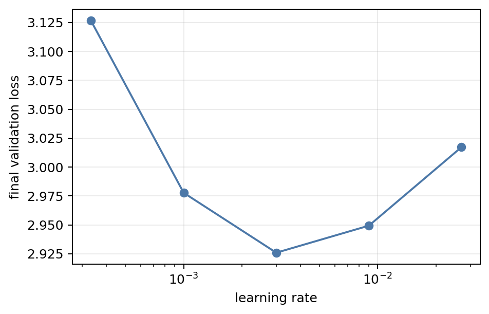
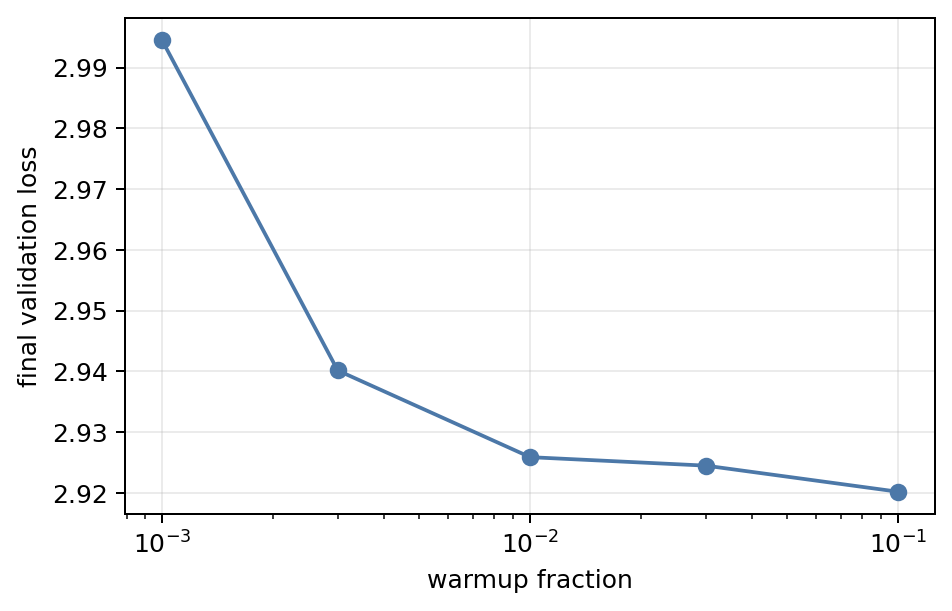
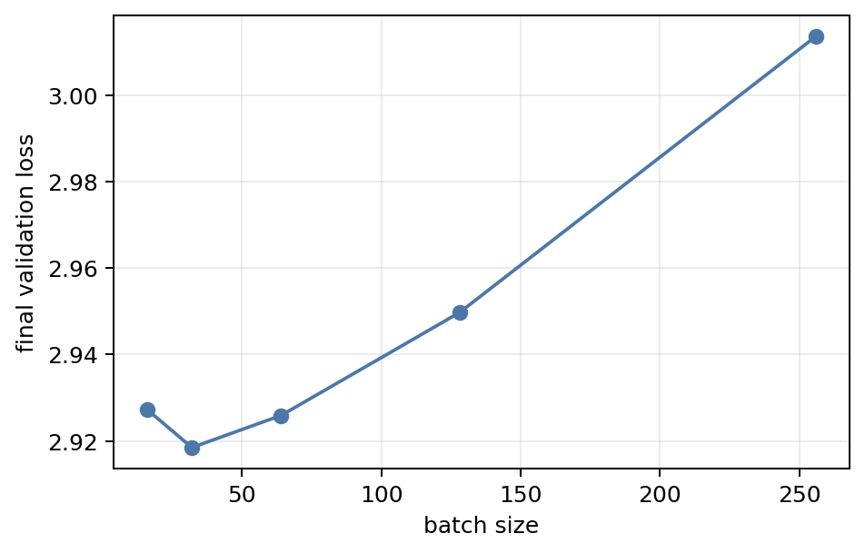
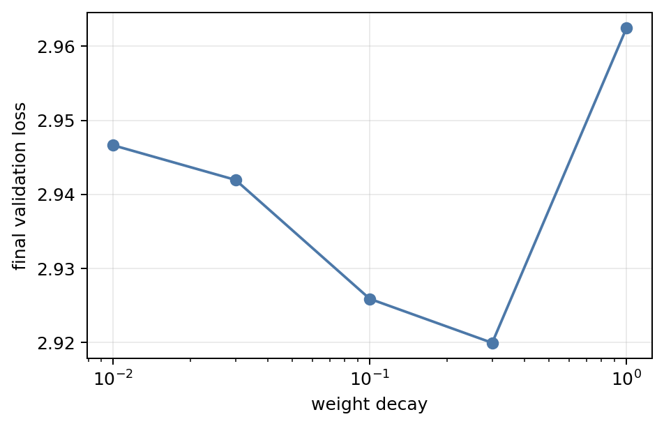
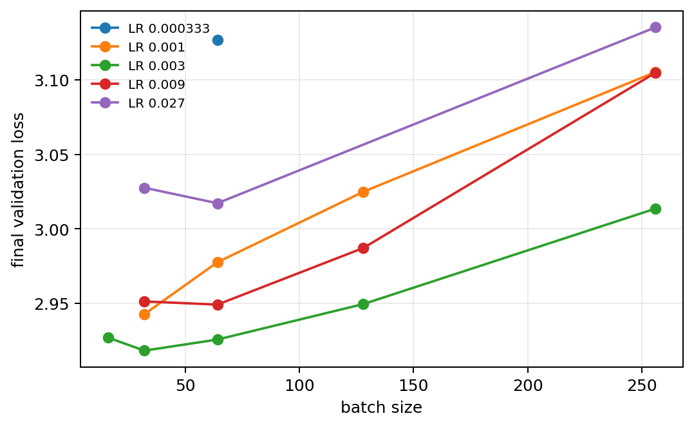
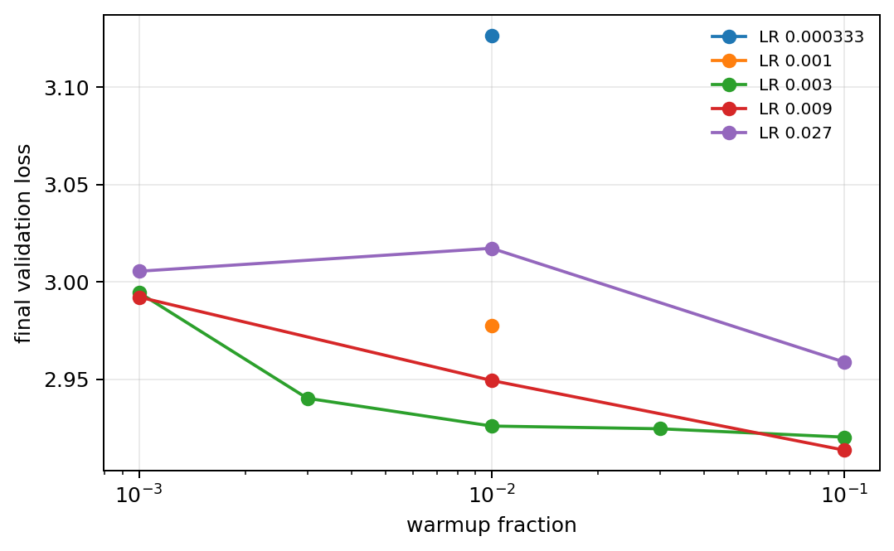
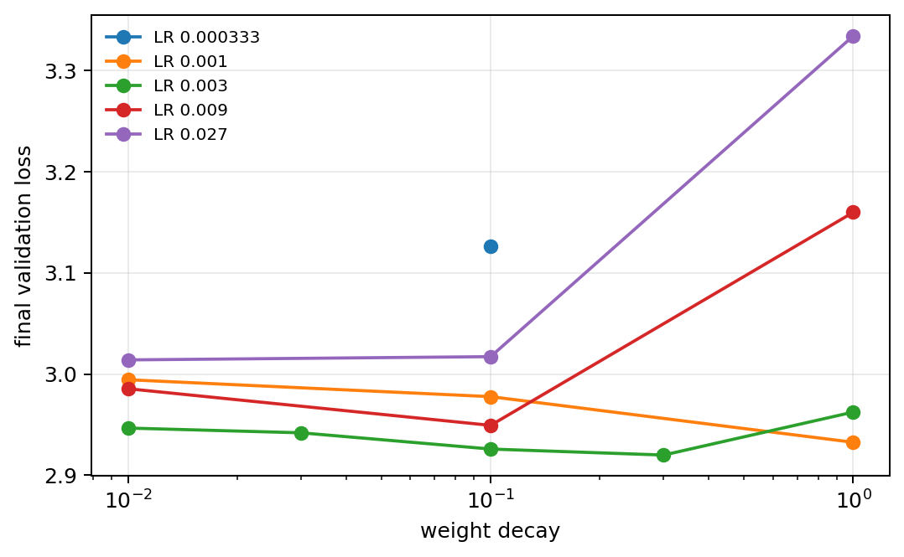
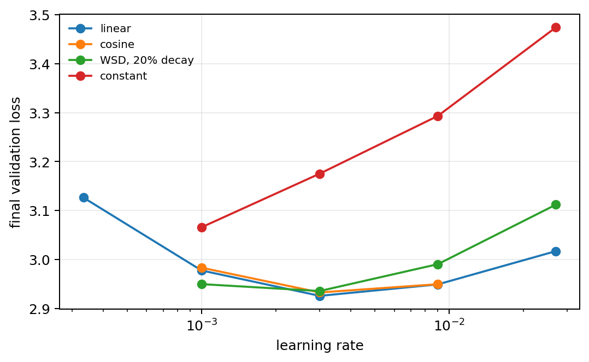
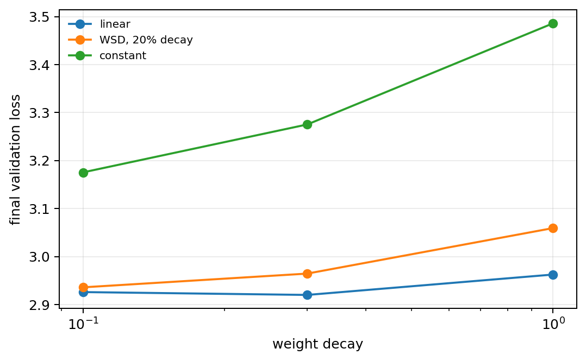
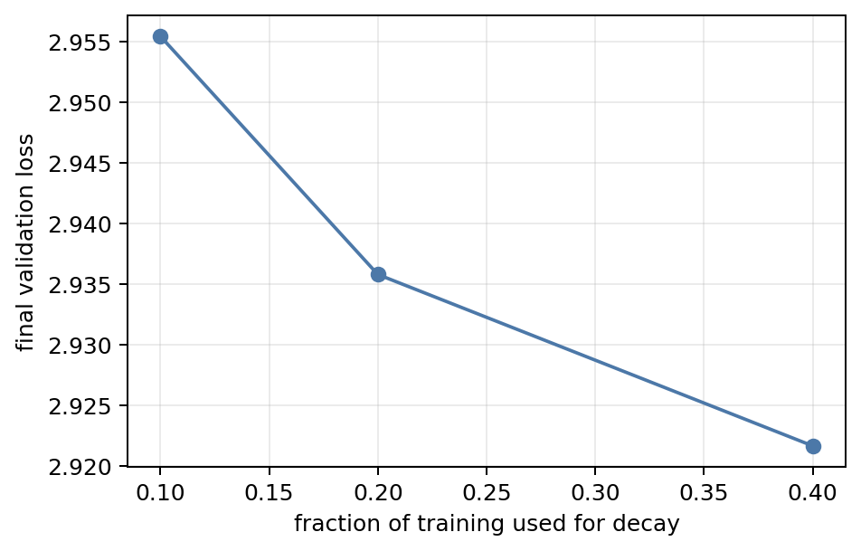

# Problem 1: Hyperparameter sweeps

All 55 runs use the d8 model and 600,000 sequences (614.4M tokens), so model size and token count are fixed. Unless named otherwise, the recipe is AdamW with learning rate 0.003, 1% warmup, linear decay, batch size 64, and weight decay 0.1.

## (a) One variable at a time

Each sweep spans roughly one order of magnitude around the standard value. The entries below are final validation losses.

| Variable | Settings | Final validation loss |
| --- | --- | --- |
| Learning rate | 0.000333, 0.001, 0.003, 0.009, 0.027 | 3.1265, 2.9777, **2.9259**, 2.9493, 3.0172 |
| Warmup fraction | 0.001, 0.003, 0.01, 0.03, 0.10 | 2.9945, 2.9402, 2.9259, 2.9245, **2.9202** |
| Batch size | 16, 32, 64, 128, 256 | 2.9272, **2.9185**, 2.9259, 2.9497, 3.0136 |
| Weight decay | 0.01, 0.03, 0.10, 0.30, 1.0 | 2.9466, 2.9420, 2.9259, **2.9200**, 2.9624 |

Learning rate has a clear optimum near 0.003. Warmup and weight decay are comparatively flat near their optima: 3–10% warmup and weight decay 0.1–0.3 all work well. Batch size 32 is best in this sweep; performance degrades sharply at 128 and 256. The important effect sizes are about 0.20 loss across the learning-rate sweep and 0.10 across the batch-size sweep, compared with only 0.04 across the useful warmup and weight-decay ranges.

## (b) Interactions

The pairwise experiments vary learning rate with batch size, warmup, or weight decay while holding the remaining settings fixed.

Learning rate 0.003 remains best at every fully compared batch size. At batch 32, losses for learning rates 0.001, 0.003, 0.009, and 0.027 are 2.9429, 2.9185, 2.9514, and 3.0276. At batch 256 they are 3.1051, 3.0136, 3.1046, and 3.1350. Larger batches therefore worsen the attainable loss without moving the optimum away from 0.003.

Warmup must be tuned with learning rate. Increasing warmup from 0.01 to 0.10 improves learning rate 0.009 from 2.9493 to 2.9135, making it better than the standard run. The same change improves learning rate 0.027 from 3.0172 to 2.9588, although it remains worse than the optimum.

Weight decay also interacts strongly with learning rate. At weight decay 1.0, learning rate 0.001 gives 2.9326, while 0.003, 0.009, and 0.027 give 2.9624, 3.1599, and 3.3343. Strong decay therefore shifts the preferred learning rate downward. The best observed pair is learning rate 0.003 with weight decay 0.3, at 2.9200.

## (c) Learning-rate schedules

The schedule comparison crosses linear, cosine, constant, and warmup-stable-decay schedules with learning rate. Separate runs vary weight decay, the decay fraction, and warmup.

At learning rate 0.003, linear, cosine, warmup-stable-decay over the final 20%, and constant schedules finish at 2.9259, 2.9328, 2.9358, and 3.1754. Constant learning rate is worst at every tested learning rate because it never anneals. Cosine and warmup-stable-decay tolerate nearby learning rates, but neither improves on the standard linear schedule at its optimum.

Linear decay also remains best when weight decay is increased. At weight decay 1.0, linear, 20% warmup-stable-decay, and constant schedules give 2.9624, 3.0593, and 3.4861.

For warmup-stable-decay, allocating more training to the decay phase helps: decay fractions 0.1, 0.2, and 0.4 give 2.9554, 2.9358, and 2.9216. In the sample ranking experiment with learning rate 0.009 and weight decay 1.0, the linear schedule with 10% warmup is best (3.0566), followed by 20% warmup-stable-decay with 20% warmup (3.2082), then the same schedule without warmup (3.4174).

## Synthesis

For this fixed d8 training budget, learning rate and batch size matter most. Learning rate 0.003 is the robust one-dimensional optimum, while batch size 32 is slightly better than 64 and much better than 128–256. Warmup and weight decay are forgiving near their defaults, but both interact with learning rate: 10% warmup makes learning rate 0.009 competitive, whereas weight decay 1.0 requires a lower learning rate. Annealing is essential; a constant schedule is consistently poor. The best observed losses, 2.9135–2.9216, come from modest coordinated changes rather than extreme values.
