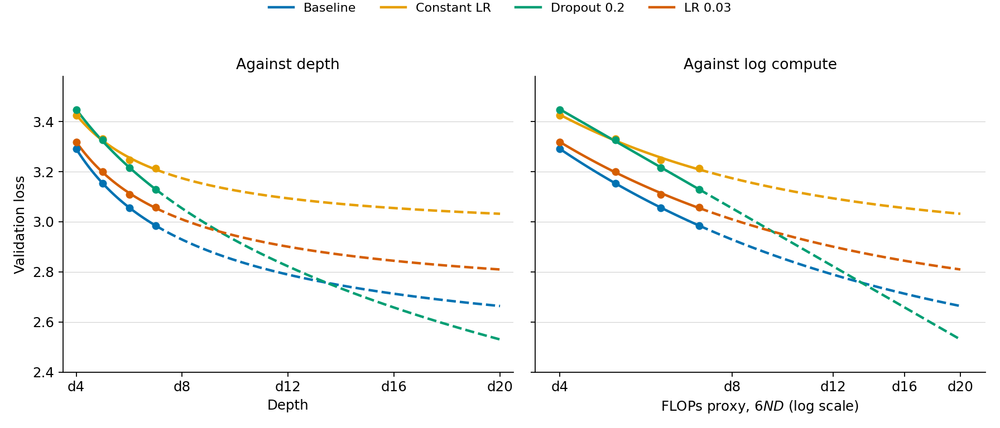
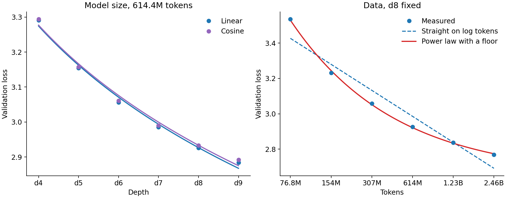
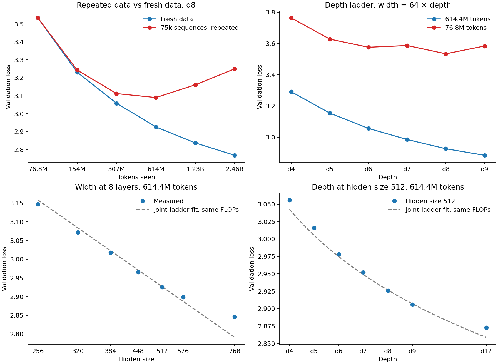

# Problem 2: Reliability of scaling laws

The main scaling ladder uses depths 4–9 with width \(64d\), 614.4M fresh training tokens, and otherwise standard settings. Compute is approximated by \(6ND\), with non-embedding parameters N about 14.5 d w squared.

## (a) Forecasting along a model-size ladder

Four depth ladders compare the standard recipe, a constant learning rate, dropout 0.2, and learning rate 0.03.

| Depth | Standard | Constant schedule | Dropout 0.2 | Learning rate 0.03 |
| --- | ---: | ---: | ---: | ---: |
| d4 | 3.2910 | 3.4256 | 3.4465 | 3.3178 |
| d5 | 3.1538 | 3.3315 | 3.3257 | 3.2011 |
| d6 | 3.0562 | 3.2472 | 3.2163 | 3.1096 |
| d7 | 2.9854 | 3.2132 | 3.1294 | 3.0571 |
| d8 | 2.9259 | 3.1754 | 3.0630 | 3.0307 |
| d9 | 2.8837 | 3.1280 | 3.0033 | 3.0009 |

Fits using only d4–d7 were recorded before running d8 and d9:

| Recipe | Predicted d8 | Measured d8 | Predicted d9 | Measured d9 | Predicted d20 |
| --- | ---: | ---: | ---: | ---: | ---: |
| Standard | 2.929 | 2.926 | 2.884 | 2.884 | 2.664 |
| Constant schedule | 3.174 | 3.175 | 3.147 | 3.128 | 3.032 |
| Dropout 0.2 | 3.053 | 3.063 | 2.986 | 3.003 | 2.530 |
| Learning rate 0.03 | 3.009 | 3.031 | 2.974 | 3.001 | 2.810 |

The standard and constant-schedule forecasts are accurate at d8 and d9. Dropout and the high learning rate are systematically worse than forecast by 0.01–0.03, suggesting curvature already visible at the held-out scales. The dropout line gives the lowest numerical d20 prediction and crosses the standard fit near d14, but this is the least trustworthy forecast because its d4–d7 fit has no identified loss floor. The standard d20 forecast of about 2.66 is the safer extrapolation.

## (b) Changing the scaling axis or schedule

The schedule comparison holds data fixed and varies model size. The data comparison holds d8 fixed and doubles the number of fresh sequences from 75,000 to 2.4M.

| Depth | Linear schedule | Cosine schedule |
| --- | ---: | ---: |
| d4 | 3.2910 | 3.2939 |
| d5 | 3.1538 | 3.1574 |
| d6 | 3.0562 | 3.0613 |
| d7 | 2.9854 | 2.9904 |
| d8 | 2.9259 | 2.9328 |
| d9 | 2.8837 | 2.8917 |

| Training tokens | Final validation loss |
| ---: | ---: |
| 76.8M | 3.5344 |
| 153.6M | 3.2307 |
| 307.2M | 3.0584 |
| 614.4M | 2.9259 |
| 1.23B | 2.8371 |
| 2.46B | 2.7682 |

Linear and cosine schedules have nearly identical model-size slopes: loss falls by 0.116 and 0.115 per doubling of the compute proxy, respectively, with R-squared about 0.99. Cosine is slightly worse at every depth, so it changes the intercept rather than the slope.

Data scaling is steeper but visibly curved. Successive token doublings improve validation loss by 0.304, 0.172, 0.133, 0.089, and 0.069. A straight line in log tokens reaches only an R-squared of about 0.93, while a power law with a floor near 2.65 fits all six points within about 0.01. Thus the measured data slope depends strongly on the token range.

## (c) Breaking the trend

Two interventions test data limitation: repeatedly training on the same 75,000 sequences and scaling model depth at a fixed budget of 76.8M fresh tokens. Two controls vary width at depth 8 and depth at width 512 while retaining 614.4M fresh tokens.

| Epochs over 75,000 sequences | Tokens processed | Repeated data | Fresh data |
| ---: | ---: | ---: | ---: |
| 1 | 76.8M | 3.5344 | 3.5344 |
| 2 | 153.6M | 3.2431 | 3.2307 |
| 4 | 307.2M | 3.1121 | 3.0584 |
| 8 | 614.4M | **3.0896** | 2.9259 |
| 16 | 1.23B | 3.1607 | 2.8371 |
| 32 | 2.46B | 3.2504 | 2.7682 |

| Depth | 76.8M tokens | 614.4M tokens |
| --- | ---: | ---: |
| d4 | 3.7638 | 3.2910 |
| d5 | 3.6277 | 3.1538 |
| d6 | 3.5756 | 3.0562 |
| d7 | 3.5871 | 2.9854 |
| d8 | 3.5344 | 2.9259 |
| d9 | 3.5838 | 2.8837 |

Repeated data follows fresh-data performance for roughly two epochs, then overfitting becomes visible. Validation loss bottoms out at eight epochs and rises thereafter, while fresh-data runs continue improving. Similarly, the 76.8M-token depth ladder improves only through d6 and then fluctuates; its log-compute fit has slope 0.052 and R-squared about 0.71, compared with slope 0.116 and R-squared about 0.99 at 614.4M tokens.

Changing model shape does not by itself break the trend when enough fresh data is available. At fixed width 512, depths 4, 5, 6, 7, 8, 9, and 12 give losses 3.0556, 3.0157, 2.9783, 2.9515, 2.9259, 2.9065, and 2.8733. At fixed depth 8, widths 256, 320, 384, 448, 512, 576, and 768 give 3.1473, 3.0719, 3.0176, 2.9663, 2.9259, 2.8993, and 2.8455. Both remain smooth and approximately linear in log compute, although the widest model gains less than the joint depth-width ladder predicts.

## Synthesis

Scaling is highly predictable only within a well-supported regime. The standard d4–d7 fit predicts d8 and d9 almost exactly, and changing linear decay to cosine preserves the slope. The reliability fails when scale increases capacity without enough distinct data: repeating a small dataset eventually worsens validation loss, and a depth ladder with only 76.8M tokens becomes non-monotonic beyond d6. Fresh data restores smooth scaling, even when depth and width are varied separately. A good fit is therefore evidence about a particular model-data recipe, not a universal law.
