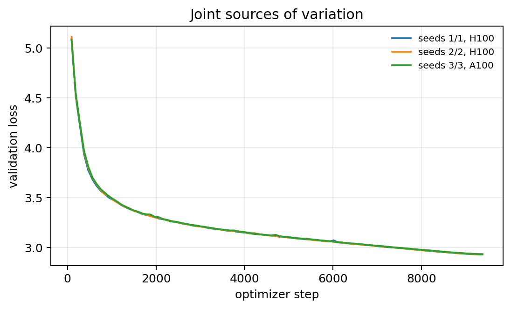
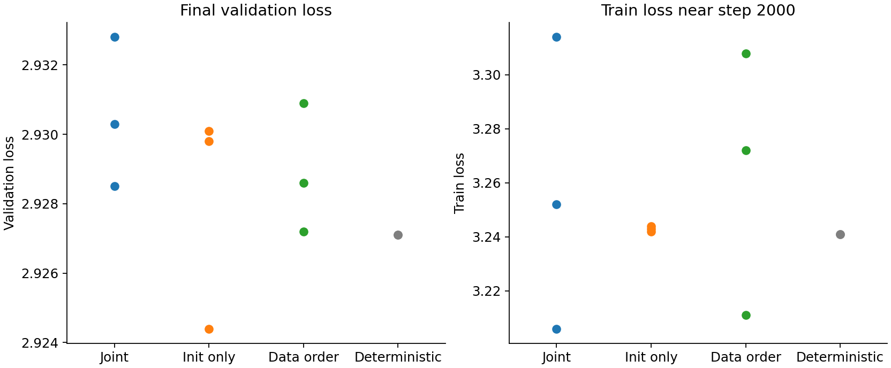
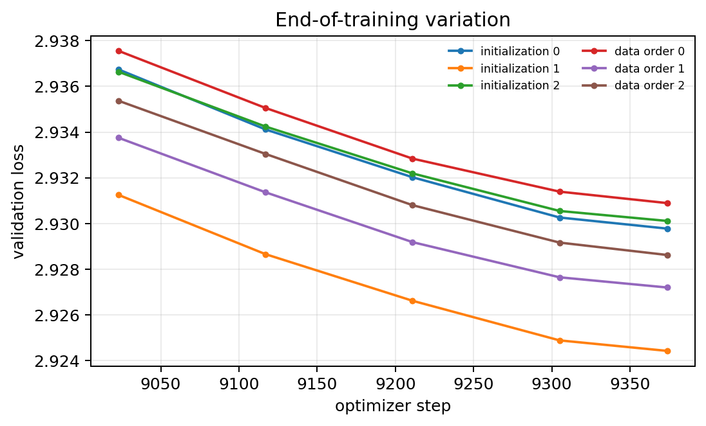

# Problem 3: Measuring variation

All comparisons use the standard d8 recipe unless an intervention is named. Initialization is controlled by the model seed, data order by the data seed, and fixed-device reproducibility by deterministic execution.

## (a) Joint sources of variation

Three runs vary model and data seeds together. Two use H100s and one uses an A100, so the comparison includes initialization, data order, and hardware.

| Model/data seed | Hardware | Final validation loss |
| ---: | --- | ---: |
| 1 | H100 | 2.9285 |
| 2 | H100 | 2.9303 |
| 3 | A100 | 2.9328 |

The mean is 2.9305, the sample standard deviation is 0.0022, and the range is 0.0044.

The curves are visually indistinguishable at full scale. Three points are too few to establish a distributional shape, but they place ordinary terminal-loss variation at a few thousandths of a nat.

## (b) Isolating each source

Initialization and data order are varied separately under deterministic execution on H100s. Two identical deterministic runs test exact replay.

| Source varied | Final validation losses | Sample SD | Range |
| --- | --- | ---: | ---: |
| Initialization | 2.9298, 2.9244, 2.9301 | 0.0032 | 0.0057 |
| Data order | 2.9309, 2.9272, 2.9286 | 0.0019 | 0.0037 |
| Deterministic replay | 2.9271, 2.9271 | 0 | 0 |
| Joint sources from part (a) | 2.9285, 2.9303, 2.9328 | 0.0022 | 0.0044 |

Initialization produces the largest terminal spread. Data order has a smaller final effect but a much larger effect on individual train batches: near step 2000, data-order runs span train losses 3.211–3.308, while initialization runs span only 3.242–3.244. This occurs because changing data order changes the batch being measured as well as the optimization path.

The two deterministic replays match exactly to the recorded precision, showing that the remaining spread is attributable to controlled seeds rather than irreproducibility on a fixed device. The A100 joint run lies within the same narrow band. A dedicated same-seed A100 run ended early, so hardware was not cleanly isolated; the cross-hardware point is only evidence that any hardware shift is not large at this resolution.

## (c) Hyperparameters and scale

Seeds 4–8 finished for the standard recipe, batch size 16, and learning rate 0.009. Dropout, learning rate 0.027, d12, and the 2.46B-token run finished for seeds 0–2.

| Setting | Seeds | Mean validation loss | Sample SD | Range |
| --- | ---: | ---: | ---: | ---: |
| Standard d8 | 4–8 | 2.9329 | 0.0025 | 0.0064 |
| Batch size 16 | 4–8 | 2.9352 | 0.0039 | 0.0095 |
| Learning rate 0.009 | 4–8 | 2.9489 | 0.0058 | 0.0142 |
| Dropout 0.2 | 0–2 | 3.0600 | 0.0044 | 0.0086 |
| Learning rate 0.027 | 0–2 | 3.0047 | 0.0058 | 0.0105 |
| d12 | 0–2 | 2.7910 | 0.0049 | 0.0087 |
| d8, 2.46B tokens | 0–2 | 2.7705 | 0.0024 | 0.0048 |

Learning rate 0.009 has 2.3 times the standard deviation of the standard recipe. Batch size 16 has 1.6 times. Only the higher learning rate clears a twofold increase. Dropout 0.2 and learning rate 0.027 are also wider than the standard run. The d12 mean is lower (2.791 versus 2.933) and its standard deviation is 0.0049, so the lower loss did not shrink the spread. Four times more tokens lowers the mean to 2.770 and leaves the spread unchanged at 0.0024.

## Synthesis

On the standard d8 recipe, terminal validation noise is a few thousandths of a nat. Initialization contributes more of that spread than data order. Data order moves individual train batches more, because it changes which batch is logged. Deterministic replay on one H100 matches exactly. A gap near 0.001 is inside this noise. A repeatable gap near 0.01 is not. A higher learning rate widens the distribution, so the noise floor has to be measured for the recipe being compared. Training four times longer lowers the loss and does not shrink that floor.
