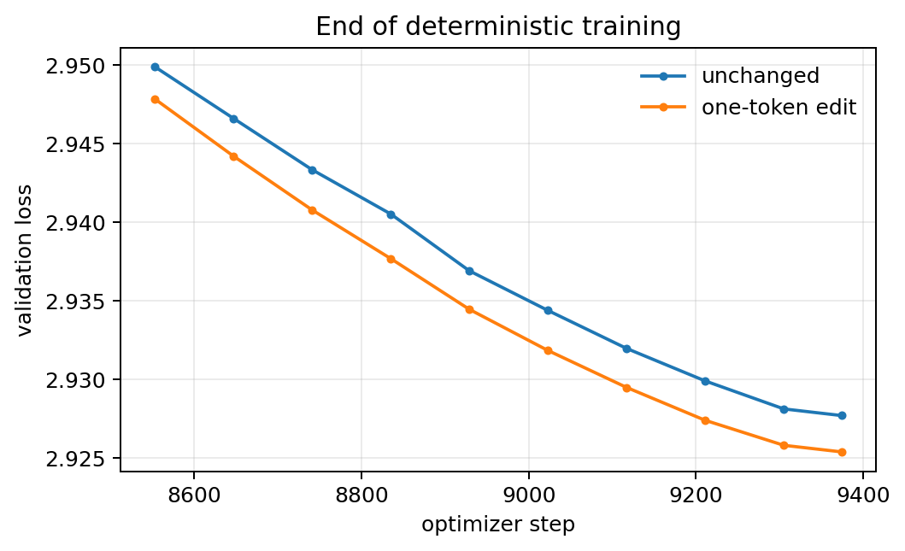

# Problem 4: Amplification of randomness

All ordinary randomness is fixed with deterministic execution. The standard d8 recipe is used throughout.

## (a) A one-token change

The perturbed run changes token position 100 in the first shuffled training sequence to token ID 17. Every other input, seed, and training setting is identical.

| Training data | Final train loss | Final validation loss |
| --- | ---: | ---: |
| Unchanged | 2.8859 | 2.9277 |
| One-token edit | 2.8858 | 2.9254 |

The train-loss difference is only 0.0001. The validation curves separate by about 0.0025 near the end and finish 0.0023 apart. Determinism shows that the edit changed the optimization trajectory, but the resulting gap is within the ordinary seed spread measured in Problem 3. The edited run happens to be lower; this is not evidence of a real improvement.

## (b) Perturbation time and magnitude

At optimizer step \(T\), independent Gaussian noise is added to every parameter tensor. The noise standard deviation is the stated scale times that tensor's own standard deviation, after which training continues to step 9375. Four perturbation times and three magnitudes test whether the optimizer forgets early or small changes.

| Perturbation step T | Updates remaining | scale 0.001 | scale 0.01 | scale 0.1 |
| ---: | ---: | ---: | ---: | ---: |
| 100 | 9275 | 2.9258 | 2.9261 | 2.9259 |
| 2000 | 7375 | 2.9262 | 2.9264 | 2.9265 |
| 5000 | 4375 | 2.9262 | 2.9258 | 2.9268 |
| 8000 | 1375 | 2.9262 | 2.9262 | 2.9301 |

The unperturbed run ended at 2.9277.

Eleven of the twelve kicks finish between 2.9258 and 2.9268. Time and magnitude do not matter when thousands of steps remain, including a scale of 0.1 at step 100. The exception is scale 0.1 at step 8000, with 1,375 steps left: it finishes at 2.9301, about 0.004 above the two smaller kicks at that same step. A large late kick is the one that is still visible in the terminal loss.

## Synthesis

A one-token edit shifts the validation curve by about 0.002, inside the seed spread from Problem 3. A weight kick is forgotten by the end unless it is large and late. Scale 0.1 at step 8000 leaves a 0.004 gap. Every earlier kick, and the smaller kicks at step 8000, land on the same validation loss.
