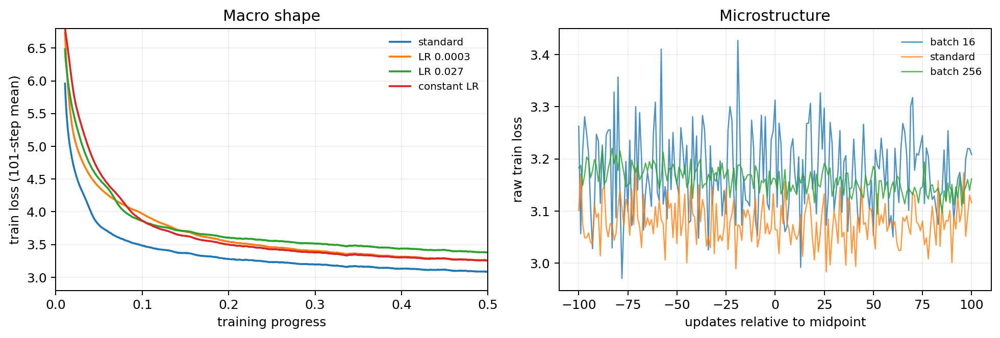

# Problem 5: Loss-curve augury

These comparisons reuse d8 runs trained on 614.4M tokens. The standard recipe finishes at validation loss 2.9259.

## (a) Macro shape

Healthy runs share a steep initial descent, a long region of diminishing returns, and a final improvement as the learning rate anneals. Learning rate and schedule control this large-scale shape:

- At 10%, 50%, and 90% of training, the standard run's local mean train losses are 3.466, 3.075, and 2.929.
- Learning rate 0.0003 descends too slowly, with corresponding losses 3.932, 3.247, and 3.136 and final validation loss 3.1473.
- Learning rate 0.027 also starts slowly and catches up late, reaching 3.833, 3.372, and 3.094 before finishing at validation loss 3.0172.
- Constant learning rate reaches 3.825, 3.248, and 3.167 and then remains high, finishing at 3.1754. Without annealing, it misses the standard run's late improvement.
- Cosine decay is smooth throughout. Warmup-stable-decay stays flatter through its stable phase and improves sharply only when decay begins.

Longer warmup delays the early descent but can help a high learning rate avoid a poor trajectory. Weight decay mostly changes the attained loss rather than producing a distinctive curve shape.

## (b) Microstructure

Batch size controls short-timescale noise. Measured as the standard deviation of adjacent train-loss differences between 10% and 90% of training, batch sizes 16, 32, 64, 128, and 256 give 0.111, 0.080, 0.056, 0.039, and 0.028. This is close to the expected inverse-square-root dependence on batch size.

Changing learning rate from 0.0003 to 0.027 at fixed batch size leaves this statistic near 0.055. Schedules also remain near 0.055. Learning rate and schedule therefore alter the trend much more than the local jaggedness; batch size is the dominant smoothness control.

## (c) Diagnostic patterns

Good d8 training is finite, steadily improving after warmup, and benefits from late annealing. Several recognizable failure modes appear in the completed runs:

- A learning rate that is too small produces a smooth but uniformly slow descent.
- A learning rate that is too large produces a delayed, high-loss trajectory that may recover late but finishes worse.
- A constant schedule appears reasonable early, then plateaus above an annealed run.
- A very large batch is visually smooth but learns less effectively at the fixed token budget.
- Warmup-stable-decay produces a deliberate late bend rather than a failure.

For the sample identification task, the high-loss early curve is most consistent with learning rate 0.009, not the standard, low-learning-rate, or batch-256 run. Its final validation loss is 2.9493, only 0.0234 above the standard run, so it belongs in the “within +0.05” bucket.

## Synthesis

Macro shape and microstructure diagnose different controls. Learning rate, warmup, and schedule determine when useful learning occurs and whether the run receives a late annealing gain. Batch size primarily determines point-to-point noise: increasing it makes the curve smoother but does not guarantee a better model. On d8, a smooth curve can still be undertrained, while a noisy small-batch curve can finish well. The most reliable healthy pattern is rapid early progress followed by continued slow improvement and a final benefit from decay.
