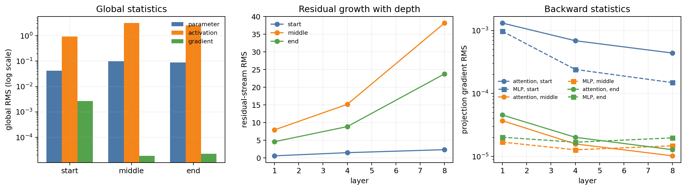

# Problem 6: Activations and gradient norms

RMS on one training batch, before clipping. The standard run is the reference.

## (a) Standard d8

| Global RMS | Start | Middle | End |
| --- | ---: | ---: | ---: |
| Parameters | 0.0422 | 0.0978 | 0.0892 |
| Activations | 0.937 | 3.157 | 2.593 |
| Gradients | \(2.68\times10^{-3}\) | \(1.85\times10^{-5}\) | \(2.25\times10^{-5}\) |

Parameters and activations peak mid-run, then fall as the learning rate decays. Gradients drop about 100× after step 0 and stay near \(2\times10^{-5}\).

Residual RMS grows with depth. Layers 1, 4, and 8 end at 4.58, 8.86, and 23.8. At layer 8 the MLP output ends larger than attention (8.67 vs 4.28). At step 0, attention-output gradient RMS is \(1.32\times10^{-3}\) in layer 1 and \(4.39\times10^{-4}\) in layer 8.

## (b) Earlier interventions

Terminal global RMS.

| Intervention | Parameter RMS | Activation RMS | Gradient RMS |
| --- | ---: | ---: | ---: |
| Standard | 0.0892 | 2.593 | \(2.25\times10^{-5}\) |
| Learning rate 0.001 | 0.0522 | 1.844 | \(3.72\times10^{-5}\) |
| Learning rate 0.009 | 0.1621 | 3.849 | \(1.67\times10^{-5}\) |
| Learning rate 0.027 | 0.3659 | 7.909 | \(1.31\times10^{-5}\) |
| Batch size 16 | 0.1012 | 2.352 | \(6.59\times10^{-5}\) |
| Batch size 256 | 0.0670 | 2.292 | \(1.46\times10^{-5}\) |
| Weight decay 1.0 | 0.0494 | 1.283 | \(8.16\times10^{-5}\) |
| Constant learning rate | 0.1319 | 4.773 | \(1.69\times10^{-5}\) |
| Dropout 0.2 | 0.0894 | 2.422 | \(1.91\times10^{-5}\) |

Raising learning rate from 0.001 to 0.027 multiplies terminal parameter RMS by 7.0 and activation RMS by 4.3. Weight decay 1.0 roughly halves both. Batch 16 has 4.5× the terminal gradient RMS of batch 256. Dropout barely moves the globals. Constant learning rate stays high at the end (activations 4.77); cosine stays near the default (2.74). Warmup 0.10 does not change the end (activations 2.62).

## (c) Moving the statistics

- Raise the learning rate to enlarge parameters and activations for the whole run.
- Raise weight decay, or lower the learning rate, to shrink them.
- Remove learning-rate decay to keep them large at the end. Warmup only moves the start.
- Shrink the batch to raise terminal gradient RMS.

## Synthesis

Activations accumulate with depth and peak mid-training. Gradients are large only at the start. Learning rate and weight decay set the scale; batch size sets the gradient; the schedule decides whether the scale lasts to the end.
