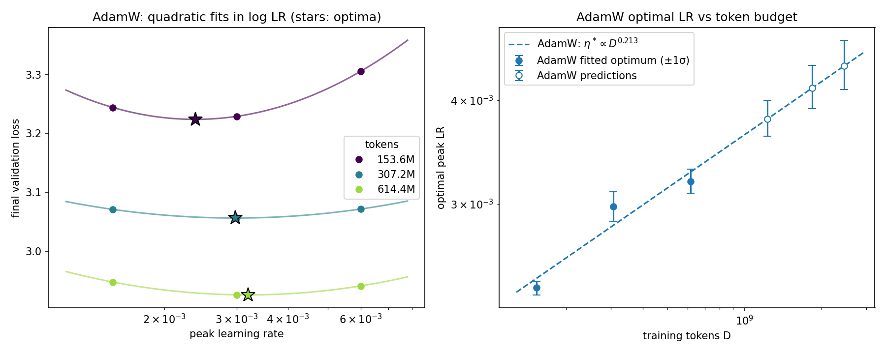
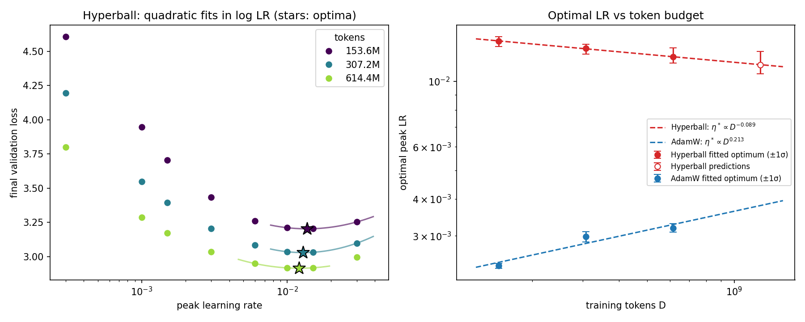

# Problem 1: Learning-rate scaling with the token budget

All runs use the d8 model and the default recipe: AdamW $(0.9, 0.95)$, weight decay 0.1, batch size 64, 1% warmup, linear decay, and seed 42. Only the peak learning rate $\eta$ and the token budget $D$ change.

**Method.** At each budget, I fit a parabola in $\log_2 \eta$ through the lowest measured loss and its two neighbors. The vertex is the fitted optimum $\eta^*$. A scaling rule is a power law $\eta^* = c\,D^{\alpha}$, fit by least squares in log–log space. Uncertainties are $\pm1\sigma$ from 4,000 refits. Each refit adds Gaussian noise with SD 0.0024 to every loss, which is the seed-to-seed SD of the default recipe measured in A1 Problem 3.

## (a) Learn from small training budgets

Final validation losses from the supplied runs:

| Tokens | $\eta$ = 0.0015 | $\eta$ = 0.003 | $\eta$ = 0.006 | Fitted $\eta^*$ ($\pm1\sigma$) | Loss at $\eta^*$ |
| --- | ---: | ---: | ---: | --- | ---: |
| 153.6M | 3.2442 | **3.2291** | 3.3056 | 0.00238 (0.00233–0.00242) | 3.2240 |
| 307.2M | 3.0709 | **3.0562** | 3.0715 | 0.00298 (0.00286–0.00310) | 3.0562 |
| 614.4M | 2.9473 | **2.9256** | 2.9408 | 0.00319 (0.00309–0.00330) | 2.9255 |

The proposed rule is

$$\eta^*(D) = 4.44\times10^{-5}\, D^{0.213},$$

with exponent $\pm1\sigma$ range 0.19–0.24. Each doubling of the budget multiplies the optimal LR by 1.16.

The optimal LR **increases** with the token budget. This contradicts both the idea that it stays fixed and the convex-optimization intuition that it should shrink like $1/\sqrt{T}$ or $1/T$.

The increase is slowing. The optimum rises 25% from 153.6M to 307.2M tokens, but only 7% from 307.2M to 614.4M. The middle point sits above the fitted line and the last one below it. The bend is about $1.7\sigma$ of the seed-noise uncertainty, and 95% of the noisy refits still show the increase slowing. It is suggestive but not conclusive.

The loss curve also flattens as the budget grows. Missing the optimum by a factor of 2 costs 0.046 in loss at 153.6M tokens, but only 0.015–0.018 at 307.2M and 614.4M.

## (b) Predict before increasing the budget

These predictions come from the rule in (a). They were recorded before loading the P1(b) measurements.

| Tokens | Predicted $\eta^*$ ($\pm1\sigma$) |
| --- | --- |
| 1.2288B | 0.00380 (0.00362–0.00400) |
| 1.8432B | 0.00414 (0.00390–0.00441) |
| 2.4576B | 0.00440 (0.00412–0.00472) |

If the slowdown seen in (a) continues, these are overestimates.

> **TODO:** fit the P1(b) loss–LR curves, compare the fitted optima with these predictions, and say whether the small-budget trend continues.

## (c) Compare and test two scaling rules

> **TODO:** fit a power law over all six source budgets and another over only 1.2288B–2.4576B tokens. Predict $\eta^*$ at 4.9152B from each. Then train at both predicted LRs and at 0.0015, 0.003, and 0.006 (5 new runs). Report each prediction's loss gap to the best sampled LR, and discuss the bias–variance tradeoff and extrapolation distance.

## (d) Hyperball versus AdamW

Hyperball uses no weight decay. Embeddings, norms, and biases use Adam at $0.1041\,\eta$. The supplied sweep has eight LRs from 0.0003 to 0.03 at each of the three budgets in (a). The loss rises steeply below the optimum and is flat near it, so only the three points around the minimum are fit. A single parabola through all eight points misses individual losses by up to 0.054.

| Tokens | Fit LRs | Fitted $\eta^*$ ($\pm1\sigma$) | Hyperball loss at $\eta^*$ | AdamW loss at $\eta^*$ |
| --- | --- | --- | ---: | ---: |
| 153.6M | 0.01, 0.015, 0.03 | 0.0137 (0.0131–0.0142) | 3.2033 | 3.2240 |
| 307.2M | 0.01, 0.015, 0.03 | 0.0129 (0.0124–0.0134) | 3.0294 | 3.0562 |
| 614.4M | 0.006, 0.01, 0.015 | 0.0121 (0.0115–0.0130) | 2.9151 | 2.9255 |

The Hyperball rule is

$$\eta^*_{\text{Hyperball}}(D) = 0.0732\, D^{-0.089},$$

with exponent $\pm1\sigma$ range −0.13 to −0.02. Each doubling of the budget multiplies the optimal LR by 0.94.

Hyperball's optimal LR moves in the opposite direction from AdamW's: it falls slowly with the budget.

It is also more regular. The two doublings multiply the Hyperball optimum by 0.944 and 0.937, while AdamW's change by 1.25 and 1.07.

Hyperball is 0.010–0.027 lower in loss than AdamW at its own optimum at every budget.

**Uncertainty.** The sign of the Hyperball exponent is fairly secure, but its size is not. Near the optimum the Hyperball curve is flat: at 614.4M tokens, LRs 0.01 and 0.015 differ by only 0.0007 in loss. As a result, seed-level noise moves each optimum by about $\pm$4–6%. The choice of fit window matters too: using four points (0.006–0.03) gives exponent −0.134 instead of −0.089.

With only three budgets spanning a factor of 4, a 2× extrapolation is reasonably constrained. A larger one is not.

**Prediction at 1.2288B tokens:** $\eta^* = 0.0114$ ($\pm1\sigma$ 0.0106–0.0126). The four-point fit gives 0.0105.

> **TODO:** train the predicted LR and three nearby LRs at 1.2288B tokens (up to 4 new runs). Compare the prediction with the best sampled target loss, and say whether the optimum varies more regularly with budget than AdamW's.

## (e) Schedule variants (optional)

> **TODO (optional):** repeat the analysis for cosine AdamW using the supplied P1e runs, and test whether the optimal LR transfers directly between schedules.

## Synthesis

> **TODO:** write after (b)–(d) are complete.
