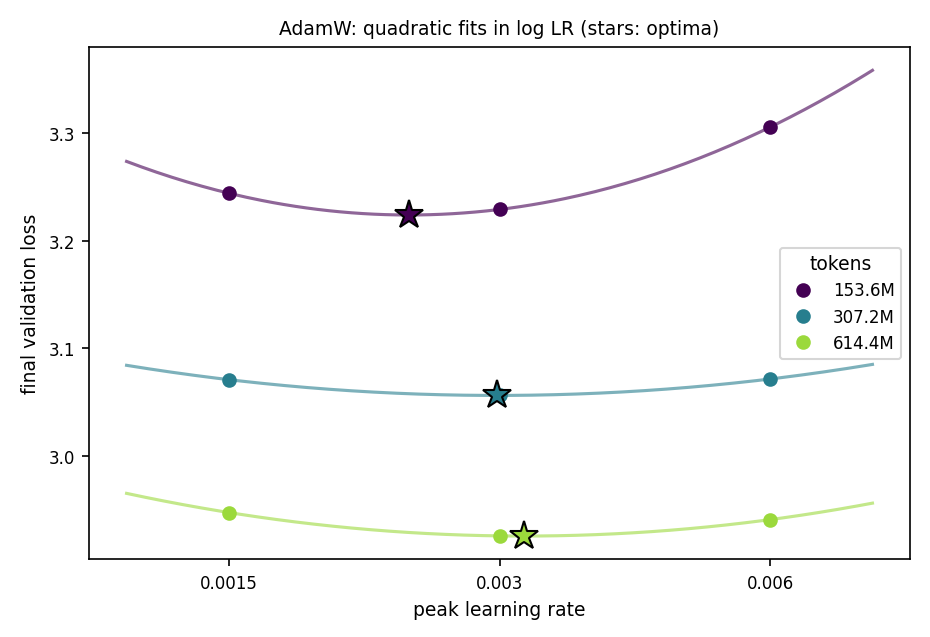
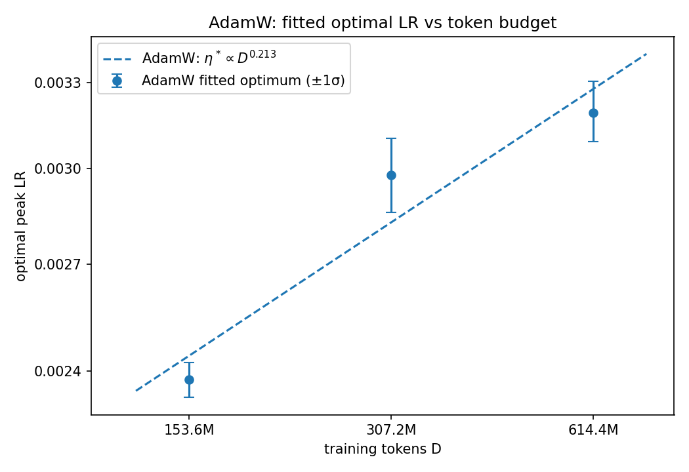
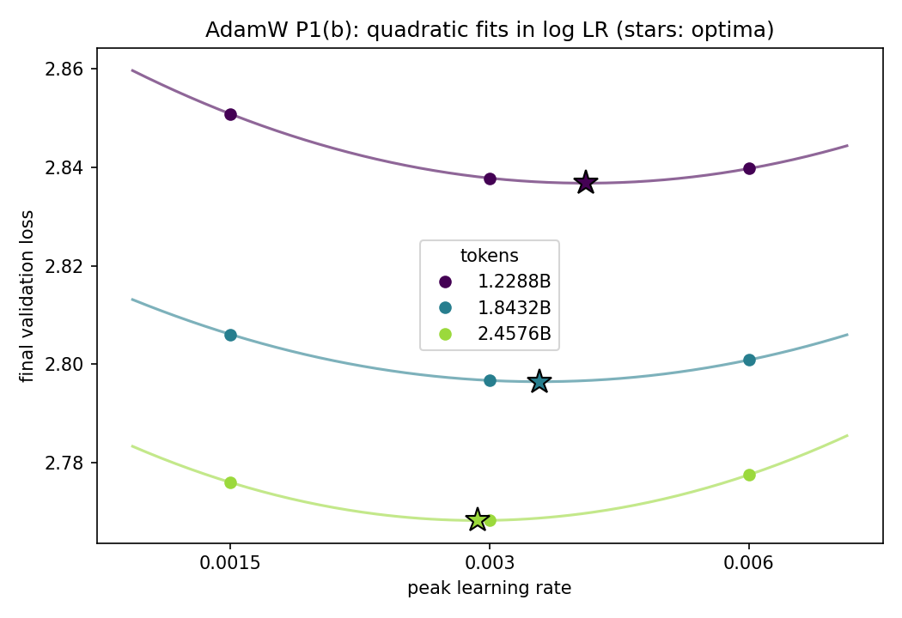
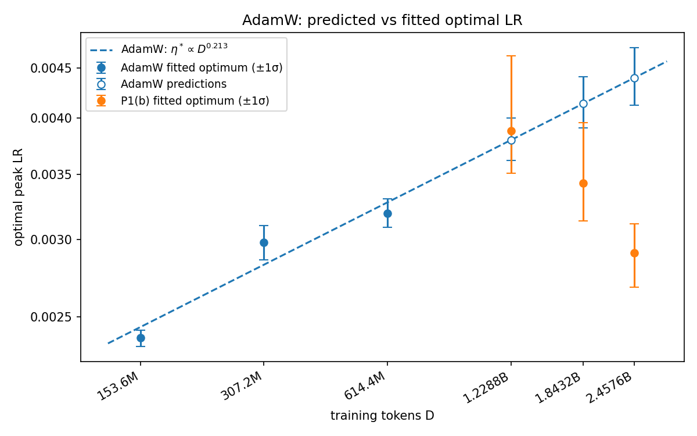
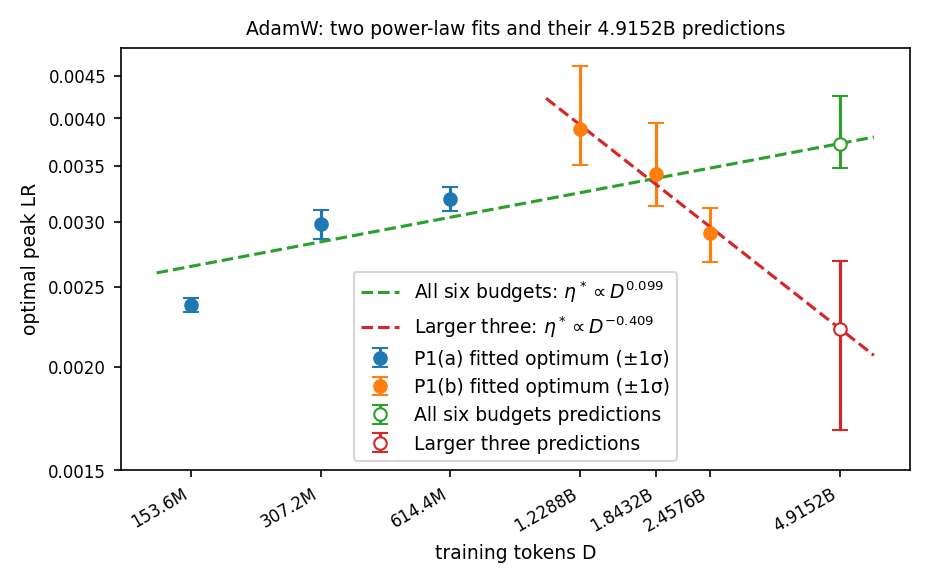
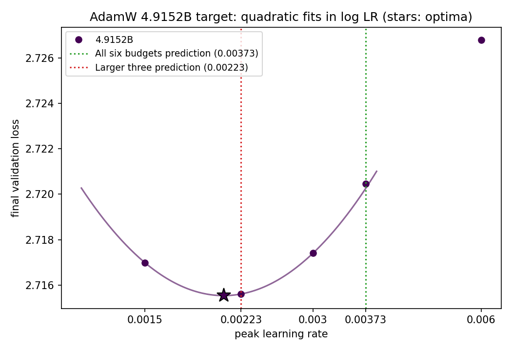
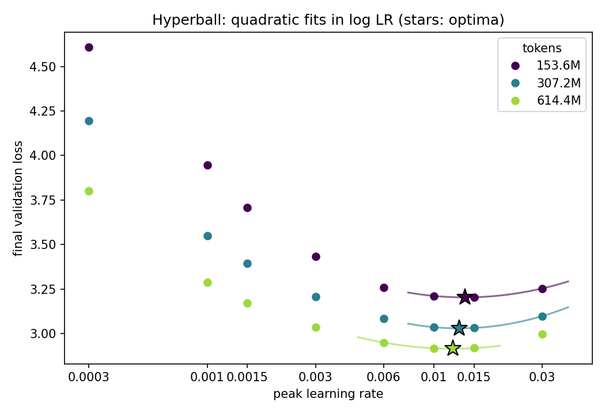
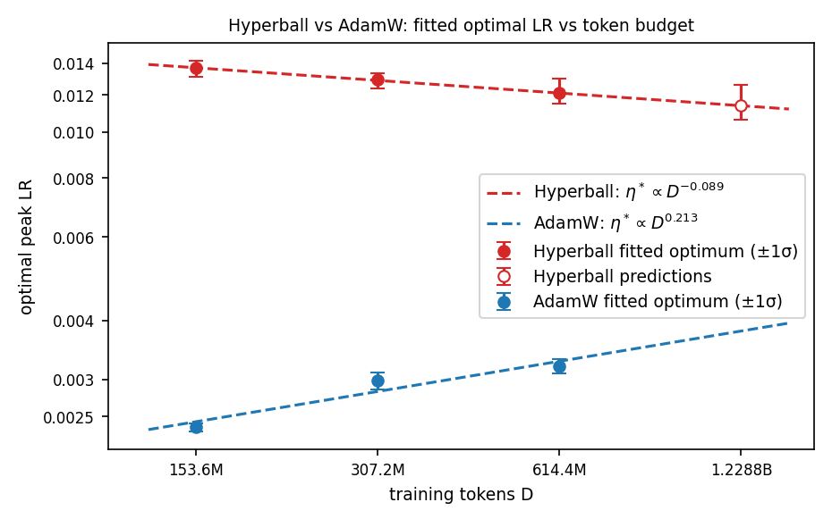
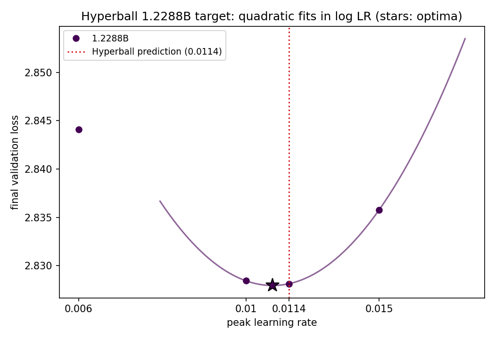

# Problem 1: When can training on less data guide large scale runs?

## (a) Learn from small training budgets

Final validation loss of the supplied AdamW runs (WD 0.1; lowest per budget in bold):

| Peak LR | 153.6M | 307.2M | 614.4M |
| --- | ---: | ---: | ---: |
| 0.0015 | 3.2442 | 3.0709 | 2.9473 |
| 0.003 | **3.2291** | **3.0562** | **2.9256** |
| 0.006 | 3.3056 | 3.0715 | 2.9408 |

Fitting a power law to the fitted optima gives the proposed scaling rule

$$
\eta^*(D) = 0.00328\left(\frac{D}{614.4\text{M}}\right)^{0.213}
$$

From what we see, the optimal LR rises with token count.

## (b) Predict before increasing the budget

Predicted optimal LRs from the power law in (a), recorded before inspecting the P1(b) measurements:

| Tokens | Predicted $\eta^*$ |
| --- | --- |
| 1.2288B | 0.00380 |
| 1.8432B | 0.00414 |
| 2.4576B | 0.00440 |

Final validation loss of the supplied AdamW runs (WD 0.1; lowest per budget in bold):

| Peak LR | 1.2288B | 1.8432B | 2.4576B |
| --- | ---: | ---: | ---: |
| 0.0015 | 2.8508 | 2.8060 | 2.7760 |
| 0.003 | **2.8378** | **2.7967** | **2.7683** |
| 0.006 | 2.8397 | 2.8008 | 2.7775 |

The trend from the small budgets does not continue. The prediction holds at 1.2288B (predicted 0.00380, fitted 0.00388) but not after. The fitted optimum falls to 0.00343 at 1.8432B and 0.00291 at 2.4576B, so the power law overpredicts by 21% and 51%. The optimal LR stops rising after about 1.2B tokens and then decreases.

## (c) Compare and test two scaling rules

| Fit | Rule | Predicted $\eta^*$ at 4.9152B |
| --- | --- | --- |
| All six budgets | $\eta^* \propto D^{0.099}$ | 0.00373 |
| Larger three (1.2288B–2.4576B) | $\eta^* \propto D^{-0.409}$ | 0.00223 |

**Which prediction should give the lower loss?** The larger-three prediction. The optimal LR stopped rising after about 1.2B tokens, and the larger-three fit follows the trend closest to the target. The all-six fit averages the rising small-budget optima with the falling larger ones, so it still predicts an increase.

| Peak LR | Source | Final validation loss | Gap vs best grid LR |
| --- | --- | ---: | ---: |
| 0.0015 | target grid | 2.7170 | best grid LR |
| 0.00223 | larger-three prediction | **2.7156** | −0.0014 |
| 0.003 | target grid | 2.7174 | +0.0004 |
| 0.00373 | all-six prediction | 2.7205 | +0.0035 |
| 0.006 | target grid | 2.7268 | +0.0098 |

The fitted target optimum is 0.00208 ($\pm1\sigma$ 0.00182–0.00235). The larger-three prediction is 7% above it and the all-six prediction is 79% above it.

**Gains from the smaller-budget fits.** The larger-three prediction beat the best grid LR by 0.0014, which is within seed noise (SD 0.0024). The all-six prediction, which relies on the smallest budgets, was 0.0035 worse. Including the small budgets did not help.

**Bias–variance.** The all-six fit has low variance (exponent $\pm1\sigma$ 0.08–0.14) but is biased, because one power law cannot follow an optimum that rises and then falls. The larger-three fit has less bias but high variance (exponent $\pm1\sigma$ −0.71 to −0.24). Here bias dominated, so the noisier local fit predicted better.

**Extrapolation.** The local fit held for a 2× extrapolation, from 2.4576B to 4.9152B. Because the trend reversed within the source budgets, a fit should only be trusted a short distance past the budgets it was fit on. Near the optimum the loss is flat: 0.0015–0.003 are within 0.0018 of the best run, so a modest LR error costs little at this budget.

## (d) Hyperball versus AdamW

Final validation loss of the 24 supplied Hyperball runs (WD 0; lowest per budget in bold):

| Peak LR | 153.6M | 307.2M | 614.4M |
| --- | ---: | ---: | ---: |
| 0.0003 | 4.6079 | 4.1946 | 3.8001 |
| 0.001 | 3.9460 | 3.5495 | 3.2863 |
| 0.0015 | 3.7064 | 3.3939 | 3.1730 |
| 0.003 | 3.4326 | 3.2063 | 3.0364 |
| 0.006 | 3.2596 | 3.0835 | 2.9494 |
| 0.01 | 3.2113 | 3.0357 | **2.9176** |
| 0.015 | **3.2040** | **3.0315** | 2.9183 |
| 0.03 | 3.2533 | 3.0981 | 2.9962 |

| Tokens | Hyperball fitted $\eta^*$ | AdamW fitted $\eta^*$ |
| --- | --- | --- |
| 153.6M | 0.0137 | 0.00238 |
| 307.2M | 0.0129 | 0.00298 |
| 614.4M | 0.0121 | 0.00319 |
| Rule | $\eta^* \propto D^{-0.089}$ | $\eta^* \propto D^{0.213}$ |

**Trend vs AdamW.** Hyperball's optimal LR falls slowly with budget (×0.94 per doubling), while AdamW's rises (×1.16 per doubling). Hyperball's two doublings give nearly the same ratio (0.944 and 0.937); AdamW's do not (1.25 and 1.07).

Predicted optimal LR at 1.2288B from the Hyperball power law, recorded before running the target: 0.0114.

| Peak LR | Final validation loss | Gap vs best sampled |
| --- | ---: | ---: |
| 0.006 | 2.8441 | +0.0160 |
| 0.01 | 2.8284 | +0.0003 |
| 0.0114 (predicted) | **2.8281** | best |
| 0.015 | 2.8358 | +0.0076 |

**Prediction vs target.** The predicted LR gave the best sampled loss. The fitted target optimum is 0.0108 ($\pm1\sigma$ 0.0092–0.0118), 5% below the prediction. LR 0.01 is only 0.0003 worse, well within seed noise. At 1.2288B, Hyperball's best loss is 0.0097 below AdamW's best sampled loss (2.8378).

**More regular?** Yes. Including the target, the Hyperball optimum changes by a similar factor each doubling (0.94, 0.94, 0.90). AdamW's changed by 1.25, 1.07, and 1.22, then reversed (0.75 from 1.2288B to 2.4576B). However, AdamW's rule also held at 1.2288B, so this single target cannot show whether Hyperball keeps its trend past the point where AdamW's broke.

**Uncertainty from three source budgets.** Three budgets spanning 4× give an exponent of −0.089 with $\pm1\sigma$ −0.13 to −0.02. The direction is fairly clear, but the rate is not. The Hyperball loss is flat near its optimum, so each fitted optimum moves $\pm$4–6% under seed noise, and the fit window matters: four points give −0.134. A 2× extrapolation stays within this uncertainty. AdamW shows that a trend can reverse just past the source range, so three budgets cannot rule out a bend further out.

## (e) Explore schedule variants (optional)

## Synthesis

With AdamW, the optimal LR rose with budget up to about 1.2B tokens (0.00238 at 153.6M to 0.00388 at 1.2288B), then fell (0.00291 at 2.4576B and 0.00208 at 4.9152B). Past that point, larger budgets preferred lower LRs. Hyperball's optimal LR fell slowly and steadily across its whole range (0.0137 at 153.6M to 0.0108 at 1.2288B, about ×0.94 per doubling). Because the AdamW trend reversed, extrapolating from small budgets was inaccurate. The rule from (a) overpredicted the 2.4576B optimum by 51%, and the all-six fit predicted an LR 79% above the 4.9152B optimum. The fit on the three largest budgets, the ones closest to the target, came within 7%. Trends can change with scale, so far-out predictions need source points at larger budgets near the target, and a power law should only be trusted a short distance past the budgets it was fit on. Hyperball's optimum moved more regularly, but we tested only one 2× extrapolation. AdamW also passed a 2× extrapolation before its trend broke, so three small budgets cannot rule out a later bend for Hyperball.

