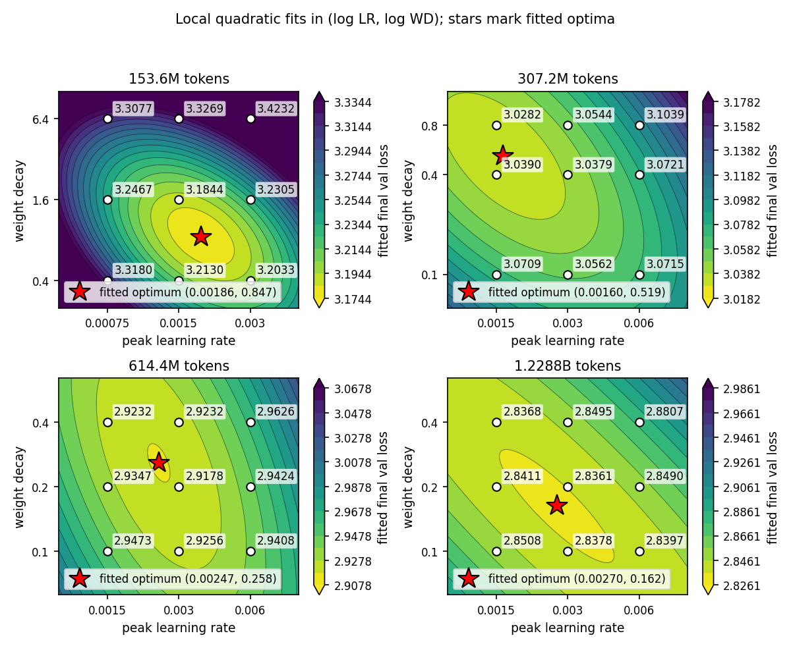
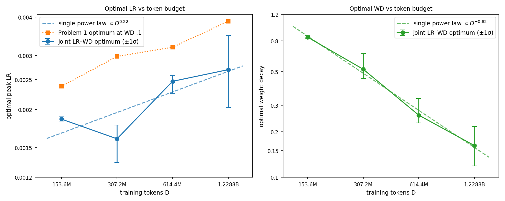
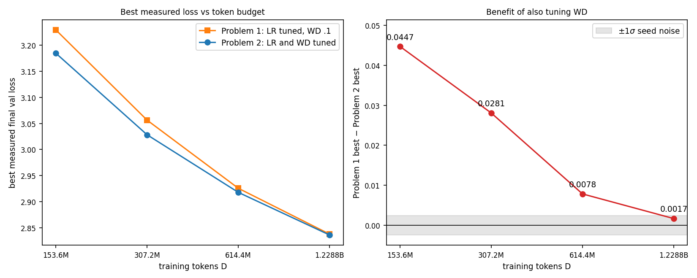
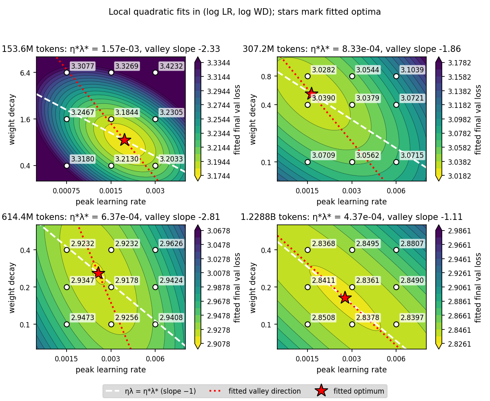
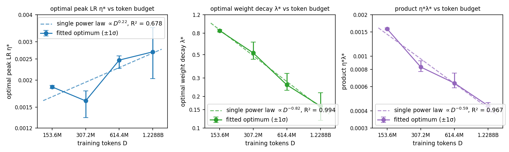

# Problem 2: How should learning rate and weight decay scale together?

## (a) LR and WD vary together

| Tokens | Fitted η\* (±1σ) | Fitted λ\* (±1σ) | Problem 1 η\* (WD 0.1) |
| --- | --- | --- | --- |
| 153.6M | 0.00186 (0.00183–0.00189) | 0.847 (0.825–0.867) | 0.00238 |
| 307.2M | 0.00160 (0.00134–0.00178) | 0.519 (0.452–0.660) | 0.00298 |
| 614.4M | 0.00247 (0.00226–0.00258) | 0.258 (0.229–0.332) | 0.00319 |
| 1.2288B | 0.00270 (0.00203–0.00349) | 0.162 (0.119–0.216) | 0.00388 |
| Single power law | ∝ D^0.22 | ∝ D^−0.82 | |

- **Trends:** optimal WD falls steadily (0.85 to 0.16, ×0.50–0.63 per doubling). Optimal LR rises overall (0.00186 to 0.00270) but not monotonically: it dips to 0.00160 at 307.2M.
- **Compared with Problem 1:** the LR rises at a similar rate (D^0.22 vs D^0.21), but the joint optimum is 22–46% lower at every budget, where WD is also above 0.1.
- **Single power law:** WD yes (steady factor per doubling, close to D^−0.82). LR no: the 307.2M dip breaks the trend and the 1.2288B optimum is poorly constrained (±1σ 0.0020–0.0035).

| Tokens | Best joint (LR, WD) | Best joint loss | Best Problem 1 loss (LR 0.003, WD 0.1) | Benefit of tuning WD |
| --- | --- | ---: | ---: | ---: |
| 153.6M | (0.0015, 1.6) | 3.1844 | 3.2291 | 0.0447 |
| 307.2M | (0.0015, 0.8) | 3.0282 | 3.0562 | 0.0281 |
| 614.4M | (0.003, 0.2) | 2.9178 | 2.9256 | 0.0078 |
| 1.2288B | (0.003, 0.2) | 2.8361 | 2.8378 | 0.0017 |

The benefit of tuning WD shrinks with budget, from 0.0447 to 0.0017 (within seed noise, SD 0.0024), because the optimal WD falls toward the 0.1 used in Problem 1 (0.16 at 1.2288B).

## (b) Joint scaling law

Fitted loss rise for a 2× move away from the optimum. The valley slope is d log λ / d log η along the fitted surface's flattest direction; the line ηλ = const has slope −1.

| Tokens | Valley slope | Along ηλ = η\*λ\* | LR only | WD only |
| --- | ---: | ---: | ---: | ---: |
| 153.6M | −2.33 | +0.0376 | +0.0468 | +0.0195 |
| 307.2M | −1.86 | +0.0098 | +0.0148 | +0.0069 |
| 614.4M | −2.81 | +0.0136 | +0.0196 | +0.0055 |
| 1.2288B | −1.11 | +0.0020 | +0.0086 | +0.0072 |

| Variable | Exponent | R² (±1σ) | Change per doubling |
| --- | ---: | --- | --- |
| η\* | +0.22 | 0.678 (0.25–0.78) | ×0.86, ×1.54, ×1.09 |
| λ\* | −0.82 | 0.994 (0.82–0.99) | ×0.61, ×0.50, ×0.63 |
| η\*λ\* | −0.59 | 0.967 (0.90–0.98) | ×0.53, ×0.77, ×0.69 |

- **Compensation:** partly. Moving along ηλ = η\*λ\* costs less than changing LR alone at every budget (e.g. +0.0020 vs +0.0086 at 1.2288B).
- **Product line vs contours:** it matches the valley only at 1.2288B (slope −1.11). At 153.6M–614.4M the valley is steeper (−1.9 to −2.8), so WD must move more than 1/LR to compensate, and a WD-only move (+0.0195, +0.0069, +0.0055) is cheaper than moving along the product line.
- **Regularity:** the product is more regular than η\* (×0.53–0.77 vs ×0.86–1.54 per doubling) but not more than λ\* (×0.50–0.63).
- **Tightest power law:** λ\* (R² 0.994), then η\*λ\* (0.967), then η\* (0.678). Under seed noise the product is the more stable of the top two (0.90–0.98 vs 0.82–0.99), but with four points the gap is not significant.

## (c) Test the joint rule

**Prediction.** The product law fitted on 153.6M–1.2288B is η\*λ\* ∝ D^−0.593, giving η\*λ\* = 2.782e−4 at 2.4576B; at LR 0.003 this is WD = 2.782e−4 / 0.003 = 0.0927.

Final validation loss at 2.4576B (gap = baseline minus predicted; positive means the prediction is better):

| Run | LR | WD | Source | Final val loss | Gap |
| --- | ---: | ---: | --- | ---: | ---: |
| Predicted (product law) | 0.003 | 0.0927 | new | 2.7667 | |
| Baseline (i): best 153.6M pair | 0.0015 | 1.6 | new | 2.8532 | +0.0865 |
| Baseline (ii): LR 0.003, WD swept | 0.003 | 0.05 | new | 2.7726 | +0.0059 |
| | 0.003 | 0.1 | supplied | 2.7683 | +0.0016 |
| | 0.003 | 0.2 | new | 2.7723 | +0.0056 |

The rule beats reusing the small-scale pair by 0.0865 and ties the best WD in the sweep (+0.0016, within seed noise). Carrying (LR 0.0015, WD 1.6) over without retuning loses because the optimal WD has fallen roughly ×0.5 per doubling; the same LR with WD 0.1 reaches 2.7760, so the WD alone costs 0.077. The test cannot separate the rule from simply keeping WD 0.1, since the loss at LR 0.003 changes by only 0.006 across WD 0.05–0.2.

## Synthesis

LR and WD act as a coupled pair, and the optimal WD moves with scale much more cleanly than the optimal LR. From 153.6M to 1.2288B tokens the optimal WD falls steadily (∝ D^−0.82, R² 0.994), while the optimal LR rises erratically (R² 0.678) and sits 22–46% below Problem 1's. Raising one partly compensates for lowering the other: moving along ηλ = const is cheaper than changing LR alone at every budget, though the fitted valley is steeper than that line at the three smaller budgets, so the product is a useful summary and not an exact invariant. The benefit of tuning WD shrinks from 0.0447 to 0.0017 as the optimal WD falls toward Problem 1's 0.1. The product law (R² 0.967) was tested at 2.4576B with the LR fixed at 0.003: the predicted WD of 0.0927 beat reusing the 153.6M optimum by 0.087 and tied the best WD in a sweep. Because the loss is nearly flat in WD near the optimum, this shows that WD must be rescaled with budget, not that the product rule beats keeping WD at 0.1. All fits use four budgets, and the rule was checked only one doubling past the data.
