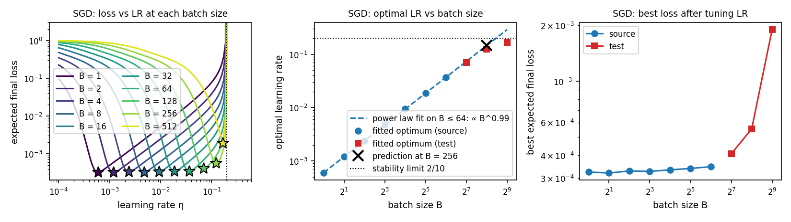
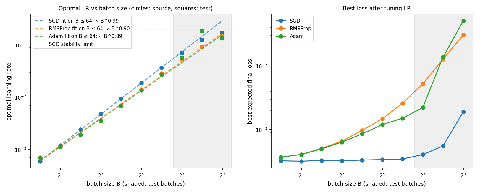
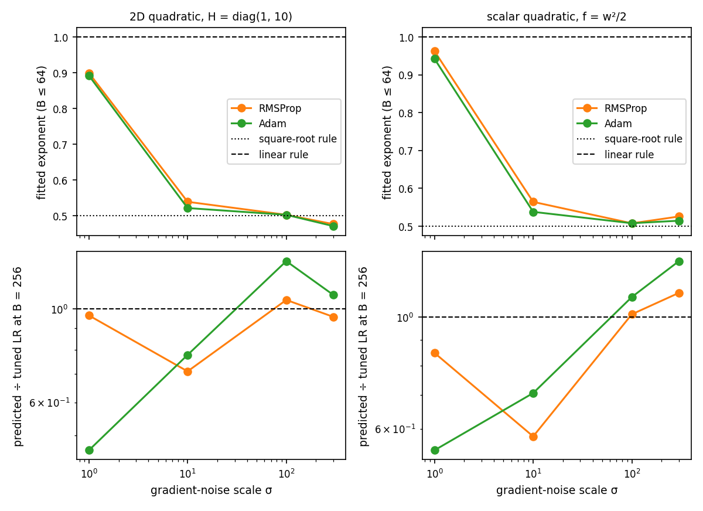
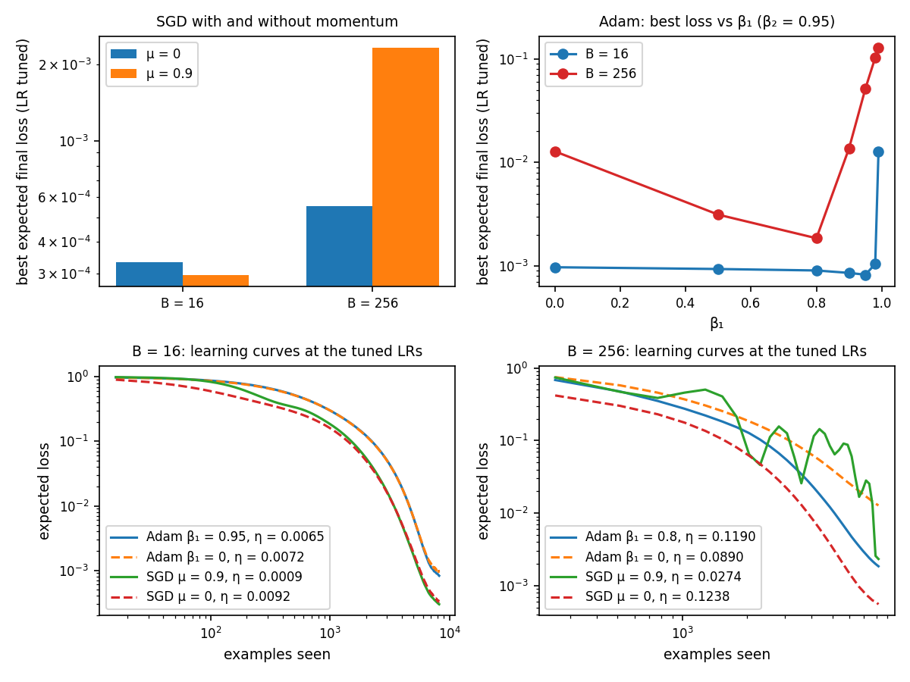
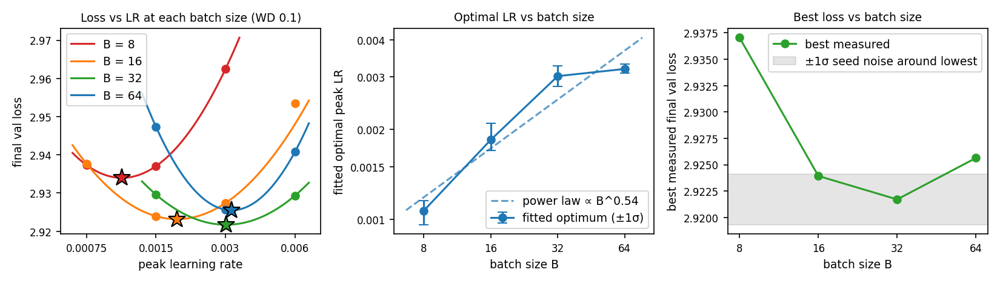
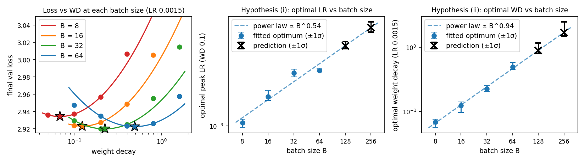
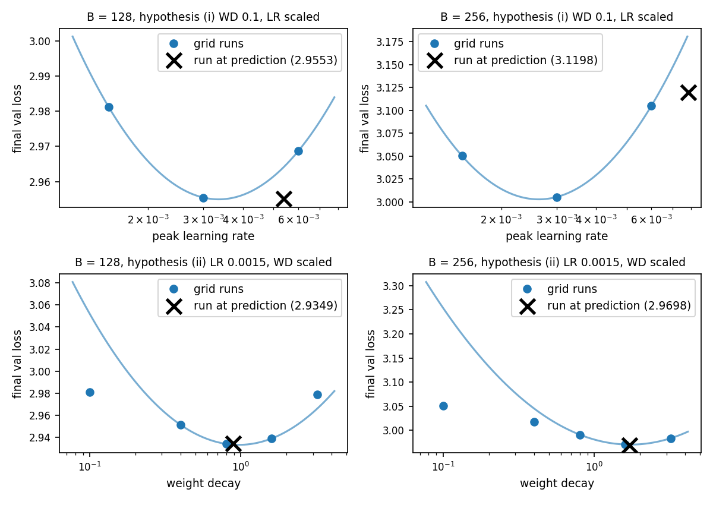
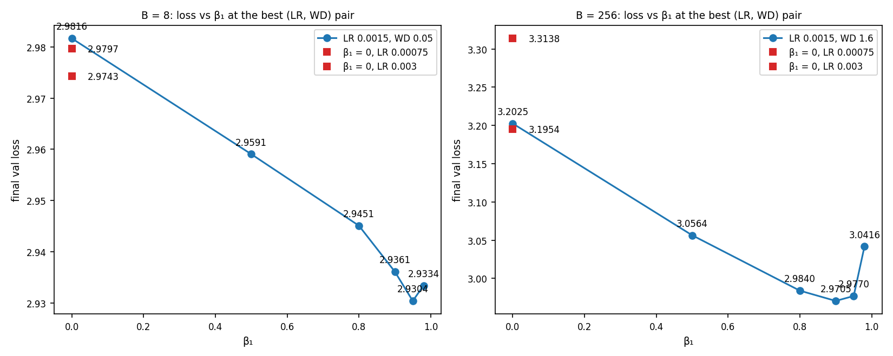

# Problem 3: How does batch size affect the hyperparameters?

## 3.1 Noisy quadratic model

Setup: H = diag(1, 10), gradient noise N(0, I/B), N = 8,192 examples, w₀ ∼ N(0, diag(1, 0.1)) with 0.1 read as a variance. Each expected final loss averages 4,096 runs; all LRs at a batch size share initializations and noise. LR grid: 100 log-spaced values from 1e−4 to 0.4. Each optimum is a parabola in log η through the lowest grid point and its neighbours.

### (a) SGD

| B | Updates N/B | Fitted optimal η | Best loss |
| ---: | ---: | ---: | ---: |
| 1 | 8192 | 0.00059 | 0.00032 |
| 2 | 4096 | 0.00120 | 0.00032 |
| 4 | 2048 | 0.00239 | 0.00033 |
| 8 | 1024 | 0.00477 | 0.00033 |
| 16 | 512 | 0.00942 | 0.00033 |
| 32 | 256 | 0.01869 | 0.00034 |
| 64 | 128 | 0.03661 | 0.00035 |
| 128 | 64 | 0.07036 | 0.00041 |
| 256 | 32 | 0.12396 | 0.00055 |
| 512 | 16 | 0.16672 | 0.00190 |

Power law on B ≤ 64: η\*(B) ∝ B^0.991. Prediction at B = 256: 0.1463; tuned: 0.1240. Loss at the predicted LR 0.00072, tuned 0.00055.

- **Rule:** the optimal LR doubles with each doubling of the batch, essentially linear scaling.
- **Test at B = 256:** the prediction is 18% above the tuned LR and slightly overshoots.
- **Range:** accurate for B ≤ 64, close at 128 (4% below the line), 15% below at 256. At 512 the line gives 0.29, above the stability limit 2/10, and the optimum is 0.167 (43% below).
- **Noise vs updates:** a larger batch cuts noise per update but also cuts the number of updates. Doubling η with B keeps η × (N/B) at about 4.7–4.8 and the noise floor (∝ η/B) fixed, so the best loss stays flat (about 0.0003) for B ≤ 64. This fails when η hits the stability cap: at B = 512 only 16 updates remain, η × (N/B) falls to 2.7, and most of the 0.0019 loss is leftover error in w₁.

### (b) RMSProp and Adam

RMSProp is Adam with β₁ = 0; β₂ = 0.95, ε = 10⁻⁸, tuned separately. LR grid: 120 values from 1e−5 to 1.

| B | SGD η\* | RMSProp η\* | Adam η\* | SGD loss | RMSProp loss | Adam loss |
| ---: | ---: | ---: | ---: | ---: | ---: | ---: |
| 1 | 0.00059 | 0.00070 | 0.00069 | 0.00032 | 0.00037 | 0.00037 |
| 2 | 0.00120 | 0.00113 | 0.00111 | 0.00032 | 0.00041 | 0.00041 |
| 4 | 0.00239 | 0.00194 | 0.00191 | 0.00033 | 0.00051 | 0.00050 |
| 8 | 0.00477 | 0.00362 | 0.00352 | 0.00033 | 0.00066 | 0.00064 |
| 16 | 0.00942 | 0.00693 | 0.00675 | 0.00033 | 0.00097 | 0.00086 |
| 32 | 0.01869 | 0.01410 | 0.01343 | 0.00034 | 0.00148 | 0.00120 |
| 64 | 0.03661 | 0.02864 | 0.02738 | 0.00035 | 0.00259 | 0.00151 |
| 128 | 0.07036 | 0.05451 | 0.05731 | 0.00041 | 0.00522 | 0.00222 |
| 256 | 0.12396 | 0.09272 | 0.18398 | 0.00055 | 0.01277 | 0.01375 |
| 512 | 0.16672 | 0.14659 | 0.13425 | 0.00190 | 0.03057 | 0.05076 |

Power laws on B ≤ 64, tested at B = 256:

| Optimizer | Exponent | Predicted LR | Tuned LR | Predicted ÷ tuned | Loss at predicted | Loss at tuned |
| --- | ---: | ---: | ---: | ---: | ---: | ---: |
| SGD | 0.991 | 0.1463 | 0.1240 | 1.18 | 0.00072 | 0.00055 |
| RMSProp | 0.899 | 0.0897 | 0.0927 | 0.97 | 0.01278 | 0.01277 |
| Adam | 0.891 | 0.0847 | 0.1840 | 0.46 | 0.01509 | 0.01375 |

- **Exponents:** RMSProp (0.90) and Adam (0.89) match each other and sit slightly below SGD's 0.99; their optima agree within 5% for B ≤ 64 and are about 25% below SGD's for B ≥ 8. They follow a similar rule to each other, slightly sublinear, and a different one from SGD.
- **Transfer at B = 256:** RMSProp's prediction is 3% off with the same loss. Adam's is less than half the tuned LR, but its loss is only 10% worse: its loss is nearly flat for LRs 0.08–0.26 (0.014–0.015), while RMSProp has a sharp minimum near 0.1.
- **Same exponent, different transfer:** Adam's optima drift off the line past the source range (0.057, 0.184, 0.134 at B = 128, 256, 512). The exponent describes the source fit, not the reliability of the extrapolation.
- **Prediction for the language model:** the optimal LR should rise a little slower than linearly (about B^0.9 for Adam-type optimizers) while many updates remain, and degrade at B = 128–256 in the toy (64–32 updates). The language model has 9,375 updates at B = 64, so the rule should hold well above 64, imprecisely. The adaptive optimizers' best loss also worsens with B at fixed examples, unlike SGD's.

### (c) Gradient-noise scale and curvature

Noise σ²I/B with σ ∈ {1, 10, 100, 300}, for RMSProp and Adam on the 2D quadratic and on the scalar quadratic f(w) = w²/2 (w₀ ∼ N(0, 2), noise variance σ²/B). The LR grid is 150 values from 1e−5σ to 10σ; fit on B ≤ 64, test at B = 256. The σ = 1, 2D rows repeat (b) on a wider grid.

| Model | σ | RMSProp exponent | Adam exponent | RMSProp: LR ratio (predicted / tuned loss) | Adam: LR ratio (predicted / tuned loss) |
| --- | ---: | ---: | ---: | --- | --- |
| 2D | 1 | 0.899 | 0.892 | 0.97 (0.01276 / 0.01283) | 0.46 (0.01508 / 0.01369) |
| 2D | 10 | 0.539 | 0.521 | 0.71 (0.04822 / 0.03717) | 0.78 (0.03918 / 0.03188) |
| 2D | 100 | 0.502 | 0.502 | 1.05 (0.42311 / 0.42300) | 1.30 (0.43507 / 0.43077) |
| 2D | 300 | 0.476 | 0.471 | 0.96 (0.73780 / 0.73782) | 1.08 (0.75978 / 0.75887) |
| Scalar | 1 | 0.962 | 0.942 | 0.85 (0.00432 / 0.00360) | 0.54 (0.01717 / 0.01333) |
| Scalar | 10 | 0.564 | 0.538 | 0.58 (0.05762 / 0.02579) | 0.71 (0.04748 / 0.02978) |
| Scalar | 100 | 0.507 | 0.508 | 1.01 (0.40154 / 0.40153) | 1.10 (0.41132 / 0.40869) |
| Scalar | 300 | 0.525 | 0.514 | 1.12 (0.84012 / 0.83842) | 1.29 (0.87204 / 0.86256) |

- **Signal-to-noise changes the rule.** The exponent falls from about 0.9 at σ = 1 to 0.5 for σ ≥ 10. Adam divides updates by the root of its second moment, E[g²] = (Hw)² + σ²/B, a B-independent signal term plus a noise term falling as 1/B. When the signal dominates the normalizer barely changes with B, and the rule stays close to SGD's (nearly linear). When noise dominates the normalizer is about σ/√B, so the update acts like SGD with LR η√B/σ; SGD's optimum grows like B, so the Adam-type optimum grows like √B.
- **Transfer:** in the noise-dominated regime (σ ≥ 100) the B = 256 prediction is within 1.0–1.3× of the tuned LR in both models, with loss within about 1% of tuned. At σ = 1 and 10 it is less accurate (0.46–0.78 for Adam, 0.58–0.97 for RMSProp) and costs more loss.
- **Non-monotone optimum:** at σ = 300 the optimal LRs are below those at σ = 100. The best loss (0.74) is barely under the starting loss (1.0), so little progress is possible in 8,192 examples and a small total step is best.
- **Curvature:** the exponent pattern is the same on the scalar model (0.96/0.94, 0.56/0.54, then 0.51–0.53), so the signal-to-noise conclusion does not depend on curvature. Absolute LRs and small-σ transfer do: scalar optima are larger (0.178 vs 0.061 for RMSProp at σ = 100, B = 256), plausibly because the curvature-10 direction limits the 2D step, and RMSProp transfers worse at σ = 1 and 10 (0.85 and 0.58 of tuned, vs 0.97 and 0.71), costing more loss at σ = 10 (0.058 vs 0.026 tuned, against 0.048 vs 0.037).

### (d) Momentum

H = diag(1, 10), noise I/B. Entries are the best expected final loss over the LR grid; Adam has β₂ = 0.95 with β₁ and LR swept jointly.

| Optimizer | B = 16: tuned LR, best loss | B = 256: tuned LR, best loss |
| --- | --- | --- |
| SGD, μ = 0 | 0.00922, 0.00033 | 0.1238, 0.00055 |
| SGD, μ = 0.9 | 0.00088, 0.00030 | 0.0274, 0.00234 |

Adam, best loss after tuning the LR at each β₁:

| β₁ | 0 | 0.5 | 0.8 | 0.9 | 0.95 | 0.98 | 0.99 |
| --- | ---: | ---: | ---: | ---: | ---: | ---: | ---: |
| B = 16 | 0.00097 | 0.00093 | 0.00090 | 0.00086 | **0.00082** | 0.00105 | 0.01267 |
| B = 256 | 0.01277 | 0.00313 | **0.00185** | 0.01375 | 0.05184 | 0.10314 | 0.12911 |

- **SGD:** at B = 16 momentum barely matters once LR is retuned (0.00030 vs 0.00033, about 10%, near the Monte Carlo noise); the tuned LR falls about 10×, so momentum mostly rescales the effective LR η/(1 − μ). At B = 256 it hurts (0.00234 vs 0.00055): only 32 updates remain, the buffer needs about 10 to fill, and the curve oscillates.
- **Adam:** the benefit grows strongly with batch size: 18% at B = 16 (best β₁ 0.95) and 6.9× at B = 256 (best β₁ 0.8). β₁ near one is harmful at the large batch (0.0518 at 0.95), again because only 32 updates remain.
- **Learning curves:** at B = 16 the best-β₁ and β₁ = 0 curves nearly coincide. At B = 256 Adam with β₁ = 0.8 is below β₁ = 0 from early on, while SGD with μ = 0.9 oscillates and ends above the no-momentum SGD curve, the lowest of the four.
- **Language model:** the Adam result should carry over, and does in 3.2(c). The SGD result cannot be tested (the language model uses Adam), and the toy's 6.9× is not comparable with language-model loss gaps.

### Synthesis

In the noisy quadratic model the optimal LR rises with batch size as a power law whose exponent depends on the optimizer and the signal-to-noise ratio. SGD follows the linear rule (B^0.99) with a flat best loss up to B = 64, then fails as the LR reaches the stability cap (2/10) and too few updates remain (B = 512). RMSProp and Adam follow about B^0.9 when the signal dominates their second moment (σ = 1) and fall to the square-root rule (about B^0.5) when noise dominates (σ ≥ 10), on both a 2D and a scalar quadratic. A fitted exponent does not guarantee that extrapolation works: RMSProp's prediction at B = 256 was within 3% of tuned and Adam's 54% off with the same exponent, because Adam's loss was flat there. For momentum, SGD only rescales the effective LR at small batch and hurts at B = 256 with 32 updates, while Adam's benefit grows with batch size (loss ratio 1.18 at B = 16 to 6.9 at B = 256) with a lower best β₁. The toy's rules depend on optimizer, noise level and number of updates, and must be checked near the target batch.

## 3.2 Batch size in the language model

All runs: d8, 614.4M tokens (600,000 sequences). B = 8, 16, 32 are new; B = 64 is the supplied P1a / P2a sweeps. Actual tokens processed: 614.4M for B ≤ 64, 614.33M at B = 128 (4,687 updates) and 614.20M at B = 256 (2,343 updates), since incomplete accumulation groups are skipped.

### (a) LR sweeps at WD 0.1

Final validation loss (lowest per batch size in bold):

| Peak LR | B = 8 | B = 16 | B = 32 | B = 64 |
| ---: | ---: | ---: | ---: | ---: |
| 0.00075 | 2.9373 | 2.9377 | | |
| 0.0015 | **2.9371** | **2.9239** | 2.9296 | 2.9473 |
| 0.003 | 2.9624 | 2.9274 | **2.9217** | **2.9256** |
| 0.006 | | 2.9535 | 2.9293 | 2.9408 |

| B | Updates | Fitted optimal LR (±1σ) | Best loss |
| ---: | ---: | --- | ---: |
| 8 | 75,000 | 0.00107 (0.00096–0.00115) | 2.9371 |
| 16 | 37,500 | 0.00185 (0.00170–0.00210) | 2.9239 |
| 32 | 18,750 | 0.00302 (0.00278–0.00327) | 2.9217 |
| 64 | 9,375 | 0.00319 (0.00309–0.00331) | 2.9256 |

Power law over the four optima: η\* ∝ B^0.54.

- **Optimal LR:** it rises with batch size, steeply from 8 to 32 (about ×1.7 per doubling) and almost flat from 32 to 64 (×1.06). B^0.54 is well below linear, which would put B = 64 near 0.0086; at B = 64, LR 0.006 already costs 0.015 over 0.003.
- **Performance:** it improves from B = 8 to 16–32 and is lowest at B = 32 (2.9217). B = 8 is clearly worse (2.9371, 0.015 above B = 32, many times the seed SD of 0.0024). At B = 64 the loss rises slightly (+0.0039 over B = 32), only about 1σ of the difference between two runs (0.0034), so the loss has flattened rather than clearly turned up. A plausible reading is that the update count has fallen to 9,375 from 75,000, but these runs cannot confirm it.

### (b) Two scaling hypotheses

(i) fixes WD at 0.1 and scales the optimal peak LR (sources: the LR sweeps above). (ii) fixes LR at 0.0015 and scales the optimal WD (sources: WD sweeps at B = 8, 16, 32 and B = 64). Each is extrapolated to B = 128 and 256 with a power law on B = 8–64.

Final validation loss at LR 0.0015 (lowest per batch size in bold):

| WD | B = 8 | B = 16 | B = 32 | B = 64 |
| ---: | ---: | ---: | ---: | ---: |
| 0.05 | **2.9361** | | | |
| 0.1 | 2.9371 | **2.9239** | 2.9296 | 2.9473 |
| 0.2 | 2.9569 | 2.9274 | **2.9201** | 2.9347 |
| 0.4 | 3.0068 | 2.9487 | 2.9250 | **2.9232** |
| 0.8 | 3.1031 | 3.0053 | 2.9551 | 2.9261 |
| 1.6 | | 3.1023 | 3.0149 | 2.9576 |

| B | Fitted optimal LR at WD 0.1 (±1σ) | Fitted optimal WD at LR 0.0015 (±1σ) |
| ---: | --- | --- |
| 8 | 0.00107 (0.00096–0.00115) | 0.068 (0.057–0.076) |
| 16 | 0.00185 (0.00170–0.00210) | 0.124 (0.096–0.141) |
| 32 | 0.00302 (0.00278–0.00327) | 0.224 (0.206–0.254) |
| 64 | 0.00319 (0.00309–0.00331) | 0.490 (0.447–0.578) |
| Power law | ∝ B^0.54 | ∝ B^0.94 |

At B = 8 and 16 the best measured WD is the lowest tried (0.05, 0.1), so those two WD optima rest on the parabola and could be lower.

**Predictions, recorded before inspecting any B = 128 or 256 run** (±1σ):

| B | (i) Optimal LR at WD 0.1 | (ii) Optimal WD at LR 0.0015 |
| ---: | --- | --- |
| 128 | 0.00537 (0.00503–0.00585) | 0.887 (0.80–1.16) |
| 256 | 0.00783 (0.00712–0.00884) | 1.70 (1.49–2.48) |

I trained exactly the predicted configurations and compared them with grid runs (LR {0.0015, 0.003, 0.006} at WD 0.1; WD {0.1, 0.4, 0.8, 1.6, 3.2} at LR 0.0015). Gap = loss at the prediction minus the best sampled loss.

| B | Hypothesis | Predicted config | Fitted optimum | Loss at prediction | Best grid loss in family | Gap in family | Gap to best sampled at this B |
| ---: | --- | --- | ---: | ---: | --- | ---: | ---: |
| 128 | (i) LR scaled | LR 0.00537, WD 0.1 | 0.00335 | 2.9553 | 2.9554 (LR 0.003) | −0.0002 | +0.0211 |
| 128 | (ii) WD scaled | LR 0.0015, WD 0.887 | 0.969 | 2.9349 | 2.9342 (WD 0.8) | +0.0007 | +0.0007 |
| 256 | (i) LR scaled | LR 0.00783, WD 0.1 | 0.00263 | 3.1198 | 3.0054 (LR 0.003) | +0.1144 | +0.1493 |
| 256 | (ii) WD scaled | LR 0.0015, WD 1.7 | 1.729 | 2.9698 | 2.9705 (WD 1.6) | −0.0007 | −0.0007 |

- **Hypothesis (ii) transfers better.** Its predicted WD matched the best sampled run at both batch sizes (+0.0007, −0.0007, within seed noise of 0.0024), with fitted optima within 9% and 2% of the predictions. Hypothesis (i) fails at B = 256: the optimal LR at WD 0.1 stopped rising (0.00302, 0.00319, 0.00335, 0.00263 at B = 32 to 256), so the predicted LR was about 3× too high and cost +0.114. Even its best LR at WD 0.1 is 0.021 (B = 128) and 0.036 (B = 256) behind the WD-scaled run, so fixing WD at 0.1 is wrong at large batch whatever the LR.
- **The best configuration:** the LR × WD product at the optimum with LR 0.0015 doubles with each doubling of B (7.4e−4, 1.5e−3, 2.6e−3 at B = 64, 128, 256), consistent with Problem 2: the product is what matters, and WD absorbs the batch-size change.
- **Agreement with the NQM:** partly. The NQM has no weight decay, so it cannot predict that scaling WD works. For the LR, the toy's adaptive optimizers give a sublinear rule that degrades at large batch, and the language model shows a similar shape (B^0.54, then a plateau). The breakdown comes much earlier in update count than in the toy (2,343 updates at B = 256, against 32–64), so fewer updates alone does not explain it.

### (c) Momentum

LR and WD held at each batch's best measured pair (B = 8: LR 0.0015, WD 0.05; B = 256: LR 0.0015, WD 1.6), β₂ = 0.95. The β₁ = 0.9 point is that best run. The β₁ = 0 control inherited an LR tuned at β₁ = 0.9, so it is also run at half and double that LR.

| β₁ | B = 8 | B = 256 |
| ---: | ---: | ---: |
| 0 | 2.9816 | 3.2025 |
| 0.5 | 2.9591 | 3.0564 |
| 0.8 | 2.9451 | 2.9840 |
| 0.9 | 2.9361 | **2.9705** |
| 0.95 | **2.9304** | 2.9770 |
| 0.98 | 2.9334 | 3.0416 |

β₁ = 0 with LR retuned:

| LR | B = 8 | B = 256 |
| ---: | ---: | ---: |
| 0.00075 | 2.9797 | **3.1954** |
| 0.0015 | 2.9816 | 3.2025 |
| 0.003 | **2.9743** | 3.3138 |

- **Effect vs batch size:** momentum is worth about four to five times more at the large batch. β₁ = 0 costs 0.051 at B = 8 (2.9816 vs 2.9304 at β₁ = 0.95) and 0.232 at B = 256 (3.2025 vs 2.9705 at β₁ = 0.9). The best β₁ is slightly lower at B = 256 (0.9 vs 0.95), and β₁ = 0.98 hurts only at the large batch (3.0416 vs 2.9334).
- **Retuning the control:** the conclusion is unchanged. The best β₁ = 0 loss is 2.9743 at B = 8 (LR 0.003) and 3.1954 at B = 256 (LR 0.00075, the lowest tried), so momentum is still worth 0.044 and 0.225. At B = 256 the control's optimum could be a little lower.
- **Versus the toy:** the NQM with Adam also shows a benefit that grows with batch (loss ratio 6.9× at B = 256 vs 1.18× at B = 16) and a lower best β₁ at the large batch (0.8 vs 0.95), the same direction as here (0.9 vs 0.95). The sizes differ.

Single seed per setting: differences of a few thousandths at B = 8 (β₁ = 0.9, 0.95, 0.98) are within seed noise.

### (d) What the NQM explains

| Topic | NQM prediction | Language-model measurement | Verdict |
| --- | --- | --- | --- |
| LR vs batch, SGD | η\* ∝ B (B^0.99) while many updates remain | not tested (language model uses Adam) | |
| LR vs batch, Adam-type | about B^0.9 if signal dominates, B^0.5 if noise dominates; degrades at large B | η\* ∝ B^0.54 for B = 8–64 (0.00107 to 0.00319), then 0.00335 (B = 128) and 0.00263 (B = 256) | partly: exponent matches the noise-dominated rule, but the optimum stops rising |
| LR prediction at the target batch | B = 256 within 3% (RMSProp) to 54% off (Adam) | predicted 0.00783 vs fitted 0.00263; loss 3.1198 vs 3.0054 at LR 0.003 (+0.114) | fails, with a larger error than any toy case |
| Weight decay | none | optimal WD at LR 0.0015 ∝ B^0.94; predicted WD gives 2.9349 (B = 128), 2.9698 (B = 256), within 0.0007 of best | not modeled |
| Momentum | Adam: benefit grows with B (loss ratio 1.18 to 6.9), best β₁ falls | β₁ = 0 minus best: 0.051 (B = 8), 0.232 (B = 256); best β₁ 0.95 to 0.9; retuned 0.044 and 0.225 | agrees in direction |
| Best loss at fixed examples | SGD flat then rises; adaptive rises steadily | 2.9371 (B = 8), 2.9239 (16), 2.9217 (32), 2.9256 (64), 2.9342 (128), 2.9705 (256) | partly: rises beyond B = 32, but B = 8 is worse |

The LR extrapolation beyond B = 64 at fixed WD is a failed prediction: the toy says the rule keeps rising until updates become scarce, but the language model's optimum stops at B = 128–256 with 2,343 updates left. The success of scaling WD is an effect the NQM does not model, since the toy has no weight decay. To model it, add decoupled weight decay to a scale-invariant toy, e.g. f(w) = ½ wᵀHw / ‖w‖², as normalization layers give: the effective step is η/‖w‖², and weight decay sets ‖w‖ at equilibrium through the product ηλ. That couples LR and WD and says how WD must move with batch size, the effect measured here.

### Synthesis

In the language model at 614.4M tokens the optimal LR at WD 0.1 rises sublinearly with batch size (B^0.54, from 0.00107 at B = 8 to 0.00319 at B = 64) and then stops (0.00335, 0.00263 at B = 128, 256), so extrapolating the LR rule fails at B = 256: the predicted LR was about three times too high and cost +0.114 in loss. With LR fixed at 0.0015, the optimal WD instead doubles with each doubling of batch (B^0.94), and the WD predicted from B ≤ 64 matched the best sampled configuration at B = 128 and 256 to within 0.0007. The LR × WD product at the optimum rises in proportion to the batch size, tying to Problem 2: the product carries over, not either value alone. Momentum matters more at large batch (β₁ = 0 costs 0.044–0.051 at B = 8 and 0.22–0.23 at B = 256, even after retuning LR), with a slightly lower best β₁, agreeing with the toy's Adam result. The NQM explains the shape of the Adam-type LR rule and the direction of the momentum effect, but has no weight decay, so it cannot say WD is the better knob to scale, and its breakdown comes much later in update count than in the language model. Best loss at fixed tokens improves from B = 8 to 16–32, is flat to B = 64, and degrades at B = 128 and 256.
