# Problem 4: Initialization, feature learning, and transfer

## 4.0 Alignment and scaling rules

Layer z = n^(−a) W x, (W₀)_ij ∼ N(0, σ² n^(−2b)), LR η n^(−c). Update alignment R(U, x₀) = Θ(n^α) and readout alignment S(V₀, Δx) = Θ(n^ω), with α, ω ∈ {1/2 (none), 1 (full)}.

- **Hidden (a = 0):** initialization stability gives a + b = 1/2, so b = 1/2 in all cases. An order-one direct update, Θ(η n^(α−a−c)), needs a + c = α, so c = α.
- **Readout (c = 0):** the direct-update condition gives a = α. An order-one response to the feature change, Θ(n^(ω−a−b)), needs a + b = ω, so b = ω − α. Initial logits are Θ(n^(1/2−ω)), O(1) for both ω.
- **Input (fixed fan-in d):** the alignment ratio does not grow with n, so a + b = a + c = 0.
- **Interaction term:** O(η n^(α−a−c)) = O(η) once a + c = α, bounded in all four cases.

| α | ω | Hidden (a, b, c) | Readout (a, b, c) | Input (a, b, c) |
| --- | --- | --- | --- | --- |
| 1 (full) | 1 (full) | (0, 1/2, 1) | (1, 0, 0) | (0, 0, 0) |
| 1 (full) | 1/2 (none) | (0, 1/2, 1) | (1, −1/2, 0) | (0, 0, 0) |
| 1/2 (none) | 1 (full) | (0, 1/2, 1/2) | (1/2, 1/2, 0) | (0, 0, 0) |
| 1/2 (none) | 1/2 (none) | (0, 1/2, 1/2) | (1/2, 0, 0) | (0, 0, 0) |

With m = n/n₀ (readout variance (1/n₀) m^(−2b), multiplier m^(−a), LR η m^(−c)):

| α | ω | Hidden: multiplier, variance, LR | Readout: multiplier, variance, LR | Input |
| --- | --- | --- | --- | --- |
| 1 | 1 | 1, 1/k, η/m | 1/m, 1/n₀, η | 1, 1/d, η |
| 1 | 1/2 | 1, 1/k, η/m | 1/m, m/n₀, η | 1, 1/d, η |
| 1/2 | 1 | 1, 1/k, η/√m | 1/√m, 1/n, η | 1, 1/d, η |
| 1/2 | 1/2 | 1, 1/k, η/√m | 1/√m, 1/n₀, η | 1, 1/d, η |

α sets the hidden LR exponent (η/m full, η/√m none) and the readout multiplier (1/m or 1/√m). ω only sets the readout initialization, through b = ω − α. The hidden initialization and input rules do not depend on either. Full alignment of both recovers the µP rules.

## 4.1 Five-update stress test

### (a) Width transfer

Prediction (made when choosing the LR grids, after the width-640 pilot): Kaiming's best LR shrinks roughly like 1/width and µP's stays near its width-640 value.

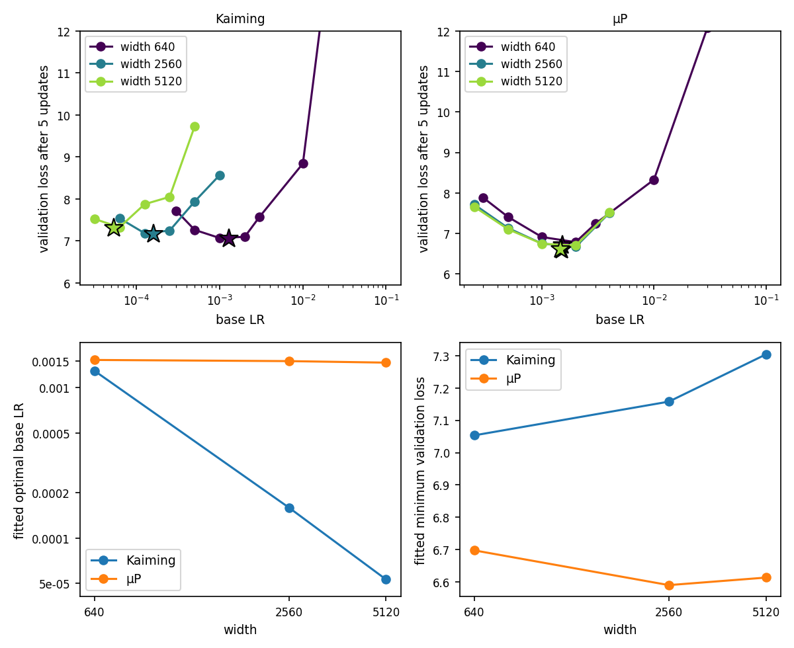

Each curve is a parabola in log LR through the lowest sampled loss and its neighbours. Sweeps are LR: loss.

| Prescription | Width | Fitted η\* | Fitted min loss | Sweep |
| --- | ---: | ---: | ---: | --- |
| Kaiming | 640 | 0.00129 | 7.054 | 0.0003: 7.720, 0.0005: 7.263, 0.001: 7.069, 0.002: 7.098, 0.003: 7.569, 0.01: 8.844, 0.03: 16.324, 0.1: 29.090 |
| Kaiming | 2,560 | 0.00016 | 7.158 | 6.25e−5: 7.539, 1.25e−4: 7.184, 2.5e−4: 7.245, 5e−4: 7.939, 1e−3: 8.571 |
| Kaiming | 5,120 | 0.00005 | 7.304 | 3.1e−5: 7.523, 6.25e−5: 7.325, 1.25e−4: 7.875, 2.5e−4: 8.049, 5e−4: 9.731 |
| µP | 640 | 0.00153 | 6.697 | 0.0003: 7.879, 0.0005: 7.404, 0.001: 6.909, 0.002: 6.784, 0.003: 7.237, 0.01: 8.327, 0.03: 12.085, 0.1: 23.865 |
| µP | 2,560 | 0.00150 | 6.590 | 2.5e−4: 7.710, 5e−4: 7.130, 1e−3: 6.746, 2e−3: 6.669, 4e−3: 7.506 |
| µP | 5,120 | 0.00147 | 6.613 | 2.5e−4: 7.655, 5e−4: 7.101, 1e−3: 6.744, 2e−3: 6.700, 4e−3: 7.518 |

µP transfers its base LR better: the fitted optimum changes by 4% over an 8× increase in width, and the best sampled LR is 0.002 at every width. Kaiming's falls 26× (about width^−1.6, faster than the 1/width predicted). µP also reaches lower loss (6.70, 6.59, 6.61 vs 7.05, 7.16, 7.30), and the gap grows with width (0.36, 0.57, 0.69).

### (b) Width probes

At each configuration's best sampled LR (Kaiming 0.001, 0.000125, 0.0000625; µP 0.002 at every width).

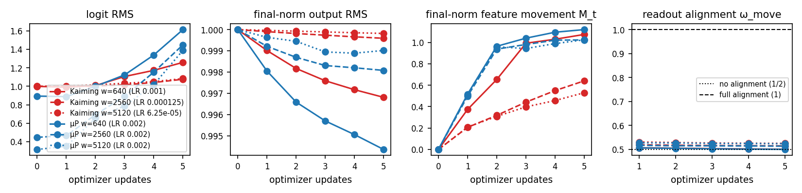

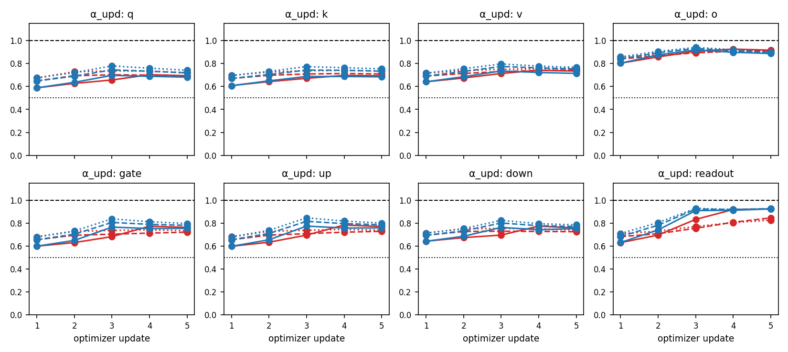

| Prescription | Width | Logit RMS, step 0 → 5 | M₅ | ω_move, step 5 | Mean α_upd, step 5 | Readout α_upd, step 5 |
| --- | ---: | --- | ---: | ---: | ---: | ---: |
| Kaiming | 640 | 1.00 → 1.26 | 1.07 | 0.501 | 0.76 | 0.92 |
| Kaiming | 2,560 | 1.00 → 1.08 | 0.64 | 0.515 | 0.75 | 0.85 |
| Kaiming | 5,120 | 1.00 → 1.08 | 0.53 | 0.525 | 0.76 | 0.83 |
| µP | 640 | 0.89 → 1.61 | 1.12 | 0.500 | 0.75 | 0.93 |
| µP | 2,560 | 0.45 → 1.45 | 1.02 | 0.514 | 0.78 | 0.93 |
| µP | 5,120 | 0.32 → 1.39 | 1.02 | 0.524 | 0.79 | 0.93 |

The final RMSNorm output has RMS 1.00 (0.99 at the lowest) everywhere, by construction.

- **Feature movement:** under µP it is width-independent (M₁ = 0.52, 0.50, 0.51; M₅ = 1.12, 1.02, 1.02), so feature learning is Θ(1). Under Kaiming at its best LR it shrinks with width (M₅ = 1.07, 0.64, 0.53), since the LR was cut 8–16×.
- **Logits:** under µP the initial logit RMS falls as m^(−1/2) (0.89, 0.45, 0.32), the Θ(n^(−1/2)) scale derived above, and is order one by update 5 (1.61, 1.45, 1.39). Under Kaiming it starts at 1.0 at every width.
- **Update alignment:** every matrix is between 1/2 and 1, rising over the first three updates then levelling. At update 5, q/k/v are at 0.68–0.77, feedforward at 0.72–0.80, attention output near 0.9, readout 0.83–0.93. Under µP the readout is about 0.93 at every width (near full); under Kaiming it falls with width (0.92, 0.85, 0.83).
- **ω_move:** 0.50–0.53 everywhere, the no-alignment scale, rising slightly with width.
- **Versus the derivation:** the Θ(n^(−1/2)) initial logits, width-independent feature movement under µP, and near-full alignment of the readout update and attention output agree. The assumption that both alignments are full does not: hidden-matrix α_upd is about 0.7–0.8, and ω_move is 1/2. With ω = 1/2 the initial readout does not amplify feature change; the logit change comes from the readout's own update, whose alignment is near full. So µP's flat optimal LR rests on the update alignments, not the initial-readout alignment.

### (c) Depth transfer

Width 64, one head, reference depth 2, BF16 autocast. At depth 2 (r = 1) all three rules coincide, so one sweep serves all. Standard-µP grids at depths 100 and 1,000 were extended upward after their first sweeps (the loss was still falling at the top of the grid).

Prediction (made when choosing the grids): standard µP needs a smaller LR as depth grows, while Depth-µP and CompleteP keep the depth-2 optimum.

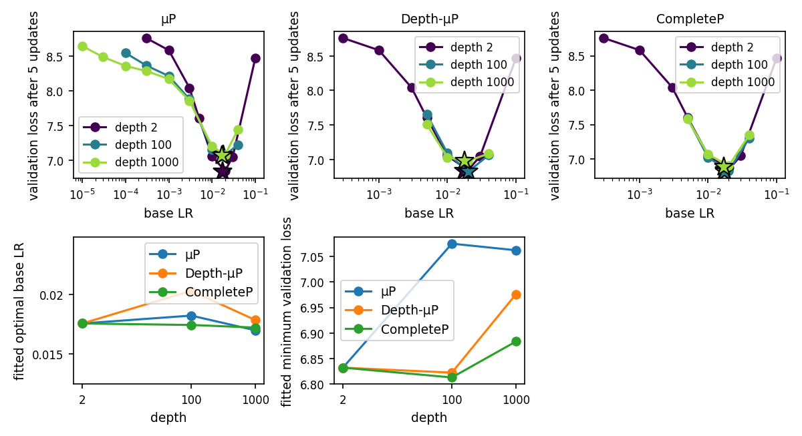

| Prescription | Depth | Fitted η\* | Fitted min loss | Sweep (LR: loss) |
| --- | ---: | ---: | ---: | --- |
| All three | 2 | 0.01738 | 6.832 | 3e−4: 8.759, 1e−3: 8.583, 3e−3: 8.042, 5e−3: 7.607, 0.01: 7.054, 0.02: 6.846, 0.03: 7.048, 0.1: 8.471 |
| Standard µP | 100 | 0.01806 | 7.075 | 1e−4: 8.544, 3e−4: 8.365, 1e−3: 8.211, 3e−3: 7.880, 0.01: 7.157, 0.02: 7.077, 0.04: 7.222 |
| Standard µP | 1,000 | 0.01681 | 7.062 | 1e−5: 8.644, 3e−5: 8.486, 1e−4: 8.357, 3e−4: 8.285, 1e−3: 8.169, 3e−3: 7.855, 0.01: 7.200, 0.02: 7.077, 0.04: 7.445 |
| Depth-µP | 100 | 0.02038 | 6.822 | 0.005: 7.656, 0.01: 7.092, 0.02: 6.823, 0.04: 7.064 |
| Depth-µP | 1,000 | 0.01768 | 6.976 | 0.005: 7.510, 0.01: 7.030, 0.02: 6.979, 0.04: 7.087 |
| CompleteP | 100 | 0.01726 | 6.813 | 0.005: 7.597, 0.01: 7.021, 0.02: 6.828, 0.04: 7.306 |
| CompleteP | 1,000 | 0.01704 | 6.883 | 0.005: 7.580, 0.01: 7.067, 0.02: 6.900, 0.04: 7.354 |

- **LR transfer:** the prediction that standard µP would lose transfer is not supported. All three keep their fitted optimum within 17% of the depth-2 value out to depth 1,000 (ratios 1.04, 0.97 standard; 1.17, 1.02 Depth-µP; 0.99, 0.98 CompleteP), and the best sampled LR is 0.02 throughout. The grid is coarse (factor 2), so differences under about 40% are not resolved.
- **Loss:** better LR transfer does not imply lower loss here, since transfer is about equal and the losses differ. At depth 100 the fitted minimum is 7.075 (standard) vs 6.822 (Depth-µP) and 6.813 (CompleteP); at depth 1,000, 7.062, 6.976 and 6.883. The ranking is CompleteP, Depth-µP, standard µP, and standard µP's loss worsens with depth (6.832 to 7.075).

### (d) Depth probes

At each prescription's best sampled LR (0.02 everywhere).

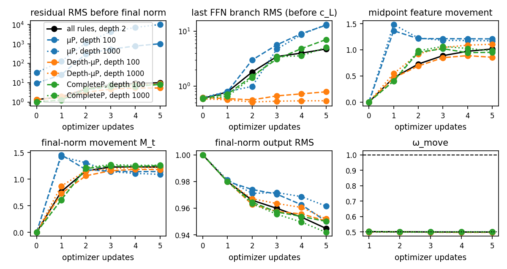

| Prescription | Depth | c_L | Residual RMS before the final norm, step 0 → 5 | Branch RMS (last block, before c_L), step 5 | M₅ final norm | M₅ midpoint | Logit RMS, step 5 |
| --- | ---: | ---: | --- | ---: | ---: | ---: | ---: |
| All three | 2 | 1 | 1.34 → 9.9 | 4.75 | 1.22 | 1.02 | 1.91 |
| Standard µP | 100 | 1 | 9.4 → 1,030 | 12.9 | 1.14 | 1.21 | 2.07 |
| Standard µP | 1,000 | 1 | 33 → 10,200 | 13.3 | 1.09 | 1.17 | 2.02 |
| Depth-µP | 100 | 0.141 | 1.34 → 5.3 | 0.79 | 1.18 | 0.86 | 1.83 |
| Depth-µP | 1,000 | 0.045 | 1.34 → 8.8 | 0.54 | 1.22 | 1.11 | 2.17 |
| CompleteP | 100 | 0.020 | 1.01 → 8.1 | 7.04 | 1.26 | 0.95 | 1.92 |
| CompleteP | 1,000 | 0.002 | 1.00 → 8.0 | 5.06 | 1.26 | 0.98 | 1.88 |

- **Normalized features can hide a growing residual stream.** Normalized features look the same for all three prescriptions at every depth (RMS 0.94–0.96 after five updates, movement 0.86–1.26, logit RMS 1.8–2.2). Yet under standard µP the residual stream grows from 9.9 at depth 2 to 1,030 at depth 100 and 10,200 at depth 1,000 (and starts at 9.4 and 33), while under Depth-µP and CompleteP it stays at about 5–9. The RMS normalization before each block hides this growth.
- **ω_move** is 0.50 for every prescription and depth through all five updates.
- **Link to (c):** the normalized signals are bounded and the feature change is order one for all three, consistent with all three transferring the LR. The unbounded residual stream under standard µP costs loss (0.18–0.25 above the depth-aware rules), not LR transfer, in this five-update test, which may be too short for its instability to move the optimum.

### Synthesis

In the five-update test µP transfers the base LR across width and Kaiming does not: µP's fitted optimum is 0.0015 at widths 640, 2,560 and 5,120 (4% spread) while Kaiming's falls 26× (0.00129 to 0.00005), and µP reaches lower loss (6.61 vs 7.30 at width 5,120). The probes agree with the derivation on what µP is built to fix: initial logits fall as n^(−1/2) and feature movement is width-independent (M₅ ≈ 1.0–1.1) under µP but shrinks under Kaiming at its best LR. They do not support the assumption of full alignment on both sides: hidden update alignment is about 0.7–0.8 and ω_move about 0.5, so µP works through the update alignments and the readout's own update. Across depth all three prescriptions kept the optimal LR (0.017–0.020) from depth 2 to 1,000, so LR transfer did not separate them; the loss did (CompleteP < Depth-µP < standard µP at depth 1,000: 6.88, 6.98, 7.06). The normalized features look alike while the standard-µP residual stream grows to about 10⁴, so similar normalized activations can hide a growing residual stream, and the cost shows in loss rather than the optimal LR within five updates.

## 4.2 Longer training (153.6M tokens)

Course model, AdamW, WD 0.1, β = (0.9, 0.95), linear decay with 1% warmup, clipping at 1 (2,344 updates). µP uses n₀ = 512: embedding G/n₀, readout G/√n₀, readout multiplier 1/m, hidden LR η/m. Depth runs: width 512, reference depth 8, r = L/8. The width-512 curve is the supplied Problem 1 sweep, the same model under both prescriptions (m = 1).

### (a) Transferring the reference LR

Prediction (reflected in the LR grids chosen before launching): Problem 1's best LR (0.003) transfers under µP but not under the baseline, whose optimum I expected to rise at narrower widths (so its grid extends to 0.024).

Final validation loss (LR: loss):

| Prescription | Width | Sweep |
| --- | ---: | --- |
| Baseline | 128 | 0.0015: 3.8826, 0.003: 3.6882, 0.006: **3.6241**, 0.012: 3.6363, 0.024: 3.6484 |
| Baseline | 256 | 0.0015: 3.4891, 0.003: **3.4094**, 0.006: 3.4126, 0.012: 3.4442, 0.024: 3.5200 |
| µP | 128 | 0.00075: 3.7658, 0.0015: 3.6510, 0.003: **3.6293**, 0.006: 3.6476, 0.012: 3.7062 |
| µP | 256 | 0.00075: 3.5125, 0.0015: 3.4126, 0.003: **3.4116**, 0.006: 3.4423, 0.012: 3.4900 |
| Both (supplied) | 512 | 0.0015: 3.2442, 0.003: **3.2291**, 0.006: 3.3056 |

Under µP the source LR transfers at both widths (0.003 is best sampled). Under the baseline it transfers to width 256 but not 128, where 0.006 is better by 0.064.

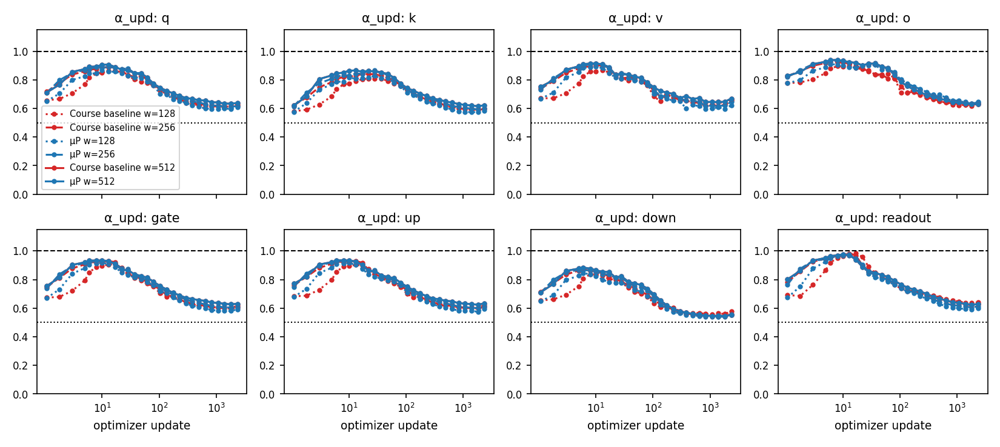

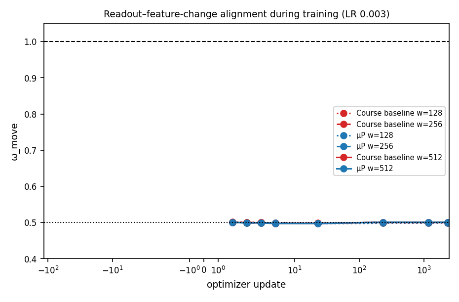

| Prescription | Width | Mean α_upd, update 5 → end | Readout α_upd, update 5 → end | ω_move range |
| --- | ---: | --- | --- | --- |
| Baseline | 128 | 0.77 → 0.62 | 0.86 → 0.64 | 0.497–0.500 |
| Baseline | 256 | 0.87 → 0.61 | 0.95 → 0.63 | 0.499–0.501 |
| µP | 128 | 0.85 → 0.60 | 0.92 → 0.60 | 0.497–0.501 |
| µP | 256 | 0.88 → 0.61 | 0.94 → 0.61 | 0.497–0.501 |
| Both | 512 | 0.89 → 0.63 | 0.95 → 0.63 | 0.497–0.501 |

α_upd keeps rising for the first 10–20 updates to a peak of about 0.85–0.97 (attention output, gate and up near 0.92; q, k, v, down 0.82–0.9; readout highest at 0.97–0.98), then decays to about 0.55–0.65 by the end. The shape is the same for both prescriptions and all widths; the narrowest baseline just rises more slowly. ω_move stays at 0.50 (0.497–0.503) at every checkpoint, width and prescription.

### (b) Transfer vs tuned performance

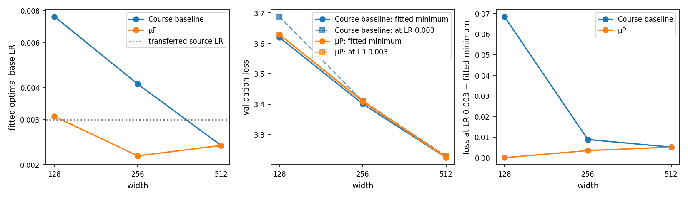

| Prescription | Width | Fitted η\* | Fitted min loss | Loss at LR 0.003 | Gap |
| --- | ---: | ---: | ---: | ---: | ---: |
| Baseline | 128 | 0.00759 | 3.6197 | 3.6882 | +0.0685 |
| Baseline | 256 | 0.00413 | 3.4006 | 3.4094 | +0.0088 |
| Baseline | 512 | 0.00238 | 3.2240 | 3.2291 | +0.0052 |
| µP | 128 | 0.00309 | 3.6293 | 3.6293 | +0.0000 |
| µP | 256 | 0.00217 | 3.4082 | 3.4116 | +0.0035 |
| µP | 512 | 0.00238 | 3.2240 | 3.2291 | +0.0052 |

µP transfers better (its optimum stays within 0.00217–0.00309 and the transferred LR costs at most 0.005; the baseline's falls from 0.00759 to 0.00238, about width^−0.84, costing 0.069 at width 128), but not lower after tuning: the baseline is slightly lower at widths 128 and 256 (3.6197 vs 3.6293; 3.4006 vs 3.4082), by 0.008–0.010, a few times the expected pairwise seed noise (about 0.0034, from A1 at 614M tokens). They are identical at 512. After five updates µP was better in both respects (loss lower by 0.36–0.69); over thousands of updates the tuned losses are nearly equal and the transfer benefit is concentrated at the narrowest width (baseline penalty 0.069, 0.009, 0.005 at widths 128, 256, 512).

### (c) Held-out width 1,024

**Prediction, recorded before inspecting any width-1,024 run:** a power law fitted to the fitted optima at widths 128, 256, 512 (bands ±1σ from seed-noise refits, SD 0.0024).

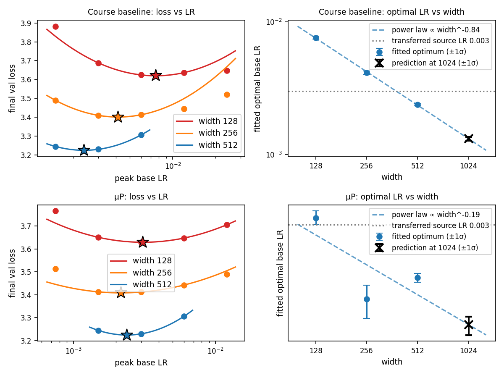

| Prescription | η\* at 128 | η\* at 256 | η\* at 512 | Power law | Predicted η\* at 1,024 |
| --- | ---: | ---: | ---: | --- | --- |
| Baseline | 0.00759 | 0.00413 | 0.00238 | ∝ width^−0.84 | 0.00132 (0.00127–0.00136) |
| µP | 0.00309 | 0.00217 | 0.00238 | ∝ width^−0.19 | 0.00194 (0.00185–0.00200) |

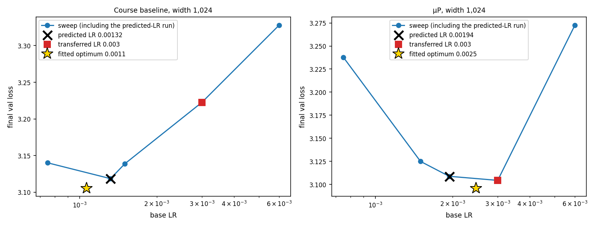

| Prescription | Predicted LR | Fitted local optimum | Best sampled LR (loss) | Loss at predicted (gap) | Loss at transferred 0.003 (gap) |
| --- | ---: | ---: | --- | --- | --- |
| Baseline | 0.00132 | 0.00106 | 0.00132 (3.1186) | 3.1186 (+0.0000) | 3.2226 (+0.1040) |
| µP | 0.00194 | 0.00247 | 0.003 (3.1044) | 3.1088 (+0.0044) | 3.1044 (+0.0000) |

Sweeps (LR: loss): baseline 0.00075: 3.1402, 0.00132: 3.1186, 0.0015: 3.1388, 0.003: 3.2226, 0.006: 3.3278; µP 0.00075: 3.2378, 0.0015: 3.1249, 0.00194: 3.1088, 0.003: 3.1044, 0.006: 3.2726.

The predictions are 25% above the fitted optimum for the baseline and 21% below it for µP, within the resolution of a factor-2 grid. Fitting the width dependence helps the baseline a lot (3.1186 vs 3.2226 for the transferred LR, which is about 3× too high at width 1,024) and does not help µP, where the transferred LR was the best run and the prediction is 0.0044 behind (within noise), since µP's optimum barely moves. After tuning at width 1,024 µP is 0.014 better (3.1044 vs 3.1186), the reverse of the small baseline advantage at widths 128 and 256.

### (d) Depth transfer

Width 512, depths 4, 8 (supplied; all rules coincide) and 16, LRs {0.0015, 0.003, 0.006}, parabola through the three points.

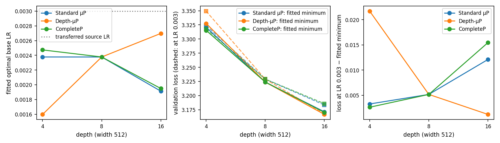

| Prescription | Depth | Sweep (LR: loss) | Fitted η\* | Fitted min loss | Loss at 0.003 |
| --- | ---: | --- | ---: | ---: | ---: |
| All three | 8 | 0.0015: 3.2442, 0.003: 3.2291, 0.006: 3.3056 | 0.00238 | 3.2240 | 3.2291 |
| Standard µP | 4 | 0.0015: 3.3335, 0.003: 3.3240, 0.006: 3.3724 | 0.00238 | 3.3207 | 3.3240 |
| Standard µP | 16 | 0.0015: 3.1750, 0.003: 3.1835, 0.006: 3.2496 | 0.00191 | 3.1714 | 3.1835 |
| Depth-µP | 4 | 0.0015: 3.3278, 0.003: 3.3493, 0.006: 3.4233 | 0.00160 | 3.3275 | 3.3493 |
| Depth-µP | 16 | 0.0015: 3.2029, 0.003: 3.1680, 0.006: 3.2337 | 0.00270 | 3.1668 | 3.1680 |
| CompleteP | 4 | 0.0015: 3.3329, 0.003: 3.3179, 0.006: 3.3704 | 0.00247 | 3.3153 | 3.3179 |
| CompleteP | 16 | 0.0015: 3.1761, 0.003: 3.1859, 0.006: 3.2755 | 0.00195 | 3.1704 | 3.1859 |

A depth correction does not clearly help. From depth 8 to 16 the fitted optimum moves ×0.80 (standard), ×1.13 (Depth-µP), ×0.82 (CompleteP); from 8 to 4, ×1.00, ×0.67, ×1.04. The loss gap from not retuning is +0.012, +0.001, +0.015 at depth 16 and +0.003, +0.022, +0.003 at depth 4, so Depth-µP transfers best at 16 and worst at 4. Tuned minimum losses differ by at most 0.007 at each depth (depth 16: 3.1714, 3.1668, 3.1704), about seed noise. A factor-2 change in depth is too small to separate the prescriptions, consistent with standard µP also keeping its LR in the five-update test.

### (e) Training regime

Logit RMS, final-norm output movement divided by its RMS (normalized feature movement) and ω_move on fixed inputs at update 5 and at the end, at the transferred and best sampled LRs. The pre-clip gradient norm is logged at nine checkpoints; update 1 is shown.

| Configuration | LR | Final loss | Logit RMS (5 / end) | Norm. feature movement (5 / end) | ω_move (5 / end) | Grad norm at update 1 (clip coef.) |
| --- | --- | ---: | --- | --- | --- | --- |
| Baseline, width 128 | 0.003 (transferred) | 3.6882 | 0.97 / 4.37 | 1.29 / 1.16 | 0.498 / 0.499 | 3.8 (0.26) |
| Baseline, width 128 | 0.006 (best) | 3.6241 | 0.95 / 4.48 | 1.37 / 1.19 | 0.497 / 0.499 | 3.8 (0.26) |
| Baseline, width 256 | 0.003 (best) | 3.4094 | 0.94 / 4.21 | 1.20 / 1.24 | 0.499 / 0.501 | 8.8 (0.11) |
| Baseline, width 1,024 | 0.003 (transferred) | 3.2226 | 1.00 / 4.18 | 1.33 / 1.91 | 0.500 / 0.501 | 33.8 (0.03) |
| Baseline, width 1,024 | 0.00132 (best) | 3.1186 | 0.96 / 3.97 | 1.33 / 1.44 | 0.499 / 0.502 | 33.8 (0.03) |
| µP, width 128 | 0.003 (best) | 3.6293 | 1.84 / 4.45 | 1.37 / 1.67 | 0.498 / 0.499 | 29.2 (0.03) |
| µP, width 256 | 0.003 (best) | 3.4116 | 1.28 / 4.29 | 1.25 / 1.51 | 0.499 / 0.501 | 25.3 (0.04) |
| µP, width 1,024 | 0.003 (best) | 3.1044 | 0.73 / 4.09 | 1.32 / 1.39 | 0.501 / 0.503 | 11.8 (0.08) |
| Standard µP, depth 16 | 0.003 (transferred) | 3.1835 | 0.95 / 4.17 | 1.30 / 1.45 | 0.500 / 0.501 | 19.0 (0.05) |
| Standard µP, depth 16 | 0.0015 (best) | 3.1750 | 0.96 / 4.00 | 1.32 / 1.30 | 0.500 / 0.500 | 19.0 (0.05) |
| Depth-µP, depth 4 | 0.003 (transferred) | 3.3493 | 0.95 / 4.29 | 1.35 / 1.45 | 0.500 / 0.500 | 14.7 (0.07) |
| Depth-µP, depth 4 | 0.0015 (best) | 3.3278 | 0.96 / 4.13 | 1.36 / 1.30 | 0.500 / 0.500 | 14.7 (0.07) |
| Depth-µP, depth 16 | 0.003 (best) | 3.1680 | 0.95 / 4.17 | 1.30 / 1.45 | 0.500 / 0.501 | 19.0 (0.05) |
| CompleteP, depth 16 | 0.003 (transferred) | 3.1859 | 0.95 / 4.18 | 1.30 / 1.45 | 0.500 / 0.501 | 19.0 (0.05) |
| CompleteP, depth 16 | 0.0015 (best) | 3.1761 | 0.96 / 3.97 | 1.32 / 1.30 | 0.500 / 0.501 | 19.0 (0.05) |

The supplied width-512 reference (baseline, also µP) starts at 15.8 (coefficient 0.063), with the embedding 98% of the squared gradient norm at the start and 3% by the end.

- **Alignment assumptions:** update–input alignment is close to full early (α_upd 0.85–0.98 within the first 10–20 updates at every width, both prescriptions) and relaxes to about 0.6 by the end, so full alignment describes early updates only. The readout–feature-change alignment is never near full: ω_move is 0.50 at every width, depth, prescription and stage.
- **Larger early transients, better final loss:** yes. At width 128, µP has a much larger first gradient (29.2 vs 3.8; clip coefficient 0.03 vs 0.26) and larger logit change by update 5 (1.84 vs 0.97), yet ends within 0.01 of the baseline's tuned loss (3.6293 vs 3.6241). Conversely, at width 1,024 the baseline at the transferred and best LRs looks the same after five updates (logit RMS 1.00 vs 0.96, movement 1.33 vs 1.33), but the transferred run ends with much larger feature movement (1.91 vs 1.44) and a loss 0.104 worse. End-of-training feature movement separates them, not the early transients.
- **Does an LR shift alone show the model left the stable regime?** No. Standard µP's optimum moves ×0.8 from depth 8 to 16 while its logits, feature movement, α_upd and ω_move match the other depths; the baseline's optimum moves 3× across widths 128–512 while its alignment curves match at every width. The one configuration that stands out in the diagnostics (baseline, width 1,024, transferred LR) is also clearly worse in loss.
- **Normalization and clipping:** the update-1 gradient norm depends on width in opposite directions: for the baseline it grows with width (3.8, 8.8, 15.8, 33.8 at widths 128, 256, 512, 1,024; clip coefficient 0.26 down to 0.03), for µP it falls (29.2, 25.3, 15.8, 11.8). The embedding dominates early, and clipping is active only for roughly the first 20 updates (coefficient 1.0 by update 234). It affects early dynamics differently for the two prescriptions but cannot explain late differences; I ran no clipping or normalization ablations.
- **LR–WD coupling:** WD is fixed at 0.1. Under µP the hidden decay per step, (η/m)λ, is 4× larger at width 128 and 2× smaller at 1,024 than at 512, while for the baseline it is the same at every width. Problem 2 found tuning WD at 153.6M tokens worth 0.045 at width 512 (LR 0.0015, WD 1.6), several times the largest prescription difference after LR tuning (0.010), so a fixed WD could mask or exaggerate the comparison.

### Synthesis

At 153.6M tokens the µP advantage seen after five updates mostly shrinks. Problem 1's best LR (0.003) transfers under µP from width 128 to 1,024, where the fitted optimum stays between 0.0022 and 0.0031, while the baseline's falls (0.0076, 0.0041, 0.0024 at widths 128, 256, 512) and the transferred LR costs it 0.069 at width 128 and 0.104 at width 1,024. Tuned losses are nearly equal: the baseline is lower by 0.008–0.010 at widths 128 and 256, µP lower by 0.014 at width 1,024. Fitting the baseline's width dependence works for the held-out width (the predicted LR was the best sampled run, 0.104 better than direct transfer) and adds nothing for µP. Depth corrections did not clearly help at depths 4 and 16 (the optimum moved by at most 33%, tuned losses differ by at most 0.007). The diagnostics show why the derivation's alignment assumptions are only partly right: update–input alignment is near full early (0.85–0.98 at updates 10–20) and relaxes to about 0.6, and the readout–feature-change alignment stays at 1/2 at every width, depth and stage. An LR shift alone does not show a model has left the stable regime, and the early gradient norm and clipping depend on width in opposite directions for the two prescriptions. Because WD was fixed and Problem 2 showed tuning it matters more at this budget (0.045) than the prescription differences, a joint LR and WD sweep would be needed for a clean comparison.
