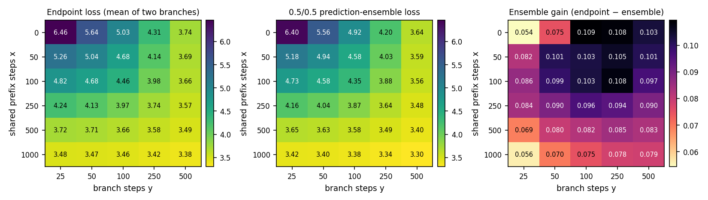
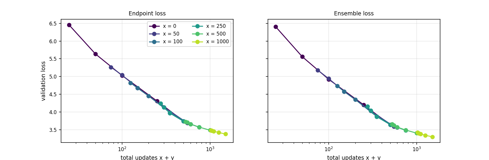
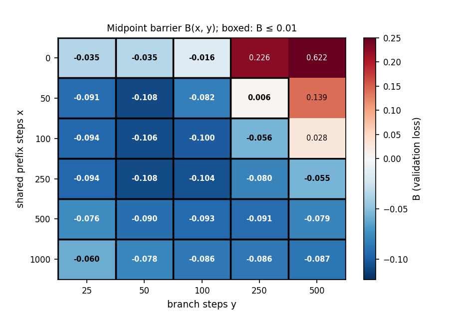
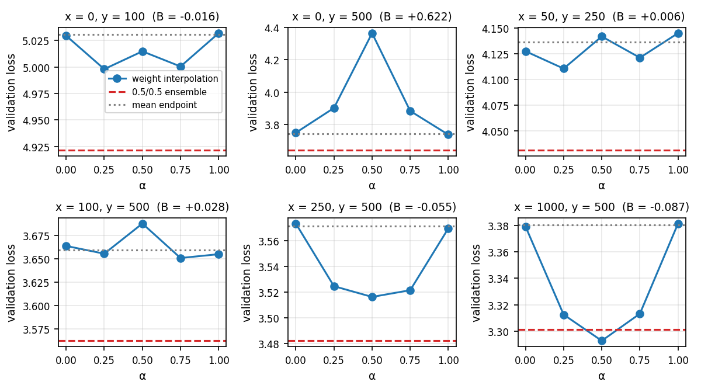

# Problem 1: Mode connectivity

Midpoint barrier B(θ₁, θ₂) = L((θ₁+θ₂)/2) − (L(θ₁)+L(θ₂))/2; weight averaging works when B ≤ 0.01.
Setup: d8, 614M-token schedule, constant LR after warmup, AdamW. Prefix of x steps, two branches (batch-order seeds 1, 2) of 500 more steps; x ∈ {0, 50, 100, 250, 500, 1000}, y ∈ {25, 50, 100, 250, 500}.

## Predictions (written before looking at the data)

- B(x, y) as a function of x and y:
- Where the ensemble beats the endpoints and by how much:

## (a) Endpoint and ensemble losses

- **Endpoints depend on total updates only.** The curves for every x fall on one line in x + y, so forking at x and training y further steps costs nothing relative to a single run of x + y steps. The two branches of each cell end within 0.03 of each other.
- **The ensemble always beats the endpoints**, by 0.054 to 0.109 in loss (mean of the two endpoints minus the ensemble). The gain is largest at moderate y (50–250) for x ≤ 250 (about 0.10) and smallest at the grid's edges: the very first steps (x = 0, y = 25: 0.054) and the late, long-prefix cells (x = 1000: 0.056–0.079).

## (b) Weight averaging and the barrier

| x | y | endpoint 1 | endpoint 2 | average | ensemble | B(x, y) | B ≤ 0.01 |
| ---: | ---: | ---: | ---: | ---: | ---: | ---: | :---: |
| 0 | 25 | 6.4534 | 6.4633 | 6.4232 | 6.4040 | -0.0352 | yes |
| 0 | 50 | 5.6239 | 5.6485 | 5.6017 | 5.5614 | -0.0345 | yes |
| 0 | 100 | 5.0295 | 5.0319 | 5.0148 | 4.9213 | -0.0159 | yes |
| 0 | 250 | 4.3130 | 4.3070 | 4.5359 | 4.2015 | +0.2259 | no |
| 0 | 500 | 3.7489 | 3.7371 | 4.3647 | 3.6398 | +0.6217 | no |
| 50 | 25 | 5.2575 | 5.2702 | 5.1728 | 5.1816 | -0.0911 | yes |
| 50 | 50 | 5.0487 | 5.0361 | 4.9343 | 4.9412 | -0.1081 | yes |
| 50 | 100 | 4.6793 | 4.6801 | 4.5977 | 4.5771 | -0.0820 | yes |
| 50 | 250 | 4.1274 | 4.1450 | 4.1418 | 4.0308 | +0.0056 | yes |
| 50 | 500 | 3.6995 | 3.6887 | 3.8335 | 3.5929 | +0.1394 | no |
| 100 | 25 | 4.8191 | 4.8221 | 4.7266 | 4.7343 | -0.0940 | yes |
| 100 | 50 | 4.6714 | 4.6807 | 4.5698 | 4.5769 | -0.1063 | yes |
| 100 | 100 | 4.4649 | 4.4463 | 4.3554 | 4.3527 | -0.1002 | yes |
| 100 | 250 | 3.9952 | 3.9705 | 3.9267 | 3.8751 | -0.0562 | yes |
| 100 | 500 | 3.6636 | 3.6548 | 3.6875 | 3.5624 | +0.0283 | no |
| 250 | 25 | 4.2365 | 4.2430 | 4.1457 | 4.1554 | -0.0940 | yes |
| 250 | 50 | 4.1315 | 4.1352 | 4.0257 | 4.0438 | -0.1077 | yes |
| 250 | 100 | 3.9699 | 3.9635 | 3.8622 | 3.8705 | -0.1045 | yes |
| 250 | 250 | 3.7405 | 3.7347 | 3.6575 | 3.6433 | -0.0801 | yes |
| 250 | 500 | 3.5736 | 3.5698 | 3.5163 | 3.4820 | -0.0554 | yes |
| 500 | 25 | 3.7257 | 3.7213 | 3.6477 | 3.6544 | -0.0758 | yes |
| 500 | 50 | 3.7124 | 3.7012 | 3.6163 | 3.6272 | -0.0904 | yes |
| 500 | 100 | 3.6624 | 3.6524 | 3.5642 | 3.5752 | -0.0932 | yes |
| 500 | 250 | 3.5774 | 3.5751 | 3.4849 | 3.4915 | -0.0914 | yes |
| 500 | 500 | 3.4852 | 3.4888 | 3.4080 | 3.4038 | -0.0790 | yes |
| 1000 | 25 | 3.4772 | 3.4802 | 3.4191 | 3.4224 | -0.0596 | yes |
| 1000 | 50 | 3.4719 | 3.4735 | 3.3945 | 3.4031 | -0.0782 | yes |
| 1000 | 100 | 3.4591 | 3.4605 | 3.3740 | 3.3848 | -0.0858 | yes |
| 1000 | 250 | 3.4232 | 3.4229 | 3.3369 | 3.3450 | -0.0861 | yes |
| 1000 | 500 | 3.3790 | 3.3813 | 3.2930 | 3.3016 | -0.0872 | yes |

- **26 of 30 cells satisfy B ≤ 0.01.** The four that fail are (x, y) = (0, 250), (0, 500), (50, 500) and (100, 500), with B = 0.226, 0.622, 0.139 and 0.028. Cell (50, 250) passes narrowly (B = 0.006).
- **Averaging mostly helps.** Most B values are negative, down to −0.108 at (50, 50): the average is better than both endpoints, not just no worse.
- **Where it fails:** runs that share none or little of the prefix and then train a long time apart. With x = 0 the barrier is negative for y ≤ 100 and jumps to 0.226 at y = 250 and 0.622 at y = 500 (the two runs share only their initialization). The failure region shrinks as x grows: it ends at y = 500 for x = 50 and 100, and no cell with x ≥ 250 fails. It looks governed by the ratio y/x, roughly y ≥ 5x.
- **Where it works best:** short branches (y ≤ 100) from any x ≥ 50, and every cell with x ≥ 250 (B between −0.055 and −0.108).
- **Weight average versus ensemble:** the averaged weights beat the ensemble in 16 of 30 cells, mostly the long-prefix, short-branch ones (x ≥ 250 with y ≤ 250, and x = 1000 throughout).

## (c) Interpolation curves

| x | y | α = 0.0 | α = 0.25 | α = 0.5 | α = 0.75 | α = 1.0 | ensemble |
| ---: | ---: | ---: | ---: | ---: | ---: | ---: | ---: |
| 0 | 100 | 5.0295 | 4.9980 | 5.0148 | 5.0005 | 5.0319 | 4.9213 |
| 0 | 500 | 3.7489 | 3.9020 | 4.3647 | 3.8835 | 3.7371 | 3.6398 |
| 50 | 250 | 4.1274 | 4.1105 | 4.1418 | 4.1211 | 4.1450 | 4.0308 |
| 100 | 500 | 3.6636 | 3.6553 | 3.6875 | 3.6507 | 3.6548 | 3.5624 |
| 250 | 500 | 3.5736 | 3.5247 | 3.5163 | 3.5215 | 3.5698 | 3.4820 |
| 1000 | 500 | 3.3790 | 3.3127 | 3.2930 | 3.3133 | 3.3813 | 3.3016 |

- **x = 0, y = 500 (B = +0.622):** a clear barrier. The loss rises from 3.75 at the endpoints to 4.36 at α = 0.5, so the two runs are in different basins. Their ensemble (3.64) is still better than either endpoint.
- **x = 0, y = 100 (B = −0.016):** after only 100 steps from the same initialization the line between the runs is flat or slightly better than the endpoints.
- **x = 50, y = 250 and x = 100, y = 500 (B = +0.006, +0.028):** near the boundary the curve is almost flat with a small bump at α = 0.5.
- **x = 250, y = 500 and x = 1000, y = 500 (B = −0.055, −0.087):** a clear dip with the minimum at α = 0.5 and a roughly quadratic shape, as expected inside one basin. At x = 1000 the midpoint (3.293) is below the ensemble (3.302).
- **Midpoint versus ensemble:** the ensemble is better than the midpoint where there is a barrier or the curve is flat (x = 0 and the small-x cells), and the midpoint is better where the curve dips (x ≥ 250 with short branches, and x = 1000). Averaging weights cannot beat the ensemble inside the failing cells, but in a shared basin it can match or exceed it at one forward pass instead of two. The curve's minimum is not always at α = 0.5: at (0, 100) and (50, 250) the α = 0.25 and 0.75 points are lower than the midpoint.

## (d) What controls whether runs share a basin

Pending: variants over learning rate, batch size and schedule have not been run yet.

## Synthesis
