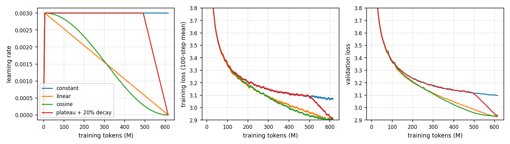
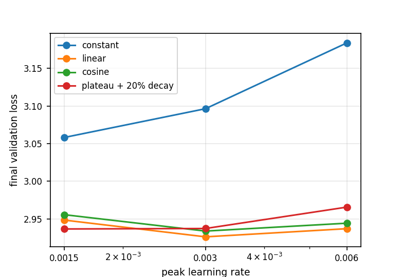
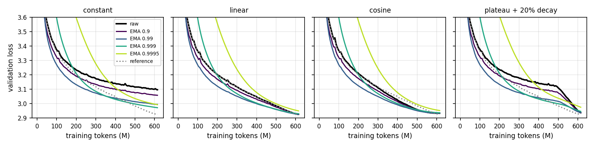
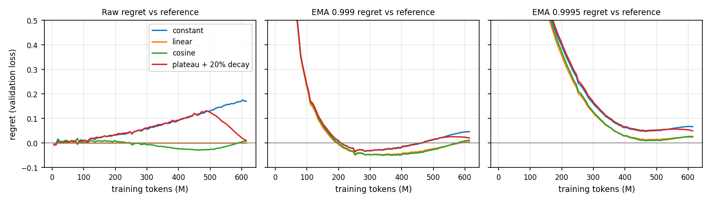
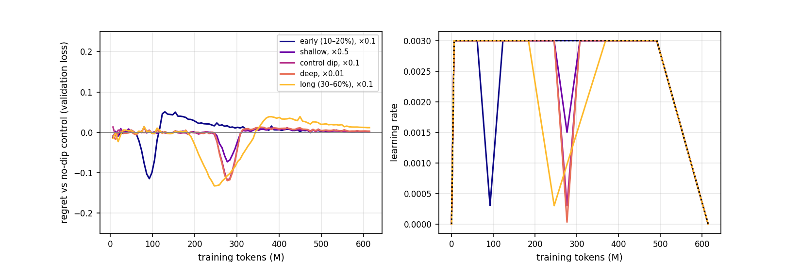
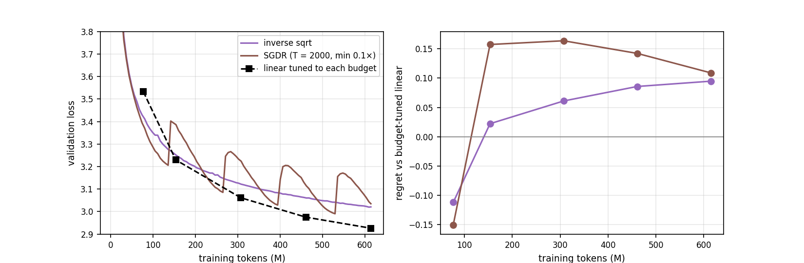

# Problem 2: River-valley dynamics

Default d8, 614M tokens, AdamW. Regret R_M(t) = L(θ_t^M) − L(θ_t^ref), compared at equal token counts. EMA decays tracked during every run (evaluation only): 0.9, 0.99, 0.999, 0.9995 (timescales of about 10, 100, 1,000 and 2,000 updates of the 9,375).

## (a) Schedules

- **Constant after warmup** keeps decreasing slowly but is 0.17 above the best run at the end (3.097 vs 2.926). Its gap to the decayed runs opens steadily from about 100M tokens, as the decayed schedules' LRs fall.
- **Linear and cosine** are almost identical until about 150M tokens, then cosine is slightly lower (by up to 0.03 around 400M tokens) while its LR is lower; they converge near the end and linear finishes ahead (2.926 vs 2.934).
- **Plateau + 20% decay** tracks the constant curve until the decay starts at about 490M tokens (80%), then drops about 0.18 in the last 120M tokens and ends at 2.937, 0.011 above linear. The drop is almost entirely made in the decay phase, as the river-valley picture predicts: the high-LR plateau hides progress that annealing reveals.
- **Peak LR.** 3e-3 is best for linear (2.926) and cosine (2.934). For plateau + decay 1.5e-3 and 3e-3 tie (2.9365 vs 2.9371), and 6e-3 is worse (2.966). Constant prefers the lower LR (3.058 at 1.5e-3, 3.097 at 3e-3, 3.184 at 6e-3): without annealing a larger LR leaves more oscillation.
- **Reference for (b):** linear at 3e-3, the lowest final validation loss (2.9261).

Reference: linear lr=0.003, final 2.9261

| Schedule | Peak LR | Final val loss | EMA 0.9 | EMA 0.99 | EMA 0.999 | EMA 0.9995 | Raw regret | Best-EMA regret |
| --- | ---: | ---: | ---: | ---: | ---: | ---: | ---: | ---: |
| constant | 0.0015 | 3.0582 | 3.0305 | 2.9804 | 2.9617 | 2.9829 | +0.1321 | +0.0356 |
| constant | 0.003 | 3.0965 | 3.0580 | 2.9948 | 2.9719 | 2.9926 | +0.1704 | +0.0458 |
| constant | 0.006 | 3.1839 | 3.1311 | 3.0529 | 3.0303 | 3.0547 | +0.2579 | +0.1042 |
| linear | 0.0015 | 2.9483 | 2.9484 | 2.9485 | 2.9523 | 2.9685 | +0.0223 | +0.0223 |
| linear | 0.003 | 2.9261 | 2.9261 | 2.9263 | 2.9301 | 2.9499 | +0.0000 | +0.0000 |
| linear | 0.006 | 2.9369 | 2.9369 | 2.9371 | 2.9431 | 2.9747 | +0.0108 | +0.0108 |
| cosine | 0.0015 | 2.9555 | 2.9555 | 2.9556 | 2.9583 | 2.9707 | +0.0295 | +0.0295 |
| cosine | 0.003 | 2.9337 | 2.9337 | 2.9337 | 2.9368 | 2.9524 | +0.0076 | +0.0076 |
| cosine | 0.006 | 2.9442 | 2.9442 | 2.9442 | 2.9486 | 2.9741 | +0.0181 | +0.0181 |
| plateau + 20% decay | 0.0015 | 2.9365 | 2.9366 | 2.9368 | 2.9433 | 2.9676 | +0.0105 | +0.0105 |
| plateau + 20% decay | 0.003 | 2.9371 | 2.9372 | 2.9374 | 2.9464 | 2.9753 | +0.0111 | +0.0111 |
| plateau + 20% decay | 0.006 | 2.9656 | 2.9657 | 2.9656 | 2.9839 | 3.0250 | +0.0395 | +0.0395 |

## (b) EMA and regret

- **EMA helps a lot without a decay, and not at all with one.** For constant LR 3e-3 the final loss falls from 3.097 (raw) to 2.972 with EMA 0.999, which removes 0.125 of the 0.170 gap to the reference. At 1.5e-3 it falls from 3.058 to 2.962. For linear, cosine and plateau + decay the raw weights are already at the valley floor, and any EMA is equal or worse at the end (EMA 0.999 is 0.003 to 0.009 worse, EMA 0.9995 is 0.02 to 0.04 worse) because it averages in older, higher-loss iterates.
- **Timescale.** 0.999 (about 1,000 updates) is best for constant LR. 0.9 and 0.99 are too short to average out the oscillation (3.058 and 2.995 at 3e-3), and 0.9995 is too long: it lags the downward trend. The EMA is not bias-corrected, so the 0.999 and 0.9995 curves are far above the raw loss for the first 200M and 450M tokens (they still contain the initialization), and the regret there is meaningless.
- **Mid-training.** Between about 200M and 450M tokens the EMA 0.999 of every schedule is below the reference's raw loss (regret down to −0.05): an EMA of a high-LR run estimates the annealed loss without annealing.
- **What gap remains.** After EMA the constant run is still 0.046 above the reference (27% of the original gap), and EMA 0.9995 does worse (0.067). Averaging closes about three quarters of the gap between schedules, not all of it. The gap between the decayed schedules themselves (0.008–0.011) is unchanged by averaging.

## (c) Dip and rewarmup

| Dip | min regret (tokens M) | final regret |
| --- | ---: | ---: |
| early (10–20%), ×0.1 | -0.1148 (92) | +0.0012 |
| shallow, ×0.5 | -0.0731 (277) | +0.0010 |
| control dip, ×0.1 | -0.1189 (277) | +0.0015 |
| deep, ×0.01 | -0.1198 (277) | +0.0030 |
| long (30–60%), ×0.1 | -0.1328 (246) | +0.0116 |

Control: plateau + 20% decay at 3e-3 with no dip, all runs sharing the same final cooldown. The regret is measured against the control's raw validation loss at the same token count.

- **The improvement appears at once and does not survive rewarmup.** Each dip lowers the validation loss by 0.07 to 0.13 within about 50M tokens, and the gain disappears as the LR returns to 3e-3. After the final cooldown every run ends within 0.003 of the control, except the long dip (+0.012).
- **Depth.** The size of the improvement saturates with depth: ×0.5 gives −0.073, ×0.1 gives −0.119 and ×0.01 gives −0.120. Going from ×0.1 to ×0.01 adds nothing, consistent with reaching the valley floor once the oscillation is small enough.
- **Duration.** The longer 30–60% dip gives the largest improvement (−0.133) but recovers more slowly, ending at +0.012 because 30% of training was spent at a lower LR than the control.
- **Timing.** The early dip at 10–20% gives −0.115 at its bottom and then overshoots: after rewarming the loss is +0.05 above the control, decaying to +0.001 over the rest of training.
- **Predictability.** The depth and duration of the regret follow the LR profile: the loss tracks the instantaneous learning rate, dropping when it dips and returning when it rewarms, and the end result is fixed by the final cooldown rather than the earlier history. The final regret after a short dip is within seed-level noise.

## (d) Horizon-free schedules

| Budget (tokens) | linear tuned | invsqrt | regret | SGDR | regret |
| --- | ---: | ---: | ---: | ---: | ---: |
| 77M | 3.5332 | 3.4214 | -0.1118 | 3.3830 | -0.1502 |
| 154M | 3.2296 | 3.2518 | +0.0222 | 3.3868 | +0.1572 |
| 307M | 3.0613 | 3.1223 | +0.0609 | 3.2249 | +0.1636 |
| 461M | 2.9752 | 3.0609 | +0.0857 | 3.1173 | +0.1420 |
| 614M | 2.9261 | 3.0207 | +0.0947 | 3.0350 | +0.1089 |

Warmup is fixed at 94 updates for both horizon-free runs. The budget-tuned linear runs use the default 1% warmup, which is only 11 updates at the 77M budget; that run is probably handicapped and the −0.11 and −0.15 entries at that budget should not be trusted.

- **Inverse square root** has regret that grows with budget: +0.022 at 154M, +0.061 at 307M, +0.086 at 461M and +0.095 at 614M. It cannot reach the loss that a budget-tuned decay to zero does, and the loss falls more slowly than the optimal anneal.
- **SGDR** has a sawtooth: each restart raises the loss by about 0.15 and it then decays again over the 2,000-update cycle. Measured at the budgets, its regret is +0.11 to +0.16 because those budgets fall mid-cycle. At the end of a cycle (low LR) it is close to the tuned curve: 3.085 at 265M and 3.029 at 394M against 3.11 and 3.01 for tuned linear (interpolated between the measured budgets), and 2.990 at 530M against 2.953.
- **Verdict.** If the budget is unknown, neither is a replacement for annealing: both stay 0.02–0.1 above a tuned schedule once the budget exceeds about 150M tokens. SGDR is a useful alternative only if you can stop at a cycle end, where it comes within 0.02–0.04 of tuned linear. Inverse square root is the more predictable of the two.

## Synthesis

The river-valley picture fits our runs. A constant LR leaves the model 0.17 above what annealing reaches, and almost all of the gap is closed in the last 20% of training when the LR decays (plateau + decay) or by averaging the iterates (EMA 0.999, three quarters of the gap), which both estimate the position at the bottom of the valley. A temporary dip shows the same thing from the other side: the loss falls as soon as the LR falls and rises when it is restored, and only the final cooldown determines the result, so dips are free but also useless. Schedules that decay to zero reach similar final losses (2.926–2.937), with linear best and cosine slightly ahead mid-training, and the best peak LR (about 3e-3) is flat for them. Horizon-free schedules give up 0.02–0.1 in loss for not knowing the budget, with SGDR competitive only at cycle ends.
