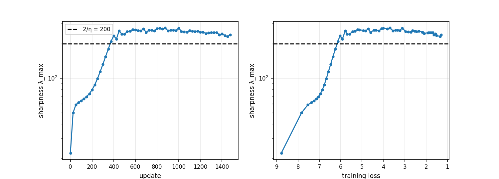
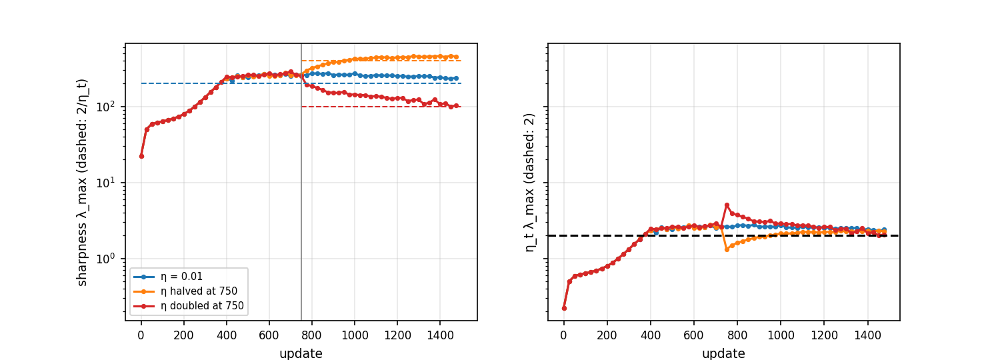
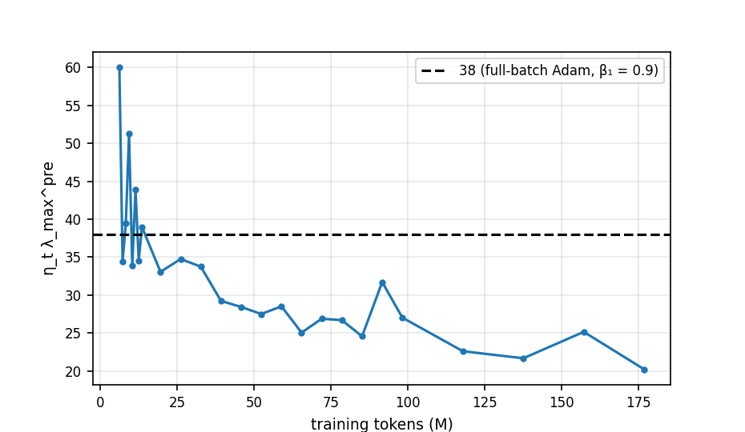
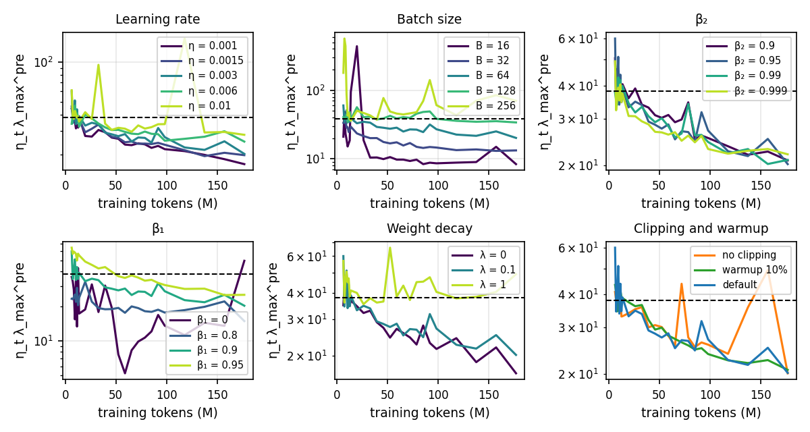

# Problem 3: The edge of stability

Thresholds: SGD η·λ_max → 2; AdamW with β₁ = 0.9 and a frozen preconditioner, η·λ_max^pre → 2(1+β₁)/(1−β₁) = 38 (and 2, 18 and 78 for β₁ = 0, 0.8 and 0.95). λ_max is measured on a fixed probe: the 32 training sequences themselves in part (a), 64 held-out sequences in parts (b) and (c).

## (a) Full-batch replication

### i. The clean case (N = 32, η = 0.01, 1,500 updates, 16× embedding initialization)

- **Progressive sharpening.** λ_max starts at 22 (η·λ_max = 0.22) and climbs steadily as the loss falls from 8.8 to 6, crossing 2/η = 200 at update 375.
- **Hovering at the edge.** After the crossing λ_max stays at 250–270 for the rest of the run (median η·λ_max = 2.56 from 100 updates after the crossing), a little above 2/η, and then drifts down slowly to about 240 while the loss goes from 6 to 1.3.
- **The loss stops decreasing monotonically.** The training loss never rises before the crossing (0% of updates) and rises on 40% of updates after it, while the long-run trend is still downward.
- **Match with the predictions.** This is the pattern in Cohen et al.: sharpening up to 2/η, then hovering there with non-monotone loss. The one difference is the level: it hovers at about 1.25–1.3 × 2/η rather than just at it, and never falls back under 2/η, so it does not leave the edge.

### ii. Changing η mid-run

| Run | λ_max, updates 600–750 | λ_max, updates 1100–1500 | η_t·λ_max after | Threshold 2/η_t |
| --- | ---: | ---: | ---: | ---: |
| η = 0.01 | 262 | 250 | 2.50 | 200 |
| η halved at 750 | 258 | 449 | 2.25 | 400 |
| η doubled at 750 | 266 | 123 | 2.46 | 100 |

- **Expected from the theory:** λ_max follows 2/η_t, up to about 400 after halving and down to about 100 after doubling.
- **Both runs move to the new edge.** λ_max rises 1.7× after halving and falls to 0.46× after doubling, so η_t·λ_max ends at 2.25 and 2.46, close to the 2.5 of the clean case.
- **The response is not symmetric.** Halving η drops η·λ_max to 1.3, below the edge, and sharpness has to rise again by progressive sharpening, which takes about 250 updates (λ_max reaches about 420 around update 1000). Doubling η pushes η·λ_max to 5, above the edge, and λ_max falls within about 100 updates (to about 150 by update 850) through self-stabilization, then keeps creeping down to 123. Reducing sharpness is much faster than raising it.

## (b) Minibatch AdamW

Base recipe: η = 3e-3, batch 64, constant LR after warmup, 0.32 epochs (197M tokens).

- **It does not stay at 38.** After warmup the quantity starts at 35–60, dips under 38 by about 20M tokens, and then drifts steadily down to about 20 by 175M tokens.
- **So no: minibatch AdamW does not train at the edge** of the full-batch Adam threshold. At 100–190M tokens it sits at 22 (58% of 38) and is still falling. The early values above 38 are the transient right after warmup.

## (c) Hyperparameter exploration

Median λ_max^pre and η·λ_max^pre over 100–190M tokens (about 60% of the run), one change at a time from the base recipe (η = 3e-3, B = 64, β₁ = 0.9, β₂ = 0.95, λ = 0.1). λ_max^pre is the top eigenvalue of D^(-1/2) H D^(-1/2); it is in the thousands because the preconditioner divides by a small √v̂, so it is only meaningful relative to 1/η:

| Change | Value | λ_max^pre | η·λ_max^pre | Final train loss |
| --- | --- | ---: | ---: | ---: |
| Base |  | 7,382 | 22.1 | 3.235 |
| Learning rate | 1e-3 | 19,160 | 19.2 | 3.246 |
|  | 1.5e-3 | 13,462 | 20.2 | 3.231 |
|  | 6e-3 | 4,460 | 26.8 | 3.305 |
|  | 1e-2 | 2,946 | 29.5 | 3.378 |
| Batch size | 16 | 2,972 | 8.9 | 3.281 |
|  | 32 | 4,454 | 13.4 | 3.295 |
|  | 128 | 11,704 | 35.1 | 3.201 |
|  | 256 | 23,449 | 70.3 | 3.329 |
| β₂ | 0.9 | 7,414 | 22.2 | 3.240 |
|  | 0.99 | 7,193 | 21.6 | 3.238 |
|  | 0.999 | 7,474 | 22.4 | 3.255 |
| β₁ | 0 | 4,645 | 13.9 | 3.405 |
|  | 0.8 | 6,387 | 19.2 | 3.246 |
|  | 0.95 | 8,910 | 26.7 | 3.255 |
| Weight decay | 0 | 6,773 | 20.3 | 3.200 |
|  | 1.0 | 13,129 | 39.4 | 3.507 |
| Gradient clipping | off | 9,935 | 29.8 | 3.251 |
| Warmup | 10% (vs 3.125%) | 7,430 | 22.3 | 3.241 |

- **Batch size matters most, and in the direction the noise picture predicts.** η·λ_max^pre grows from 8.9 at B = 16 to 70 at B = 256 (about B^0.75), so larger batches sit at or above 38 and small batches well below it. Smaller batches add gradient noise that keeps the model away from the edge; large batches approach the full-batch behaviour (and the early transient of 100+ for B = 256 and 16 shows how noisy the measurement is).
- **Learning rate has a weak, monotone effect.** A 10× larger LR raises η·λ_max^pre only 1.5× (19 to 29.5): sharpness falls as η rises (λ_max^pre scales roughly like η^-0.8), so the product moves little. The quantity is closer to constant than λ_max itself, which supports η·λ_max as the natural variable.
- **β₂ has no effect** (21.6–22.4 over a 1,000× range in 1 − β₂), and so does warmup length.
- **β₁ moves it up, but far less than the threshold.** The measured value grows 13.9, 19.2, 22.1, 26.7 for β₁ = 0, 0.8, 0.9, 0.95, while 2(1+β₁)/(1−β₁) grows 2, 18, 38, 78. The ratio to the threshold goes 6.9, 1.07, 0.58, 0.34: at β₁ = 0 the run is far above the quadratic threshold of 2 yet trains stably (the preconditioner and gradients are not frozen), and with large β₁ it sits well below. Momentum does raise the stable sharpness, as in the lecture's full-batch picture, but not by the full factor in the minibatch regime.
- **Weight decay and clipping.** λ = 1 gives 39 but a much worse loss (3.507, so a different regime), and removing the gradient clip raises it to 29.8.
- **What decides whether the run is at the edge.** The tendency to be near the threshold goes up with batch size, β₁ and LR, and goes down with noise (small batches). Even where it does reach 38 (B ≥ 128, λ = 1) it does not hold there.

## Synthesis

Full-batch training on a tiny set reproduces the edge of stability: sharpness rises until η·λ_max reaches about 2.5, and then holds there, with the loss still falling but no longer monotonically. When η is changed the sharpness moves to the new 2/η, quickly when it must go down and slowly when it can go up. The minibatch AdamW setting we actually use is different: η·λ_max^pre starts near 38 after warmup, then falls to about 20 and keeps falling, well below the full-batch threshold. Noise appears to keep the model off the edge: smaller batches sit far below it (9 at B = 16), larger batches approach it (70 at B = 256), and the measured level changes only weakly with LR and β₁ and not at all with β₂, so the full-batch threshold is a useful upper reference and not a good prediction for minibatch training.
