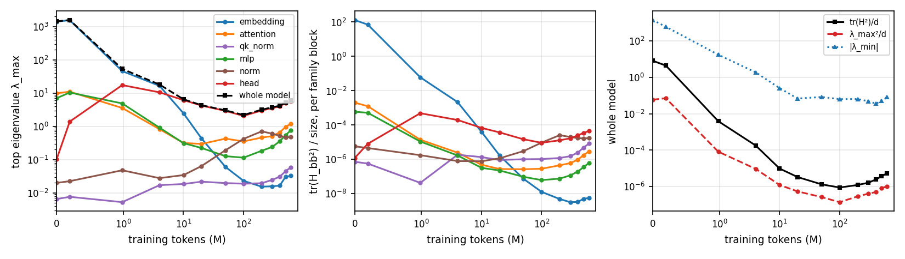
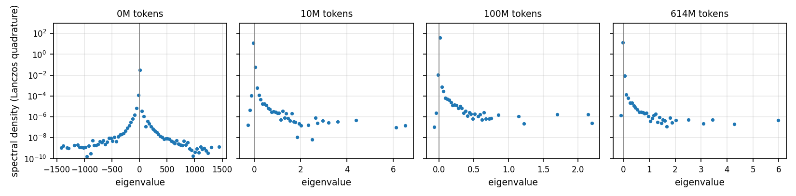
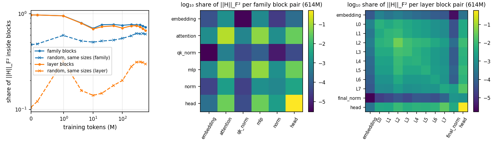
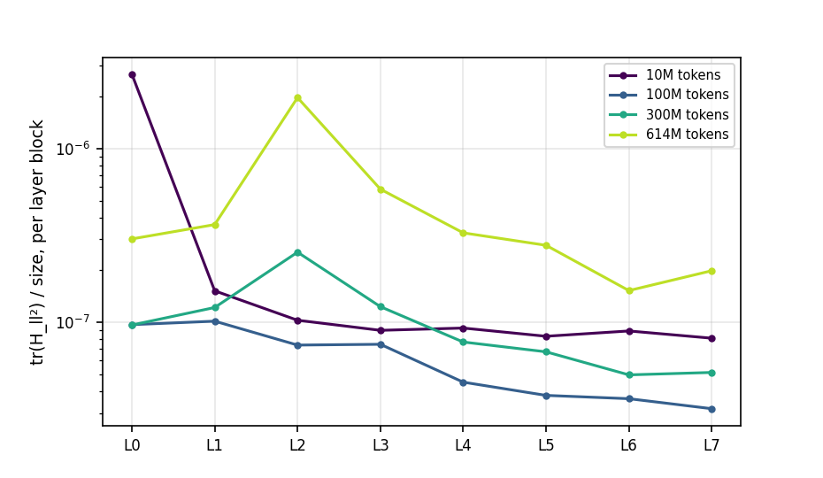

# Problem 4: Inside the Hessian

Hessian of the mean next-token loss on the 64 held-out probe sequences, FP32, TF32 off.

## (a) What the Hessian looks like

Default d8 AdamW run, 13 checkpoints from initialization to 614M tokens; all measurements on the 64 held-out probe sequences in FP32. tr(H²)/d is estimated by Hutchinson block energies (4 probes), the family λ_max values by Lanczos on each principal block.

### Which family is sharpest, and how it changes

| tokens | λ_max | λ_min | tr(H²)/d | sharpest family (λ_max) | λ_max² / tr(H²) |
| --- | ---: | ---: | ---: | ---: | ---: |
| 0.0M | 1431.503 | -1410.061 | 8.18 | embedding (1414.298) | 0.007 |
| 0.2M | 1571.742 | -601.660 | 4.43 | embedding (1553.920) | 0.016 |
| 1.0M | 53.364 | -17.453 | 0.00388 | embedding (45.811) | 0.021 |
| 4.0M | 18.055 | -1.896 | 0.000181 | embedding (16.491) | 0.052 |
| 10.0M | 6.502 | -0.256 | 9.74e-06 | head (6.139) | 0.125 |
| 20.0M | 4.329 | -0.069 | 3.33e-06 | head (4.213) | 0.162 |
| 50.0M | 3.024 | -0.083 | 1.33e-06 | head (2.911) | 0.199 |
| 100.0M | 2.195 | -0.064 | 8.86e-07 | head (2.067) | 0.157 |
| 200.0M | 3.164 | -0.065 | 1.23e-06 | head (2.980) | 0.236 |
| 300.0M | 3.742 | -0.049 | 1.62e-06 | head (3.558) | 0.249 |
| 400.0M | 4.155 | -0.036 | 2.44e-06 | head (3.963) | 0.205 |
| 500.0M | 5.282 | -0.050 | 3.7e-06 | head (5.021) | 0.218 |
| 614.4M | 5.967 | -0.080 | 5.36e-06 | head (5.642) | 0.192 |

Top eigenvalue of each family's own block:

| tokens | embedding | attention | qk_norm | mlp | norm | head |
| --- | ---: | ---: | ---: | ---: | ---: | ---: |
| 0.0M | 1414.298 | 9.879 | 0.007 | 7.011 | 0.020 | 0.102 |
| 0.2M | 1553.920 | 11.032 | 0.008 | 10.397 | 0.022 | 1.389 |
| 1.0M | 45.811 | 3.563 | 0.005 | 4.881 | 0.048 | 17.367 |
| 4.0M | 16.491 | 0.821 | 0.017 | 0.911 | 0.028 | 10.538 |
| 10.0M | 2.457 | 0.316 | 0.018 | 0.312 | 0.034 | 6.139 |
| 20.0M | 0.432 | 0.296 | 0.022 | 0.224 | 0.064 | 4.213 |
| 50.0M | 0.060 | 0.427 | 0.020 | 0.127 | 0.191 | 2.911 |
| 100.0M | 0.023 | 0.352 | 0.019 | 0.114 | 0.420 | 2.067 |
| 200.0M | 0.015 | 0.460 | 0.019 | 0.184 | 0.706 | 2.980 |
| 300.0M | 0.016 | 0.508 | 0.025 | 0.241 | 0.602 | 3.558 |
| 400.0M | 0.016 | 0.658 | 0.031 | 0.355 | 0.523 | 3.963 |
| 500.0M | 0.030 | 0.959 | 0.044 | 0.543 | 0.471 | 5.021 |
| 614.4M | 0.033 | 1.208 | 0.059 | 0.764 | 0.475 | 5.642 |

- **Early training is dominated by the input embedding, then the head takes over.** At initialization the sharpest block is the embedding (λ_max 1,414, whole-model 1,432), up to 4M tokens. From 10M tokens on, the output head is the sharpest family at every checkpoint, by a margin of 2.5–10× over the next family, and the whole-model λ_max is within 3–6% of the head's.
- **Two phases.** λ_max falls by more than 200× in the first 20M tokens (1,432 to 4.3) and keeps falling to 2.2 at 100M, then rises to 6.0 at 614M. tr(H²)/d follows the same U shape (8.2 at initialization, 8.9e-7 at 100M, 5.4e-6 at 614M).
- **Families differ in how they move.** The embedding block collapses (1,414 to 0.033), the head block first rises (0.10 at initialization, 17 at 1M) then falls and rises again (2.07 at 100M, 5.64 at the end), the attention and MLP blocks fall to a minimum at 20–100M tokens and then rise again (to 1.21 and 0.76), and the norm gains rise from 0.02 to 0.7 at 200M and settle at about 0.48. The QK-norm gains stay small (0.007–0.06).
- **A few directions carry a growing share of the curvature.** λ_max² / tr(H²), the share of ‖H‖_F² in the top eigenvector, goes from 0.7% at initialization to about 20% at the end.

### The spectrum

| tokens | λ_min | λ_max | mass at λ < −0.01 | mass within ±0.01 of 0 | 99.99% quantile | 99.9999% quantile | top-3 eigenvalues |
| --- | ---: | ---: | ---: | ---: | ---: | ---: | ---: |
| 0M | -1410.061 | 1431.503 | 4.51e-03 | 0.0000 | 58.556 | 684.375 | 1431.503, 1307.342, 1250.305 |
| 10M | -0.256 | 6.502 | 4.31e-04 | 0.9983 | 0.069 | 1.212 | 6.502, 6.095, 4.398 |
| 100M | -0.064 | 2.195 | 2.70e-05 | 0.9998 | 0.013 | 0.305 | 2.195, 2.156, 1.692 |
| 614M | -0.080 | 5.967 | 4.96e-05 | 0.9993 | 0.023 | 0.849 | 5.967, 4.289, 3.429 |

- **The bulk is a spike at zero.** 99.8–99.98% of the spectral mass lies within |λ| ≤ 0.01 from 10M tokens onward, with a long, thin tail of positive eigenvalues out to a few. At initialization it is much wider and nearly symmetric (|λ| up to 1,400).
- **There are outliers.** A handful of eigenvalues separate from the continuous part: at 614M the top eigenvalues are 5.97, 4.29, 3.43, against a 99.9999% spectral quantile of 0.85. The outliers are isolated spikes in the density, not a continuous tail.
- **There are negative eigenvalues, but they are small.** The most negative is −0.08 at 614M tokens (about 1.3% of λ_max), −0.26 at 10M and −0.06 at 100M, and the mass below −0.01 is only 3e-5 to 4e-4. At initialization it is large (−1,410) and symmetric with λ_max. So training mostly sits in a region with almost no negative curvature, which is the "saddles are not a problem" picture of lecture 1.
- **Implications for training.** Almost all directions are flat (|λ| < 0.01), so a step in them changes the loss very little, and the loss is controlled by a few sharp directions: the learning rate is limited by the top few eigenvalues (about 6 at the end), while progress comes from the large flat bulk.

### Block structure

| tokens | family blocks: share inside | layer blocks: share inside | random family | random layer |
| --- | ---: | ---: | ---: | ---: |
| 0.0M | 0.968 | 0.969 | 0.474 | 0.105 |
| 0.2M | 0.967 | 0.968 | 0.483 | 0.121 |
| 1.0M | 0.950 | 0.948 | 0.592 | 0.319 |
| 4.0M | 0.799 | 0.794 | 0.518 | 0.157 |
| 10.0M | 0.702 | 0.691 | 0.504 | 0.140 |
| 20.0M | 0.766 | 0.730 | 0.517 | 0.147 |
| 50.0M | 0.770 | 0.745 | 0.529 | 0.178 |
| 100.0M | 0.755 | 0.707 | 0.551 | 0.200 |
| 200.0M | 0.769 | 0.744 | 0.588 | 0.279 |
| 300.0M | 0.763 | 0.747 | 0.622 | 0.311 |
| 400.0M | 0.762 | 0.726 | 0.615 | 0.313 |
| 500.0M | 0.744 | 0.695 | 0.618 | 0.309 |
| 614.4M | 0.719 | 0.665 | 0.610 | 0.297 |

Block energies are Hutchinson estimates of ‖H_cb‖_F² with 4 probes per block. "Random" assigns each parameter to a block of the same size as the real family or layer block uniformly at random. At 614M tokens the four probes give 0.54–0.65 for the random family partition and 0.28–0.31 for the random layer partition.

- **The Hessian is close to block-diagonal at initialization and less so later.** The share of ‖H‖_F² inside family blocks is 0.97 at initialization and falls to about 0.70 by 10M tokens, then stays at 0.72–0.77; for layer blocks it falls from 0.97 to 0.69 at 10M and then to 0.67 at the end.
- **Against a random partition of the same sizes:** the layer blocks are far more block-diagonal than chance, 0.67 against 0.30 at 614M (2.2×; and 0.97 against 0.10 at initialization). The family blocks are only moderately above their random baseline (0.72 against 0.61 at 614M, with a spread of about ±0.05), because the MLP block holds 64% of all parameters and any partition with such a big block keeps a lot of energy inside it.
- **Where the energy is.** At 614M the head–head block alone holds 52% of ‖H‖_F² (63% at 100M), attention–attention 13% and MLP–MLP 7%, and the attention–MLP cross blocks another 13%. The head's coupling to the other families is 14%.
- **Cross-layer structure.** The layer-by-layer heat map shows that within-layer blocks dominate, with extra coupling between neighbouring middle layers and between the last layers and the head.

- **Curvature does not grow with depth.** At 614M tokens the per-layer curvature tr(H_ll²)/size is 3.0e-7 (L0), 3.7e-7 (L1), 2.0e-6 (L2, the peak), 5.8e-7 (L3), and then falls to 2.0e-7 at L7. At 10M tokens it is largest in the first layer (2.7e-6 at L0) and decreases with depth, and at 100M it decreases from 1.0e-7 (L1) to 3.2e-8 (L7). It is largest in the early layers and lower in the last ones.

## (b) Moving λ_max without moving the loss

**Rationale.** Sharpness is not invariant to reparametrization. If a parameter group a is multiplied by c and its partner b by 1/c, the network computes the same function, so the loss is unchanged, but the Hessian block of a is scaled by 1/c² and the block of b by c². The pairs in this architecture are:

- the output head `lm_head` and the final-norm gain (logits = lm_head(norm(x))),
- `up_proj` and `down_proj` in each MLP (the gate is nonlinear, but `up_proj` multiplies linearly),
- `v_proj` and `o_proj` in each attention layer,
- `q_proj` and `k_proj`, which feed RMSNorms (QK-norm), so rescaling them changes nothing.

### Hand rescaling of the final AdamW checkpoint

| Rescaling | Probe loss | λ_max | × reference | embedding | attention | qk_norm | mlp | norm | head |
| --- | ---: | ---: | ---: | ---: | ---: | ---: | ---: | ---: | ---: |
| reference | 2.9474 | 5.967 | 1.00 | 0.033 | 1.208 | 0.059 | 0.764 | 0.475 | 5.642 |
| head ×0.25, final norm ×4 | 2.9474 | 90.547 | 15.17 | 0.033 | 1.208 | 0.059 | 0.764 | 0.236 | 90.266 |
| head ×0.5, final norm ×2 | 2.9474 | 22.855 | 3.83 | 0.033 | 1.208 | 0.059 | 0.764 | 0.278 | 22.566 |
| head ×4, final norm ×0.25 | 2.9474 | 5.506 | 0.92 | 0.033 | 1.208 | 0.059 | 0.764 | 4.940 | 0.353 |
| `up_proj` ×0.25, `down_proj` ×4 | 2.9474 | 6.749 | 1.13 | 0.033 | 1.208 | 0.059 | 3.072 | 0.475 | 5.642 |
| `v_proj` ×0.25, `o_proj` ×4 | 2.9474 | 16.864 | 2.83 | 0.033 | 16.220 | 0.059 | 0.764 | 0.475 | 5.642 |
| `q_proj` ×0.25, `k_proj` ×0.25 | 2.9474 | 7.098 | 1.19 | 0.033 | 6.754 | 0.059 | 0.764 | 0.475 | 5.642 |

- **The loss does not move** (2.9474 to four digits in every row) while λ_max changes by up to 15×.
- **The block that is scaled down gets sharper by about 1/c².** The head goes 5.64 to 22.6 (c = 0.5, ×4) and to 90.3 (c = 0.25, ×16).
- **The whole-model λ_max follows the sharpest block.** MLP rescaling raises the MLP block 4× (0.76 to 3.07) but the model's λ_max moves only 1.13× because the head is still the sharpest block (5.64). Scaling the head up (×4) removes the head from the top (0.353), but λ_max only falls to 5.5 because the norm block has risen to 4.94.
- **At least a 2× change at fixed loss** is reached by the head ×0.5 and ×0.25 and the `v_proj`/`o_proj` rescalings.

### Training with a sharper or flatter head from the start

`head_init_scale = c` (a new option in `train.py`) multiplies the output head by c at initialization and divides the final-norm gain by c, so the model is identical at initialization. Everything else is the default recipe (three runs, one seed each).

| head_init_scale | Final val loss | Probe loss | λ_max | × default | head λ_max |
| --- | ---: | ---: | ---: | ---: | ---: |
| default (1) | 2.925–2.931 (three seeds) | 2.9474 | 5.967 | 1.00 | 5.642 |
| 0.25 | **2.9257** | 2.9464 | 13.399 | 2.25 | 12.917 |
| 4 | 2.9320 | 2.9529 | 2.593 | 0.43 | 2.240 |
| 0.0625 | 2.9602 | 2.9805 | 290.294 | 48.65 | 289.302 |

- **head_init_scale = 0.25 meets both criteria:** the final validation loss (2.9257) is inside the 2.925–2.931 range of the default recipe and λ_max is 2.25× larger (13.4 against 4.5–6.0).
- **head_init_scale = 4** lowers λ_max 2.3× (to 2.6) at a loss of 2.932, just above the range (by 0.001), so it is borderline on the loss criterion.
- **head_init_scale = 0.0625** makes the head 48× sharper but costs 0.03 in loss (2.960), outside the range, so there is a limit to how far this can go for free.
- **Training only partly keeps the initial scale.** Starting with the head at 0.25 gives a head λ_max of 12.9, not the 90 of the same rescaling applied to the finished checkpoint, which is consistent with AdamW growing the small head back toward the scale it would otherwise reach (updates of size η per weight regardless of the weight's size). The effect is still large and persistent.

**What this means for comparing λ_max across runs.** Two models with the same function and the same loss can differ in λ_max by an arbitrary factor, just by how the weights are scaled, and an initialization or optimizer choice can change that scale during training. A larger λ_max in one run does not mean the loss landscape around its solution is sharper in any function-space sense. Comparisons are only meaningful between runs with the same parametrization and initialization, or after normalizing for the weight scale (for example by weight norms or using a reparametrization-invariant measure).

## (c) Training in and out of the top subspace

Starting point: the SGD-with-momentum checkpoint at 100M tokens (step 1526, LR about 0.85, β = 0.9), momentum zeroed, 300 updates, top-k basis refreshed every 25 updates. The "fraction of the gradient in the subspace" is the share of the squared gradient norm.

| Job | Start step | Start val | Final val | Δ val | Mean share of gradient in top-k | Final λ_max / threshold |
| --- | ---: | ---: | ---: | ---: | ---: | ---: |
| full | 1526 | 3.694 | 3.583 | −0.112 | 0.093 | 0.63 |
| top-10 only | 1526 | 3.694 | 6.706 | +3.011 | 0.155 | 6.46 |
| top-10 removed | 1526 | 3.694 | 3.582 | −0.112 | 0.028 | 0.70 |
| top-10 only, LR × 0.25 | 1526 | 3.694 | 3.695 | +0.001 | 0.024 | 0.16 |
| top-3 only | 1526 | 3.694 | 43.531 | +39.836 | 0.094 | 135.30 |
| top-40 only | 1526 | 3.694 | 3.765 | +0.071 | 0.136 | 0.62 |
| top-10 only, start 305 | 305 | 4.807 | 45.148 | +40.342 | 0.110 | 381.49 |
| top-10 removed, LR × 2 | 1526 | 3.694 | 3.607 | −0.087 | 0.035 | 1.09 |
| top-40 removed | 1526 | 3.694 | 3.579 | −0.115 | 0.041 | 0.73 |
| top-10 removed, start 305 | 305 | 4.807 | 4.191 | −0.615 | 0.049 | 0.99 |

- **The gradient is not mostly in the top subspace here.** In the full update only about 9% of the squared gradient lies in the top-10 eigenspace (12% on the probe), far from the "mostly in the top few eigenvectors" of Gur-Ari et al. for this language model.
- **Removing the top-10 directions costs nothing.** The update with them removed trains exactly like the full update (3.582 against 3.583 after 300 updates), even though it discards about 9% of the gradient.
- **Moving only in the top-10 subspace is unstable.** The loss rises (3.69 to 6.7), the gradient norm grows by more than 10× and λ_max reaches 6.5 times the heavy-ball threshold 2(1+β)/η_t by the end, so the run diverges as a quadratic would above the threshold. The full run stays below the threshold (λ_max is 0.63 of it at the end) and so does the removed run (0.70).
- **Top-only is a stability problem, not a lack of signal.** At LR × 0.25 the top-only run is stable (3.695), but it makes no progress at all (+0.001) in 300 updates, so steps along the sharpest directions neither help nor are safe at the base LR.
- **More directions is safer.** top-3 diverges fastest (final val 43.5), top-10 diverges more slowly (6.7), and top-40 is stable but drifts up slowly (+0.071). Starting earlier, at 20M tokens (step 305), the top-only update diverges even faster (45.1), and the removed update still trains (−0.615), with no full-update control there.
- **Changes that make training faster: none.** The removed-subspace update with k = 40 improves the loss by 0.115, against 0.112 for the full update, which is within noise, and a larger LR for the removed update (×2) is slower (−0.087), and puts λ_max just above the threshold (1.09).

**Mental model.** The top eigendirections are the steep walls of the river valley: they hold a small share of the gradient, the iterates bounce across them at the edge of stability, and following them alone makes the iterate oscillate and diverge. Progress is made along the many flat bulk directions that remain when the top-k are removed, which is why the removed update trains as fast as the full one. A larger LR does not make it faster (×2 is slower and brings λ_max to the threshold), so in these runs the sharp directions are not what limits the speed.

## Synthesis

Sharpness (λ_max) is not a property of the function the model computes: rescaling matched pairs of parameters changes it 15× at an identical loss, and a different initialization scale changes it 2× at the same final loss, so λ_max should only be compared at matched parametrization. Along the d8 AdamW run the sharpest block moves from the input embedding at initialization to the output head from 10M tokens on, and the spectrum is a spike at zero with a few outliers, almost no negative curvature, and about 20% of ‖H‖_F² in the top eigenvector at the end. In SGD with momentum the top-10 eigenvectors carry only about 9% of the gradient; the optimizer's progress comes from the bulk of flat directions, and following the sharp ones alone destabilizes training.
