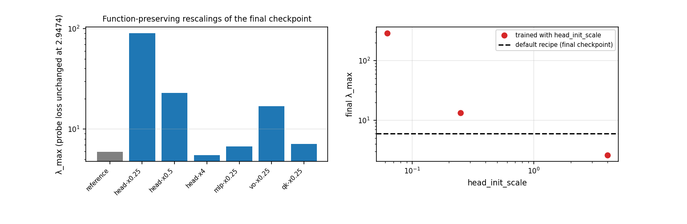
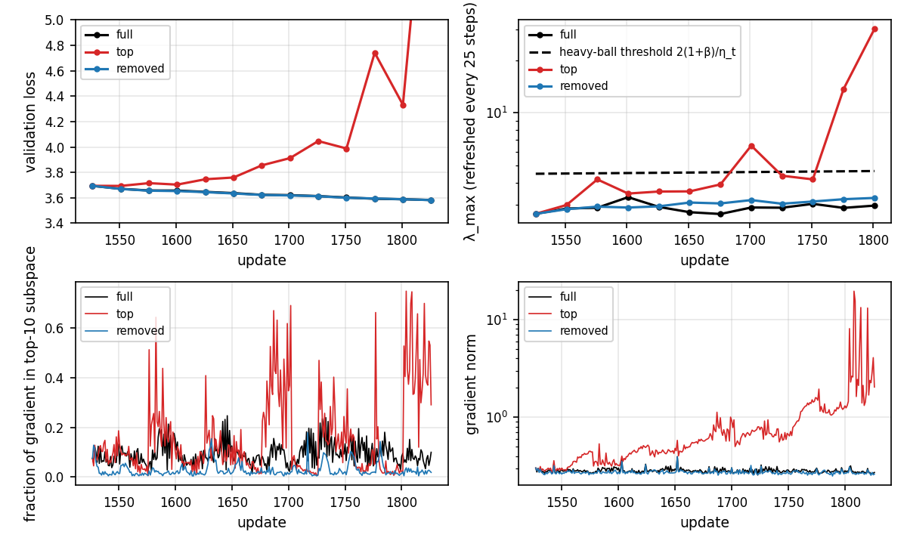
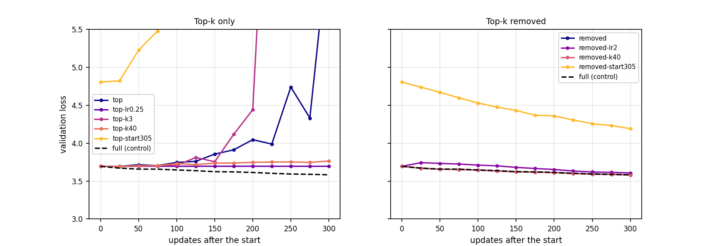

# Problem 4: Inside the Hessian

Hessian of the mean next-token loss on the 64 held-out probe sequences, FP32, TF32 off.

## (a) What the Hessian looks like

## (a) What the Hessian looks like

Pending: the random-partition baseline jobs are still running.

## (b) Moving λ_max without moving the loss

**Rationale.** Sharpness is not invariant to reparametrization. If a parameter group a is multiplied by c and its partner b by 1/c, the network computes the same function, so the loss is unchanged, but the Hessian block of a is scaled by 1/c² and the block of b by c². The pairs in this architecture are:

- the output head `lm_head` and the final-norm gain (logits = lm_head(norm(x))),
- `up_proj` and `down_proj` in each MLP (the gate is nonlinear, but `up_proj` multiplies linearly),
- `v_proj` and `o_proj` in each attention layer,
- `q_proj` and `k_proj`, which feed RMSNorms (QK-norm), so rescaling them changes nothing.

### Hand rescaling of the final AdamW checkpoint

| Rescaling | Probe loss | λ_max | × reference | embedding | attention | qk_norm | mlp | norm | head |
| --- | ---: | ---: | ---: | ---: | ---: | ---: | ---: | ---: | ---: |
| reference | 2.9474 | 5.967 | 1.00 | 0.033 | 1.208 | 0.059 | 0.764 | 0.475 | 5.642 |
| head ×0.25, final norm ×4 | 2.9474 | 90.547 | 15.17 | 0.033 | 1.208 | 0.059 | 0.764 | 0.236 | 90.266 |
| head ×0.5, final norm ×2 | 2.9474 | 22.855 | 3.83 | 0.033 | 1.208 | 0.059 | 0.764 | 0.278 | 22.566 |
| head ×4, final norm ×0.25 | 2.9474 | 5.506 | 0.92 | 0.033 | 1.208 | 0.059 | 0.764 | 4.940 | 0.353 |
| `up_proj` ×0.25, `down_proj` ×4 | 2.9474 | 6.749 | 1.13 | 0.033 | 1.208 | 0.059 | 3.072 | 0.475 | 5.642 |
| `v_proj` ×0.25, `o_proj` ×4 | 2.9474 | 16.864 | 2.83 | 0.033 | 16.220 | 0.059 | 0.764 | 0.475 | 5.642 |
| `q_proj` ×0.25, `k_proj` ×0.25 | 2.9474 | 7.098 | 1.19 | 0.033 | 6.754 | 0.059 | 0.764 | 0.475 | 5.642 |

- **The loss does not move** (2.9474 to four digits in every row) while λ_max changes by up to 15×.
- **The block that is scaled down gets sharper by about 1/c².** The head goes 5.64 to 22.6 (c = 0.5, ×4) and to 90.3 (c = 0.25, ×16).
- **The whole-model λ_max follows the sharpest block.** MLP rescaling raises the MLP block 4× (0.76 to 3.07) but the model's λ_max moves only 1.13× because the head is still the sharpest block (5.64). Scaling the head up (×4) removes the head from the top (0.353), but λ_max only falls to 5.5 because the norm block has risen to 4.94.
- **At least a 2× change at fixed loss** is reached by the head ×0.5 and ×0.25 and the `v_proj`/`o_proj` rescalings.

### Training with a sharper or flatter head from the start

`head_init_scale = c` (a new option in `train.py`) multiplies the output head by c at initialization and divides the final-norm gain by c, so the model is identical at initialization. Everything else is the default recipe (three runs, one seed each).

| head_init_scale | Final val loss | Probe loss | λ_max | × default | head λ_max |
| --- | ---: | ---: | ---: | ---: | ---: |
| default (1) | 2.925–2.931 (three seeds) | 2.9474 | 5.967 | 1.00 | 5.642 |
| 0.25 | **2.9257** | 2.9464 | 13.399 | 2.25 | 12.917 |
| 4 | 2.9320 | 2.9529 | 2.593 | 0.43 | 2.240 |
| 0.0625 | 2.9602 | 2.9805 | 290.294 | 48.65 | 289.302 |

- **head_init_scale = 0.25 meets both criteria:** the final validation loss (2.9257) is inside the 2.925–2.931 range of the default recipe and λ_max is 2.25× larger (13.4 against 4.5–6.0).
- **head_init_scale = 4** lowers λ_max 2.3× (to 2.6) at a loss of 2.932, just above the range (by 0.001), so it is borderline on the loss criterion.
- **head_init_scale = 0.0625** makes the head 48× sharper but costs 0.03 in loss (2.960), outside the range, so there is a limit to how far this can go for free.
- **Training only partly keeps the initial scale.** Starting with the head at 0.25 gives a head λ_max of 12.9, not the 90 of the same rescaling applied to the finished checkpoint, which is consistent with AdamW growing the small head back toward the scale it would otherwise reach (updates of size η per weight regardless of the weight's size). The effect is still large and persistent.

**What this means for comparing λ_max across runs.** Two models with the same function and the same loss can differ in λ_max by an arbitrary factor, just by how the weights are scaled, and an initialization or optimizer choice can change that scale during training. A larger λ_max in one run does not mean the loss landscape around its solution is sharper in any function-space sense. Comparisons are only meaningful between runs with the same parametrization and initialization, or after normalizing for the weight scale (for example by weight norms or using a reparametrization-invariant measure).

## (c) Training in and out of the top subspace

Starting point: the SGD-with-momentum checkpoint at 100M tokens (step 1526, LR about 0.85, β = 0.9), momentum zeroed, 300 updates, top-k basis refreshed every 25 updates. The "fraction of the gradient in the subspace" is the share of the squared gradient norm.

| Job | Start step | Start val | Final val | Δ val | Mean share of gradient in top-k | Final λ_max / threshold |
| --- | ---: | ---: | ---: | ---: | ---: | ---: |
| full | 1526 | 3.694 | 3.583 | −0.112 | 0.093 | 0.63 |
| top-10 only | 1526 | 3.694 | 6.706 | +3.011 | 0.155 | 6.46 |
| top-10 removed | 1526 | 3.694 | 3.582 | −0.112 | 0.028 | 0.70 |
| top-10 only, LR × 0.25 | 1526 | 3.694 | 3.695 | +0.001 | 0.024 | 0.16 |
| top-3 only | 1526 | 3.694 | 43.531 | +39.836 | 0.094 | 135.30 |
| top-40 only | 1526 | 3.694 | 3.765 | +0.071 | 0.136 | 0.62 |
| top-10 only, start 305 | 305 | 4.807 | 45.148 | +40.342 | 0.110 | 381.49 |
| top-10 removed, LR × 2 | 1526 | 3.694 | 3.607 | −0.087 | 0.035 | 1.09 |
| top-40 removed | 1526 | 3.694 | 3.579 | −0.115 | 0.041 | 0.73 |
| top-10 removed, start 305 | 305 | 4.807 | 4.191 | −0.615 | 0.049 | 0.99 |

- **The gradient is not mostly in the top subspace here.** In the full update only about 9% of the squared gradient lies in the top-10 eigenspace (12% on the probe), far from the "mostly in the top few eigenvectors" of Gur-Ari et al. for this language model.
- **Removing the top-10 directions costs nothing.** The update with them removed trains exactly like the full update (3.582 against 3.583 after 300 updates), even though it discards about 9% of the gradient.
- **Moving only in the top-10 subspace is unstable.** The loss rises (3.69 to 6.7), the gradient norm grows by more than 10× and λ_max reaches 6.5 times the heavy-ball threshold 2(1+β)/η_t by the end, so the run diverges as a quadratic would above the threshold. The full run stays below the threshold (about 0.63), and the removed run slightly lower than it (0.70, not above 1).
- **Top-only is a stability problem, not a lack of signal.** At LR × 0.25 the top-only run is stable (3.695), but it makes no progress at all (+0.001) in 300 updates, so steps along the sharpest directions neither help nor are safe at the base LR.
- **How many directions matters non-monotonically.** top-3 diverges faster (43.5) than top-10, top-40 is stable but slowly drifts up (+0.071). Starting earlier, at 20M tokens (step 305), the top-only update diverges even faster (45.1), and the removed update still trains (−0.615), with no full-update control there.
- **Changes that make training faster: none.** The removed-subspace update with k = 40 improves the loss by 0.115, against 0.112 for the full update, which is within noise, and a larger LR for the removed update (×2) is slower (−0.087), and puts λ_max just above the threshold (1.09).

**Mental model.** The top eigendirections are the steep walls of the river valley: they hold a small share of the gradient, the iterates bounce across them at the edge of stability, and following them alone makes the iterate oscillate and diverge. Progress is made along the many flat bulk directions that remain when the top-k are removed, which is why the removed update trains at the full speed and a larger LR does not help (the remaining directions are not the limiting ones, and the sharpness rises to the heavy-ball threshold as the LR increases).

## Synthesis

Sharpness (λ_max) is not a property of the function the model computes: rescaling matched pairs of parameters changes it 15× at an identical loss, and a different initialization scale changes it 2× at the same final loss, so λ_max should only be compared at matched parametrization. In the d8 AdamW run the sharpest block is the output head throughout, and in SGD with momentum the top-10 eigenvectors carry only about 9% of the gradient; the optimizer's progress comes from the bulk of flat directions, and following the sharp ones alone destabilizes training.
